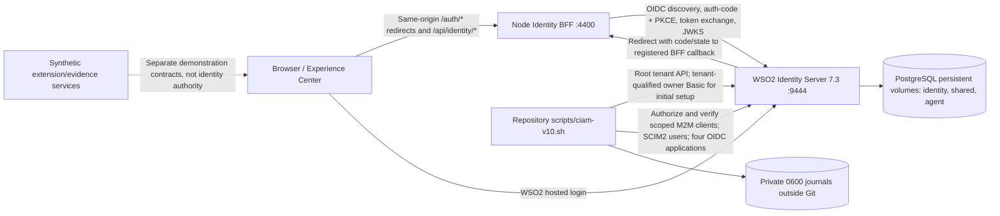

# Identity Experience Center — WSO2 Identity Server 7.3

<!-- CIAM_SINGLE_README_V1_START -->

> **Single documentation source.** This `README.md` contains the current architecture,
> Carbon Super and tenant inventory, real E2E tests, credentials-copy instructions,
> operational notes and preserved historical documentation.
> **Status:** four browser-based OIDC customer flows verified on 2026-10-28;
> successful TOTP approval, delegated B2B, consent preferences, and native mobile remain pending.

**Launch:** [Guided lab](http://127.0.0.1:4400/lab) · [Aurora Web](http://127.0.0.1:4400/portal/aurora/web) · [Aurora Mobile](http://127.0.0.1:4400/portal/aurora/mobile) · [Brisa Web](http://127.0.0.1:4400/portal/brisa/web) · [Brisa Mobile](http://127.0.0.1:4400/portal/brisa/mobile)

**Security boundary:** WSO2 is the authoritative identity and permission system.
The BFF handles OAuth sessions, live introspection, audience and scope checks,
UserInfo, CSRF, and privately stored business case data. No simulated users, MFA,
roles, permissions or consent are accepted as live evidence.


### P0.11–P0.12 independent readbacks (post-source review)

The existing `./scripts/ciam-v10.sh readiness` command now checks Cases API
resources, application grants and SCIM role configuration separately from the
missing historical Cases provisioning journal. It also records independent
persisted-case audit status from the real P010 browser run, requiring a case
UUID and current-source/runtime evidence; no mock or historical evidence may
substitute. See [CIAM P0.11–P0.12 gates](docs/CIAM_P011_P012_GATES.md).

Use `offline-test`, `security-audit`, `inventory` and `readiness` from the
existing v10 CLI. The real WSO2/browser `live-acceptance` remains a separate,
operator-authorized, business-mutating activity. It is **not** run by the
installer, and missing ownership history or incomplete live negative testing
must remain `BLOCKED`. No tenant, API, role or journal is re-created.

## Contents

- [Architecture, Carbon Super, tenancy and ownership](#ciam-doc-docs-ciam-v5-architecture-and-ownership-md)
- [Live tenant, applications, seeded users and role inventory](#ciam-doc-docs-ciam-v5-tenant-inventory-md)
- [End-to-end testing and secure password retrieval](#ciam-doc-docs-ciam-v5-e2e-testing-md)
- [Experience Center, four websites and trust boundaries](#ciam-doc-docs-ciam-v5-experience-and-wso2-relationships-md)
- [Verified runtime acceptance evidence](#ciam-doc-docs-ciam-v10-acceptance-2026-10-28-md)
- [Implementation map and authority relationships](#ciam-doc-docs-ciam-v10-implementation-map-md)
- [Phase 4 provisioning and implementation runbook](#ciam-doc-readme-implementation-md)
- [Previous v5 README overview (historical)](#ciam-doc-readme-ciam-update-md)
- [v5 deployment and installation history](#ciam-doc-readme-live-experience-v5-md)
- [Historical and supporting repository documentation](#ciam-doc-historical)

---

<a id="ciam-doc-docs-ciam-v5-architecture-and-ownership-md"></a>
## Architecture, Carbon Super, tenancy and ownership

> **Consolidated from:** `docs/CIAM_V5_ARCHITECTURE_AND_OWNERSHIP.md` — content preserved in this README.

### CIAM v5 — architecture, tenancy, ownership, and live capability map

**Baseline:** WSO2 Identity Server 7.3.0, persistent v10 local lab, with v3–v5 additive identity, business and Experience Center stages. **Evidence date: 2026-10-28.** The source paths below are repository paths; private runtime data lives outside Git.

> **Authority rule:** WSO2 is authoritative for users, authentication, application registrations, roles, API resources, token scopes and authentication factors. The Node BFF validates real WSO2 tokens; it is not an identity provider. Its JSONL case ledger contains application business data, not identity/permissions. Client-side pages may display permissions but cannot grant them.

#### 1. Complete topology: Carbon Super → Aurora and Brisa

```text
Mac / Docker project: wso2-ciam-v10
  WSO2 IS 7.3.0  https://localhost:9444
    carbon.super  ← server super tenant / super admin 'admin'
      ├─ server-level tenant API, IS/SCIM/system administration context
      ├─ creates root tenant + tenant owner: aurora.identity.test
      └─ creates root tenant + tenant owner: brisa.identity.test
    aurora.identity.test  ← independent identity realm
      ├─ owner / tenant-local M2M application / bootstrap SCIM user
      ├─ Aurora Web OIDC app (aurora-web)    ──┐
      ├─ Aurora Mobile Browser OIDC (aurora-app) ├─ profile + cases API resources
      ├─ application-scoped SCIM v2 roles      ┘
      └─ 6 persona SCIM users, including Ana and Marcos
    brisa.identity.test  ← independent identity realm
      ├─ owner / tenant-local M2M application / bootstrap SCIM user
      ├─ Brisa Web OIDC app (brisa-web)       ──┐
      ├─ Brisa Mobile Browser OIDC (brisa-app)  ├─ profile + cases API resources
      ├─ application-scoped SCIM v2 roles      ┘
      └─ 3 persona SCIM users, including its own separate Ana
  PostgreSQL container: ciam_identity, ciam_shared, ciam_agent

Browser
  ├─ /, /lab, /experience (Experience Center / six guided journeys)
  ├─ /portal/aurora/web        /portal/aurora/mobile
  └─ /portal/brisa/web         /portal/brisa/mobile
          │ same-origin BFF session cookie (no bearer tokens in browser JS)
          ▼
  Node BFF http://127.0.0.1:4400
          ├─ /auth/{client}/login → WSO2 Authorization Code + PKCE
          ├─ /api/identity/me → live introspection / validated session evidence
          ├─ /api/brands/{brand}/profile → validated UserInfo from WSO2
          └─ /api/brands/{brand}/cases → audience + action scope + tenant checks
                 └─ private append-only cases JSONL in CIAM_BUSINESS_DATA_DIR
```

The PostgreSQL databases are the **Identity Server persistence layer**, shared by the same server instance. They do *not* imply a shared user realm or interchangeability of Aurora and Brisa tokens. The `ciam_agent` database is an AgentIdentity datasource configured by the server bootstrap, **not** proof that a live agent/token-exchange journey is implemented.

#### 2. Carbon Super — what really belongs there

| Object / responsibility | Carbon Super relationship | Source of evidence |
|---|---|---|
| Default server super tenant | `carbon.super` is the built-in root/super administration context, not a customer brand | WSO2 multi-tenancy docs + server topology |
| Super administrator | `admin`, created by `[super_admin] create_admin_account = true`; password saved privately | `deploy/ciam-v10/server/render.py` and `~/wso2-ciam-v10/private/admin.private.json` |
| Root tenant creation | Super admin calls `POST /api/server/v1/tenants` and reads the owners for `aurora.identity.test` and `brisa.identity.test` | `deploy/ciam-v10/tenants/provision.py` |
| Runtime policies and datasources | Hostname/port offset, PostgreSQL identity/shared/agent config and introspection policy in private `deployment.toml` | `deploy/ciam-v10/server/render.py`, `server/introspection_policy.py` |
| WSO2 system apps, built-in API resources, SCIM users/roles | Can exist in the super tenant. **Do not infer the complete live inventory from the brand bootstraps.** | `python3 scripts/ciam-carbon-super-readback.py` (read-only, bounded, prints status as UNVERIFIED if unsupported) |
| Brand OIDC clients and brand SCIM roles | **Not Carbon Super-owned:** they are provisioned under `/t/aurora.identity.test/...` or `/t/brisa.identity.test/...` | `oidc/bootstrap.py`, `authority/bootstrap.py`, Phase 4 bootstrap |
| Demonstration customer login | **Not in Carbon Super.** Use the appropriate tenant and one of the four tenant OIDC clients | BFF OIDC / tenant-qualified issuer |

The super-admin is a high-privilege **administrative identity**, not a representative seller/administrator persona and not an `admin` user in each brand. A tenant owner is an entirely different account (`labtenantadmin@<tenant-domain>`). WSO2's built-in super-tenant roles should not be confused with the application-scoped `CIAM Demo …` and `CIAM Business …` roles in the two customer tenants.

WSO2 documents that `carbon.super` is present by default and additional root organizations/tenants isolate user bases. This system-level statement does not establish the exact application/user inventory of your running super tenant; the read-only audit supplements it. See [Manage Root Organizations](https://is.docs.wso2.com/en/7.2.0/guides/multitenancy/manage-tenants/).

<!-- CIAM_V5_CARBON_SUPER_READBACK_2026_10_28 -->
##### Carbon Super live readback — October 28, 2026

The read-only Carbon Super audit confirmed:

| Resource | Verified evidence |
|---|---|
| Root customer tenants | `aurora.identity.test`, `brisa.identity.test` (2) |
| Super-tenant applications | `Console`, `My Account` (2) |
| Super-tenant SCIM users | 1: administrator `admin` |
| Super-tenant SCIM v2 roles | `Administrator`, `Impersonator`, `system`, `everyone`, `admin` |
| API resources | 184 reported; first 100 inspected |

**Important:** The super-tenant API-resource enumeration is
partial (100 of 184). These system/management resources must not
be confused with the separately registered Aurora and Brisa
customer applications, API resources, users, or roles.

The audit is reproducible with:
`python3 scripts/ciam-carbon-super-readback.py`.

#### 3. Aurora and Brisa ownership by object type

| Object | Aurora tenant | Brisa tenant | Created/read by |
|---|---|---|---|
| Tenant domain | `aurora.identity.test` | `brisa.identity.test` | Carbon Super root-tenant API |
| Tenant owner | `labtenantadmin@aurora.identity.test` | `labtenantadmin@brisa.identity.test` | Tenant owner journal/API |
| Bootstrap non-admin SCIM user | `ciam_aurora` | `ciam_brisa` | `resources/bootstrap.py` |
| Scoped management M2M OAuth app | `Identity Lab AURORA Management Bootstrap` | `Identity Lab BRISA Management Bootstrap` | `resources/bootstrap.py` |
| Customer Web OIDC application | `Identity Lab v10 Aurora Web` (`aurora-web`) | `Identity Lab v10 Brisa Web` (`brisa-web`) | `oidc/bootstrap.py` |
| Customer Mobile Browser OIDC application | `Identity Lab v10 Aurora Mobile Browser Preview` (`aurora-app`) | `Identity Lab v10 Brisa Mobile Browser Preview` (`brisa-app`) | `oidc/bootstrap.py` |
| Profile API resource | `https://api.ciam-v10.test/profile` (its own tenant registration) | Same identifier, **separate registration** | `authority/bootstrap.py` |
| Business API resource | `urn:ciampoc:service-requests:v1` (tenant registration) | Same identifier, **separate registration** | `phase4/business-bootstrap.py` |
| Profile scope | `ciam:profile:read` | `ciam:profile:read` | WSO2 authorized API and app roles |
| Business scopes | `ciam:cases:create`, `ciam:cases:read`, `ciam:cases:review`, `ciam:cases:approve` | Same names, tenant-specific grants | `phase4/desired.json` |
| Root-tenant SCIM personas | 6 accounts | 3 accounts | `identities/seed.json`, `identities/bootstrap.py` |
| App-specific roles | Separate Web and Mobile role audiences and memberships | Separate Web and Mobile role audiences and memberships | SCIM v2 roles, app ID audience |
| Issuer | `https://localhost:9444/t/aurora.identity.test/oauth2/token` | `https://localhost:9444/t/brisa.identity.test/oauth2/token` | Tenant OIDC discovery / BFF |

All four OIDC clients are confidential server-side BFF clients configured with authorization code, mandatory PKCE, and per-app redirect URIs. The Mobile views are **responsive browser demos**, not native mobile-app production clients. Pairwise subject configuration was requested at registration; stronger sector-host/pairwise guarantees and cross-tenant linked identity remain separate, unverified work.

##### User and role inventory: generated from your actual journals

Run `python3 scripts/ciam-identity-ops.py inventory --output docs/CIAM_V5_TENANT_INVENTORY.md`. This generates the exact per-tenant seeded user list and both Web/Mobile role tables from **your local** `identities/seed.json`, protected user/role journals, OIDC-app journal, and business-resource journal. It shows no passwords, token values, emails, or client secrets. Review the generated Markdown before any Git commit.

The six seed personas represent **nine distinct WSO2 accounts**:

| Persona | Aurora | Brisa | Purpose |
|---|---|---|---|
| Ana Costa (`ana.costa`) | Yes | Yes | Customer; create/read own requests |
| Rafael Nunes (`rafael.nunes`) | Yes | No | Tenant-scoped seeded persona; consult actual seed `type` and granted permissions |
| Marcos Oliveira (`marcos.oliveira`) | Yes | No | Seller; read/review/approve scope, approval gated by verified TOTP |
| Luiza Ferreira (`luiza.ferreira`) | Yes | Yes | Tenant-scoped seeded persona; consult actual seed `type` and grants |
| Pedro Reis (`pedro.reis`) | Yes | No | Tenant-scoped seeded persona; consult actual seed `type` and grants |
| Camila Lima (`camila.lima`) | Yes | Yes | Tenant-scoped seeded persona; consult actual seed `type` and grants |

**Do not confuse “same visible person” with shared credentials or tenant identity:** `ana.costa` in Aurora and `ana.costa` in Brisa have separate WSO2 user records and separately generated bootstrap passwords. Never move an access token from one tenant into another.

##### Role families, their scope and their relationships

The original `CIAM Demo <Role Label> WEB/APP` roles are application-scoped **per tenant and per client**. The seed intentionally grants `ciam:profile:read` to customer roles and no operational API permissions to unsupported persona categories; check the generated inventory for exact labels, membership, and journal states.

Phase 4 creates separate `CIAM Business Customer WEB/APP`, `CIAM Business Seller WEB/APP`, `CIAM Business Administrator WEB/APP` roles **only in tenants with matching seeded members**, each audience-bound to the corresponding OIDC application's WSO2 app ID. It does not silently modify the older roles.

| Business role family | Actual WSO2 permission scopes | Effective BFF capabilities |
|---|---|---|
| Customer | `ciam:cases:create`, `ciam:cases:read` | Create/read own request(s) |
| Seller | `ciam:cases:read`, `ciam:cases:review`, `ciam:cases:approve` | Brand-wide review; approval requires fresh genuine TOTP |
| Administrator (business app role) | `ciam:cases:read`, `ciam:cases:review`, `ciam:cases:approve` | Brand-wide review; approval requires fresh TOTP; **not** Carbon or tenant administration |
| Other original demo roles | Depends on the real bootstrap seed, often none | No implied extra business privileges |

The BFF checks **granted access-token scopes**, not visual role names; a missing `roles` ID-token claim is not evidence that the WSO2 role assignment is missing. All four OIDC clients passed client-specific positive login/scope/profile/read and opposite-brand denial tests. A scope does not imply audience: the BFF separately demands the exact profile or business API resource audience.

#### 4. End-to-end trust, data and API ownership

1. **Browser → BFF:** `/auth/{brand}-web/login` or `/auth/{brand}-mobile/login` invokes real authorization code + PKCE, tenant-correct issuer, state/nonce and callback validation; the browser gets an HttpOnly same-origin session cookie.
2. **BFF → WSO2:** `/api/identity/me` introspects the actual access token. It shows WSO2-granted scopes and only verified ID-token roles if released; it never invents an actor.
3. **Profile:** `/api/brands/{brand}/profile?client={client}` validates identity/client/tenant/profile audience and `ciam:profile:read`, calls the WSO2 OIDC UserInfo endpoint and enforces exact subject equality. `sub`-only UserInfo is a legitimate WSO2 release decision; name/email claims remain deferred.
4. **Requests:** `/api/brands/{brand}/cases?client={client}` requires an active token, correct client ID, tenant issuer, `urn:ciampoc:service-requests:v1` in `aud`, and action-specific scope. Customer reads are `OWNER_ONLY`; reviewers may receive `BRAND_REVIEW` within the same tenant.
5. **Mutations:** writes require CSRF and Origin/session protection. Business case creation persists append-only JSONL under `CIAM_BUSINESS_DATA_DIR` (outside Git); the case owner is bound to actual WSO2 issuer and subject. Approval additionally denies self-approval and requires the verified ID-token TOTP AMR and authentication time no older than 300 seconds. **Positive TOTP approval has not been proven.**
6. **Illustrative UI vs live operations:** static product cards and guided conceptual scenarios are demonstration design content, not WSO2 records. Identity/permission/consent/MFA success must never be simulated. Legacy `/api/experience/*` synthetic APIs remain blocked.

##### Primary routes

| Route | Role | Source |
|---|---|---|
| `/`, `/lab`, `/experience` | Main guided Experience Center; six journeys and four WSO2 login choices | `live-experience-v5.*` and original design assets |
| `/portal/aurora/web`, `/portal/aurora/mobile` | Aurora Web/Mobile browser experiences | `aurora-web`, `aurora-app` |
| `/portal/brisa/web`, `/portal/brisa/mobile` | Brisa Web/Mobile browser experiences | `brisa-web`, `brisa-app` |
| `/portal/aurora`, `/portal/brisa` | Backward-compatible v3 brand portal | Client selector + protected BFF |
| `/api/identity/me` | Sanitized BFF session/token readback | WSO2 introspection |
| `/api/brands/{brand}/profile` | Protected live OIDC UserInfo | WSO2 |
| `/api/brands/{brand}/cases` | Protected persistent service requests | WSO2 authorization + private JSONL ledger |

#### 5. Bootstrap lifecycle and private state

| Stage | Code | Evidence / private journal |
|---|---|---|
| Local server + persistent PostgreSQL | `server/setup.sh`, `server/render.py` | `private/deployment.toml`, admin password, database files |
| Carbon Super tenant creation | `tenants/provision.py` | `bootstrap-tenants-v10.private.json` |
| Tenant management clients + `ciam_*` users | `resources/bootstrap.py` | `bootstrap-resources-v10.private.json` |
| Four OIDC applications | `oidc/bootstrap.py` | `bootstrap-oidc-v10.private.json` |
| Profile API + app roles | `authority/bootstrap.py` | `bootstrap-authority-v10.private.json` (pinned `roleApiVersion=v2`) |
| Six personas / nine tenant accounts | `identities/bootstrap.py` | `bootstrap-identities-v10.private.json` |
| Business API + roles | `phase4/business-bootstrap.py` | `bootstrap-business-v4.private.json` |
| Audience compatibility readbacks | v4.4 and v5.1 guarded recovery scripts | Separate private OIDC backups/recovery journals; **not** fresh-lab installers |
| Lab UI + four websites | v5 installer + v5.2 visible-login patch | Local source files; no WSO2 writes |

Private file default root: `~/wso2-ciam-v10/private/`, permissions 0600 for secret journals. **Never commit or upload them.** Source control carries only code/manifests/docs. `carbon.super` bootstrap identity is not a substitute for tenant user management.

**Existing lab guardrails:** never run `fresh`, `docker compose down -v`, an old v8 script, or repeat a journaled `apply` just to check status. The real running IS 7.3.0 is bound to `https://localhost:9444`; the BFF listens on `http://127.0.0.1:4400`. Original port 9443 and other services remain separate.

#### 6. Verified behavior versus planned capability

**Observed successful browser results (2026-10-28):** all four OIDC clients authenticated Ana with `ciam:profile:read`, `ciam:cases:create`, `ciam:cases:read`; each returned profile 200, cases 200 `OWNER_ONLY`, and a wrong-brand 403. Aurora Web: Ana created a real case (201) and read it back; Marcos read it as `BRAND_REVIEW` and received 403 on a customer-only creation; approval without fresh WSO2 TOTP received 403 `fresh_wso2_totp_required`. Case ID recorded in the acceptance report.

**Not claimed:** all six guided journeys are not complete WSO2 workflows; positive TOTP approval, TOTP enrollment, real B2B delegated organizations, consent preference persistence/revocation, real agent/token exchange, full profile attribute release, ID-token `roles` release, native mobile SDK behavior, and production Postgres/case-ledger durability are unverified or pending. Architecture diagrams and source manifests alone do not prove them.

Continue with [E2E testing guide](#ciam-doc-docs-ciam-v5-e2e-testing-md) and [generated inventory](#ciam-doc-docs-ciam-v5-tenant-inventory-md). For earlier evidence, see [2026-10-28 acceptance](#ciam-doc-docs-ciam-v10-acceptance-2026-10-28-md).

---

<a id="ciam-doc-docs-ciam-v5-tenant-inventory-md"></a>
## Live tenant, applications, seeded users and role inventory

> **Consolidated from:** `docs/CIAM_V5_TENANT_INVENTORY.md` — content preserved in this README.

### CIAM v5 — tenant/application/identity inventory

> Generated locally 2026-10-28 17:34 UTC using source manifests and private bootstrap journals. **No passwords, client secrets, or tokens are written.**
> Journal status is provisioning evidence, not a live remote SCIM read or authenticated browser test.

#### Carbon Super (`carbon.super`)

- **Role:** WSO2 server super tenant; not Aurora or Brisa and not a customer website.
- **Super administrator:** `admin` configured by the private `[super_admin]` deployment setting; the password is in `~/wso2-ciam-v10/private/admin.private.json`.
- **Provisioning responsibility:** root tenant creation via `/api/server/v1/tenants` and owner setup. Tenant APIs and SCIM roles are then administered using tenant-qualified accounts.
- **Shared runtime:** one `wso2/wso2is:7.3.0` container, PostgreSQL identity/shared/agent databases, and the common TLS endpoint on `https://localhost:9444`.
- **Important:** this source/journal inventory does *not* enumerate arbitrary applications, service accounts, system roles or APIs that may exist in Carbon Super. A read-only live Carbon audit is required to claim a complete super-tenant catalog.
- **Consumer logins:** none of the four demo OIDC clients belongs to Carbon Super; their applications are tenant-local.

#### Tenants and tenant-local resources

##### Aurora — `aurora.identity.test`

- **Owner:** `labtenantadmin@aurora.identity.test` (tenant admin, distinct from Carbon Super admin).
- **Bootstrap SCIM user:** `ciam_aurora` (non-super support/test identity).
- **Management M2M application:** `Identity Lab AURORA Management Bootstrap` (tenant-local; used for authorized management/SCIM scope operations, not a customer login).
- **Profile API resource:** `https://api.ciam-v10.test/profile`; `ciam:profile:read`.
- **Business API resource:** `urn:ciampoc:service-requests:v1`; `ciam:cases:create`, `ciam:cases:read`, `ciam:cases:review`, `ciam:cases:approve`.
- **Business case data:** BFF JSONL records tagged by brand; not a WSO2 user table.

| OIDC channel | WSO2 application name | BFF client key | Callback |
|---|---|---|---|
| Web | Identity Lab v10 Aurora Web | `aurora-web` | `http://127.0.0.1:4400/auth/aurora-web/callback` |
| Mobile browser | Identity Lab v10 Aurora Mobile Browser Preview | `aurora-app` | `http://127.0.0.1:4400/auth/aurora-app/callback` |

| Seeded person | Username | Persona category | SCIM journal state |
|---|---|---|---|
| Ana Costa | `ana.costa` | customer | verified |
| Rafael Nunes | `rafael.nunes` | customer | verified |
| Marcos Oliveira | `marcos.oliveira` | seller | verified |
| Luiza Ferreira | `luiza.ferreira` | administrator | verified |
| Pedro Reis | `pedro.reis` | attendant | verified |
| Camila Lima | `camila.lima` | analyst | verified |

**Application-scoped roles and permission membership**

| Application | Role | Members (usernames) | Scopes / permissions | State |
|---|---|---|---|---|
| `aurora-web` | `CIAM Demo Customer WEB` | `ana.costa`, `rafael.nunes` | `ciam:profile:read` | verified |
| `aurora-web` | `CIAM Demo Seller WEB` | `marcos.oliveira` | None (not an authorization grant) | verified |
| `aurora-web` | `CIAM Demo Business Administrator WEB` | `luiza.ferreira` | None (not an authorization grant) | verified |
| `aurora-web` | `CIAM Demo Attendant WEB` | `pedro.reis` | None (not an authorization grant) | verified |
| `aurora-web` | `CIAM Demo Security Analyst WEB` | `camila.lima` | None (not an authorization grant) | verified |
| `aurora-web` | `CIAM Business Customer WEB` | `ana.costa`, `rafael.nunes` | `ciam:cases:create`, `ciam:cases:read` | verified |
| `aurora-web` | `CIAM Business Seller WEB` | `marcos.oliveira` | `ciam:cases:read`, `ciam:cases:review`, `ciam:cases:approve` | verified |
| `aurora-web` | `CIAM Business Administrator WEB` | `luiza.ferreira` | `ciam:cases:read`, `ciam:cases:review`, `ciam:cases:approve` | verified |
| `aurora-app` | `CIAM Demo Customer APP` | `ana.costa`, `rafael.nunes` | `ciam:profile:read` | verified |
| `aurora-app` | `CIAM Demo Seller APP` | `marcos.oliveira` | None (not an authorization grant) | verified |
| `aurora-app` | `CIAM Demo Business Administrator APP` | `luiza.ferreira` | None (not an authorization grant) | verified |
| `aurora-app` | `CIAM Demo Attendant APP` | `pedro.reis` | None (not an authorization grant) | verified |
| `aurora-app` | `CIAM Demo Security Analyst APP` | `camila.lima` | None (not an authorization grant) | verified |
| `aurora-app` | `CIAM Business Customer APP` | `ana.costa`, `rafael.nunes` | `ciam:cases:create`, `ciam:cases:read` | verified |
| `aurora-app` | `CIAM Business Seller APP` | `marcos.oliveira` | `ciam:cases:read`, `ciam:cases:review`, `ciam:cases:approve` | verified |
| `aurora-app` | `CIAM Business Administrator APP` | `luiza.ferreira` | `ciam:cases:read`, `ciam:cases:review`, `ciam:cases:approve` | verified |

**API and application relationship:** both `aurora-web` and `aurora-app` are explicitly authorized to consume the profile and business resources in the **aurora.identity.test** tenant. WSO2 still decides token scopes from memberships and authorization; the BFF checks live audience and scope per call.

##### Brisa — `brisa.identity.test`

- **Owner:** `labtenantadmin@brisa.identity.test` (tenant admin, distinct from Carbon Super admin).
- **Bootstrap SCIM user:** `ciam_brisa` (non-super support/test identity).
- **Management M2M application:** `Identity Lab BRISA Management Bootstrap` (tenant-local; used for authorized management/SCIM scope operations, not a customer login).
- **Profile API resource:** `https://api.ciam-v10.test/profile`; `ciam:profile:read`.
- **Business API resource:** `urn:ciampoc:service-requests:v1`; `ciam:cases:create`, `ciam:cases:read`, `ciam:cases:review`, `ciam:cases:approve`.
- **Business case data:** BFF JSONL records tagged by brand; not a WSO2 user table.

| OIDC channel | WSO2 application name | BFF client key | Callback |
|---|---|---|---|
| Web | Identity Lab v10 Brisa Web | `brisa-web` | `http://127.0.0.1:4400/auth/brisa-web/callback` |
| Mobile browser | Identity Lab v10 Brisa Mobile Browser Preview | `brisa-app` | `http://127.0.0.1:4400/auth/brisa-app/callback` |

| Seeded person | Username | Persona category | SCIM journal state |
|---|---|---|---|
| Ana Costa | `ana.costa` | customer | verified |
| Luiza Ferreira | `luiza.ferreira` | administrator | verified |
| Camila Lima | `camila.lima` | analyst | verified |

**Application-scoped roles and permission membership**

| Application | Role | Members (usernames) | Scopes / permissions | State |
|---|---|---|---|---|
| `brisa-web` | `CIAM Demo Customer WEB` | `ana.costa` | `ciam:profile:read` | verified |
| `brisa-web` | `CIAM Demo Business Administrator WEB` | `luiza.ferreira` | None (not an authorization grant) | verified |
| `brisa-web` | `CIAM Demo Security Analyst WEB` | `camila.lima` | None (not an authorization grant) | verified |
| `brisa-web` | `CIAM Business Customer WEB` | `ana.costa` | `ciam:cases:create`, `ciam:cases:read` | verified |
| `brisa-web` | `CIAM Business Administrator WEB` | `luiza.ferreira` | `ciam:cases:read`, `ciam:cases:review`, `ciam:cases:approve` | verified |
| `brisa-app` | `CIAM Demo Customer APP` | `ana.costa` | `ciam:profile:read` | verified |
| `brisa-app` | `CIAM Demo Business Administrator APP` | `luiza.ferreira` | None (not an authorization grant) | verified |
| `brisa-app` | `CIAM Demo Security Analyst APP` | `camila.lima` | None (not an authorization grant) | verified |
| `brisa-app` | `CIAM Business Customer APP` | `ana.costa` | `ciam:cases:create`, `ciam:cases:read` | verified |
| `brisa-app` | `CIAM Business Administrator APP` | `luiza.ferreira` | `ciam:cases:read`, `ciam:cases:review`, `ciam:cases:approve` | verified |

**API and application relationship:** both `brisa-web` and `brisa-app` are explicitly authorized to consume the profile and business resources in the **brisa.identity.test** tenant. WSO2 still decides token scopes from memberships and authorization; the BFF checks live audience and scope per call.

#### Distinctions not to collapse

- A tenant owner, a management M2M OAuth app, and an application-scoped business administrator role are **three different authorities**.
- Ana in Aurora and Ana in Brisa are **two separately provisioned WSO2 tenant accounts**, not a shared cross-tenant session or linked subject.
- The same human may be a member of both Web and Mobile app roles; these are still separate OIDC applications with distinct client IDs and token audience policies.
- Application roles are not equivalent to the `roles` claim in an ID token. Browser UI renders role names only when WSO2 releases the claim.
- OAuth access-token audience is checked independently of `ciam:*` scopes; the four OIDC clients were configured for both profile and business audiences and each passed a positive browser read/isolation test on 2026-10-28.
- Consent preference APIs, B2B child-organization delegation, successful TOTP approval, and production native-mobile SDK behavior remain unverified.
- Inventory above comes from source and private journals; run the explicit management API verify steps in the E2E guide for a fresh remote readback.

---

<a id="ciam-doc-docs-ciam-v5-e2e-testing-md"></a>
## End-to-end testing and secure password retrieval

> **Consolidated from:** `docs/CIAM_V5_E2E_TESTING.md` — content preserved in this README.

### CIAM v5 — end-to-end testing runbook (WSO2 Identity Server 7.3)

**Target:** local Docker project `wso2-ciam-v10`, WSO2 IS `https://localhost:9444`, Node BFF `http://127.0.0.1:4400`. Last positive evidence: **2026-10-28**. The Web/Mobile views use four different **browser OIDC clients**. This guide never treats source-only tests as live-user evidence.

#### 0. Rules and prerequisites

- Begin from the existing running lab; do **not** run `fresh`, schema installers, Docker volume removal, or SCIM/role `apply` to run tests.
- All identity data, roles, scopes, client identities, audience and TOTP evidence must come from WSO2. No fake persona selection, injected bearer tokens, local role switches or simulated MFA/consent.
- For reliable client-specific results, use a new **private browser window** for each login test (separate tenant/channel), and sign in with the correct tenant credential. The BFF session cookie is per browser session; opening the same profile in an unrelated CLI won't authenticate it.
- Never print access/refresh/ID tokens, passwords, cookies, raw session JSON (may include CSRF) or private journals in logs or issue trackers. The test snippets below print only statuses, scopes, and safe result fields.
- HTTP 403 for a wrong-brand or wrong-role request is **expected success of a denial test**. A full identity profile is **not** expected until WSO2 attribute-release settings are configured.

#### 1. Read-only infrastructure / provisioning smoke tests

From repository root:

```bash
cd "$HOME/wso2mi/Projects/Demo/poc-implementation"
./scripts/ciam-v10.sh status
./scripts/ciam-v10.sh bff-diagnose
bash scripts/live-experience-v5-acceptance.sh
python3 scripts/ciam-v5-four-client-readback.py
python3 deploy/ciam-v10/phase4/business-bootstrap.py verify
python3 scripts/ciam-carbon-super-readback.py
node --test tests/live-userinfo.test.mjs tests/live-cases-v4.test.mjs tests/live-experience-v5.test.mjs
python3 scripts/zero-mock-gate.py .
```

**Expected:** BFF ready on 4400; all v5 routes HTTP 200; anonymous protected endpoints 401; synthetic endpoints disabled; four OIDC app records show JWT/profile+business audiences/RBAC; business bootstrap readback verified; Node tests pass; zero-mock gate passes. Carbon Super readback is **independent**: `FULL_FIRST_PAGE` means only a complete bounded first-page response for that endpoint; `UNVERIFIED_*` means no claim can be made about its contents. The Carbon audit does not change WSO2 configuration.

Additional profile/role source verification when inspecting drift (no writes):

```bash
export WSO2_CIAM_V10_ROLE_API=v2
export WSO2_CIAM_V10_ROLE_V2_CONFIRM=USE_DEPRECATED_ROLE_V2_FOR_NEW_CIAM_V10_ROLES
python3 deploy/ciam-v10/identities/bootstrap.py verify
python3 deploy/ciam-v10/phase4/business-bootstrap.py verify
```

The existing v10 role journal is pinned to SCIM v2: do **not** change API version to make a failing check pass.

#### 2. Get a password without displaying it

The repository CLI reads the **existing private password journal** and copies only the requested password to your macOS clipboard. It will not write a credential to the README or terminal.

```bash
# Ana (Aurora): choose the exact tenant
python3 scripts/ciam-identity-ops.py password --kind person --tenant aurora --user ana.costa

# Ana (Brisa): a separate WSO2 account and password
python3 scripts/ciam-identity-ops.py password --kind person --tenant brisa --user ana.costa

# Marcos, seller (Aurora)
python3 scripts/ciam-identity-ops.py password --kind person --tenant aurora --user marcos.oliveira

# Any other person: inspect generated inventory for exact user/tenant first
python3 scripts/ciam-identity-ops.py password --kind person --tenant aurora --user luiza.ferreira

# Tenant-level bootstrap non-admin users (not customer personas)
python3 scripts/ciam-identity-ops.py password --kind foundation --tenant aurora
python3 scripts/ciam-identity-ops.py password --kind foundation --tenant brisa

# Tenant owners (admin login; do not use in retail scenarios)
python3 scripts/ciam-identity-ops.py password --kind owner --tenant aurora
python3 scripts/ciam-identity-ops.py password --kind owner --tenant brisa

# Carbon Super admin (server/root-tenant operations ONLY; highly privileged)
python3 scripts/ciam-identity-ops.py password --kind super
```

The user for a seeded person is their real `username`, e.g. `ana.costa`. Tenant owner: `labtenantadmin@aurora.identity.test` or `labtenantadmin@brisa.identity.test`; Carbon Super administrator: `admin` on the super tenant, not a brand OIDC client. **Paste only into the matching WSO2-hosted login**. Clear clipboard after each use:

```bash
printf '' | pbcopy
```

The CLI refuses absent/unverified user or journal mismatch. If a password has changed in WSO2 since bootstrap, the journal's original value will no longer log in; do not assume credential freshness or reset users automatically.

#### 3. All four real customer website logins

Open the [guided lab](http://127.0.0.1:4400/lab) and choose the prominent **Entrar com WSO2** login link for each channel. Direct destinations:

| Order | Browser URL | Client key | WSO2 account | Expected tenant |
|---|---|---|---|---|
| 1 | `http://127.0.0.1:4400/portal/aurora/web` | `aurora-web` | `ana.costa` (Aurora password) | `aurora.identity.test` |
| 2 | `http://127.0.0.1:4400/portal/aurora/mobile` | `aurora-app` | `ana.costa` (Aurora password) | `aurora.identity.test` |
| 3 | `http://127.0.0.1:4400/portal/brisa/web` | `brisa-web` | `ana.costa` (Brisa password) | `brisa.identity.test` |
| 4 | `http://127.0.0.1:4400/portal/brisa/mobile` | `brisa-app` | `ana.costa` (Brisa password) | `brisa.identity.test` |

Each login starts a real WSO2 authorization-code/PKCE redirect, not a local form that stores a password in the BFF UI. Mobile means *responsive mobile browser experience*, not native app authentication.

##### Browser test: current page, correct tenant/client, live profile, business read, cross-brand denial

After login, use Developer Tools → Console and paste the **entire** code block below. It derives the tenant/client from the current path and refuses other pages:

```javascript
(async () => {
  const m = /^\/portal\/(aurora|brisa)\/(web|mobile)$/.exec(location.pathname);
  if (!m) throw new Error('Open one of the four explicit /portal/{brand}/{channel} pages');
  const [ , brand, channel ] = m;
  const client = `${brand}-${channel === 'mobile' ? 'app' : 'web'}`;
  const other = brand === 'aurora' ? 'brisa' : 'aurora';
  const options = { credentials: 'same-origin', cache: 'no-store' };
  const meRes = await fetch('/api/identity/me', options);
  const me = await meRes.json();
  const session = me.clients?.[client];
  const scopes = session?.permissions ?? [];
  const profile = await fetch(`/api/brands/${brand}/profile?client=${client}`, options);
  const cases = await fetch(`/api/brands/${brand}/cases?client=${client}`, options);
  const data = await cases.json();
  const denial = await fetch(`/api/brands/${other}/cases?client=${client}`, options);
  const result = {
    brand, client,
    authenticated: session?.authenticated === true,
    scopes,
    profileHTTP: profile.status,
    casesHTTP: cases.status,
    visibility: data.visibility ?? null,
    oppositeBrandHTTP: denial.status,
    passed:
      session?.authenticated === true &&
      scopes.includes('ciam:profile:read') &&
      scopes.includes('ciam:cases:create') &&
      scopes.includes('ciam:cases:read') &&
      !scopes.includes('ciam:cases:approve') &&
      profile.status === 200 && cases.status === 200 &&
      data.visibility === 'OWNER_ONLY' && denial.status === 403
  };
  console.log(JSON.stringify(result, null, 2));
})();
```

**Acceptance:** for each channel `passed: true`, profile 200, cases 200, `OWNER_ONLY`, correct client, expected scopes, and opposite-brand 403. Record **only** the sanitized object printed by the snippet. The four actual tests passed on 2026-10-28; rerun after upgrades or source changes.

#### 4. Positive business persistence (Aurora Customer → Aurora Seller)

**Mutating operation.** Execute once as Ana in **Aurora Web**, using the same authenticated browser session. It creates one persistent request. Copy the returned UUID for seller review; no synthetic case is used.

```javascript
(async () => {
  const client = 'aurora-web';
  if (location.pathname !== '/portal/aurora/web') throw Error('Use Aurora Web');
  const opts = { credentials: 'same-origin', cache: 'no-store' };
  const me = await (await fetch('/api/identity/me', opts)).json();
  if (!me.clients?.[client]?.authenticated ||
      !me.clients[client].permissions.includes('ciam:cases:create')) throw Error('Not authorized');
  const url = `/api/brands/aurora/cases?client=${client}`;
  const r = await fetch(url, { ...opts, method: 'POST',
    headers: { 'Content-Type': 'application/json', 'X-CSRF-Token': me.csrf },
    body: JSON.stringify({title:'E2E atendimento real', description:'Teste de criação e persistência WSO2 CIAM'}) });
  const created = await r.json();
  const listResponse = await fetch(url, opts);
  const listing = await listResponse.json();
  console.log(JSON.stringify({ createHTTP:r.status, uuid:created.id ?? null,
    readHTTP:listResponse.status, visibility:listing.visibility,
    persisted: r.status === 201 && listResponse.status === 200 &&
      listing.records?.some(x=>x.id === created.id && x.status === 'OPEN') === true
  },null,2));
})();
```

**Acceptance:** `createHTTP=201`, UUID returned, `readHTTP=200`, visibility `OWNER_ONLY`, `persisted=true`.

Now open a **different private browser session** as `marcos.oliveira` on Aurora Web. Copy his password using the CLI above. In the Console, set the UUID to the previously returned value and run:

```javascript
(async () => {
  const caseId = 'REPLACE_WITH_REAL_CREATED_CASE_UUID';
  if (!/^[0-9a-f-]{36}$/.test(caseId)) throw Error('Paste a real case UUID');
  const client='aurora-web', url=`/api/brands/aurora/cases?client=${client}`;
  const opts={credentials:'same-origin',cache:'no-store'};
  const me=await (await fetch('/api/identity/me',opts)).json();
  const u=me.clients?.[client];
  if (!u?.authenticated || !u.permissions.includes('ciam:cases:review'))
    throw Error('Seller not authenticated/authorized');
  const read=await fetch(url,opts); const data=await read.json();
  if (read.status !== 200 || data.visibility !== 'BRAND_REVIEW' ||
      !data.records?.some(x=>x.id===caseId)) throw Error('Read/review failed; not attempting create');
  const write=await fetch(url,{...opts,method:'POST',
    headers:{'Content-Type':'application/json','X-CSRF-Token':me.csrf},
    body:JSON.stringify({title:'Negative permission test',description:'Must fail'})});
  const body=await write.json();
  console.log(JSON.stringify({reviewHTTP:read.status,visibility:data.visibility,
    anaCaseVisible:true,sellerCreateHTTP:write.status,denial:body.error ?? null,
    passed:write.status===403 && body.error==='wso2_scope_denied'},null,2));
})();
```

If Marcos unexpectedly has `ciam:cases:create`, this script may create a record. Treat that as a **critical RBAC defect**; stop and examine WSO2 roles instead of accepting it. Do not use a super/tenant admin account as the seller.

#### 5. MFA gate: approve scope does not mean MFA success

Use Marcos's authenticated Aurora Web browser with `ciam:cases:approve`. Create a **nonexistent UUID** (never use Ana's actual case ID) and attempt approval:

```javascript
(async () => {
  const client='aurora-web';
  const me=await (await fetch('/api/identity/me',{credentials:'same-origin'})).json();
  const u=me.clients?.[client];
  if (!u?.authenticated || !u.permissions?.includes('ciam:cases:approve')) throw Error('No verified approval scope');
  const missingId=crypto.randomUUID();
  const r=await fetch(`/api/brands/aurora/cases/${missingId}/approve?client=${client}`,
    {method:'POST',credentials:'same-origin',headers:{'X-CSRF-Token':me.csrf}});
  const data=await r.json();
  console.log(JSON.stringify({testTarget:'NONEXISTENT_CASE',http:r.status,
    reason:data.error ?? null,passed:r.status===403 && data.error==='fresh_wso2_totp_required'},null,2));
})();
```

**Acceptance without fresh WSO2 TOTP:** HTTP 403 `fresh_wso2_totp_required`. This negative gate passed on 2026-10-28. **Do not claim positive TOTP approval** until an authenticator is genuinely enrolled, WSO2 completes a challenge, and the BFF verifies `totp` in a validated `amr` plus `auth_time` no older than 300 seconds. The current gate is a verification requirement, not an automated step-up redirect.

#### 6. Carbon Super acceptance (server administration only)

```bash
python3 scripts/ciam-carbon-super-readback.py
python3 scripts/ciam-identity-ops.py inventory --output docs/CIAM_V5_TENANT_INVENTORY.md
```

Check the root tenant enumeration includes Aurora and Brisa (but note: this endpoint may not list the built-in Carbon Super domain as an ordinary tenant). Check super applications, API resources, SCIM users and roles using the status fields. A 401/403/404/unknown schema is **not** proof that none exist; it is `UNVERIFIED` and requires further investigation. This script is **GET-only** and logs no admin password. Never log into a brand OIDC client as Carbon Super `admin`.

#### 7. Guided Experience Center acceptance checklist

- Open `/lab`. Confirm six guided journeys, real sign-in links for all four sites, and navigation back to lab from storefronts.
- Use the appropriate tenant/user. The page session and available actions must update from `/api/identity/me`, not locally chosen personas.
- Open UserInfo; confirm actual response from WSO2, even if it contains only `sub`.
- Verify cases listing uses WSO2 scopes and tenant isolation; safe denial should not be replaced with synthetic fallback.
- Confirm legacy fake `/api/experience/meta` remains HTTP 503 and old synthetic standalone pages remain disabled.
- Mark privacy preferences/consent, B2B delegated admin, token-exchange agents, and successful MFA workflows **Not Implemented / Not Verified** until their real APIs and positive tests exist.

#### 8. Recording results / failure decisions

Maintain a test record with date, server version, repo SHA, tenant, client, account alias (not password), actual status codes, pass/fail and known limitations. The source-only tests and management readbacks are not substitutes for browser OIDC acceptance.

If a protected call is 401, inspect WSO2 introspection audience and issuer, as we did for the business API; do **not** turn off validation. If 403, inspect live granted scopes and role audience/membership. If a bootstrap journal says `*-started`, reconcile the remote record by GET before any new write. Do not rerun `apply` blindly.

##### Known outstanding scenarios

Successful TOTP approval and enrollment; B2B organization delegation/readback; privacy preference management; names/email claim release; verified ID-token role claims; native mobile app integration; agent token exchange; cross-tenant pairwise identity correlation; production-grade session/case storage, backup/restore and observability. These are separate requirements, not implied by four successful customer browser flows.

---

<a id="ciam-doc-docs-ciam-v5-experience-and-wso2-relationships-md"></a>
## Experience Center, four websites and trust boundaries

> **Consolidated from:** `docs/CIAM_V5_EXPERIENCE_AND_WSO2_RELATIONSHIPS.md` — content preserved in this README.

### CIAM v5 – Experience Center, websites and WSO2 trust boundaries

Source basis: repository source snapshot from `main` at `4a99dd5a49e4ace0f3eda16fd8150bcd34dc0b15` and original Experience Center from its parent commit, supplied on 2026-10-28. This document describes code, not unobserved successful browser flows.

#### Why v5 exists

The original React Experience Center had six guided journeys, branded storefronts, mobile presentations, privacy/assurance visualizations and operations/provider laboratories. It read from `/api/experience/*` and client-side persona fixtures. The safe v3/v4 implementation retired those synthetic entry points and replaced `src/main.tsx` with a two-portal handoff. The `/api/experience/*` routes deliberately return 503 in the live BFF; they must **not** be reopened as fake identity providers. The original CSS is reused in v5, and the original six narrative topics are preserved and updated to distinguish real evidence from pending scope.

#### The live architecture

```
                          Experience Center (/ and /lab)
                           /      /       /       \\
                  Aurora Web Aurora Mobile Brisa Web Brisa Mobile
                      |            |         |         |
              aurora-web     aurora-app   brisa-web  brisa-app
                      \            /         \         /
                 Aurora tenant             Brisa tenant
                         \                    /
                          WSO2 IS 7.3 (9444)
                                   |
                      OAuth2/OIDC / code+PKCE / ID token verification
                                   |
                       identity-bff (127.0.0.1:4400)
                                   |
                    Server-side sessions + introspection per request
                                   |
                 +-----------------+---------------------------+
                 |                 |                           |
              UserInfo         Business cases              Evidence
     GET /brands/{brand}/profile     /cases         GET /api/identity/me
                 |                 |                           |
       WSO2-released attrs    JSONL application data        live scopes/claims
                                    |
                  audience/issuer/client/scope/MFA gate (WSO2)
```

##### Tenant vs OIDC client vs API resource

- `aurora.identity.test` and `brisa.identity.test` are separate WSO2 tenant namespaces; each contains Web and Mobile OIDC clients. WSO2 user identities, assignments, registered apps and issuing URLs are scoped appropriately.
- OIDC **client ID and ID-token audience** identify the authenticating application; the server verifies the ID token's signature, issuer, client and nonce at callback.
- An OAuth **API-resource identifier** is an audience for access tokens. Profile: `https://api.ciam-v10.test/profile`; cases: `urn:ciampoc:service-requests:v1`. `inspectAccessToken` requires this audience, active/exp, client ID and issuer, then required scope.
- The Phase 4 roles were created and readback verified in WSO2. **Scopes** on active tokens determine BFF authorization; client-side visual role text never grants permission. A `roles` display is shown only if WSO2 emitted it in a verified ID token.
- WSO2 UserInfo returns only claims the actual tenant releases. In today's prior test it returned `sub` only for Ana. Lack of released name/email must not be filled in with a mock persona.
- Web and mobile are *distinct browser OIDC client flows*. `/portal/{brand}/mobile` is a responsive browser demonstration of the Mobile client, **not a native app or proof of a native PKCE flow**.

##### Business-data ownership

- `/api/brands/{brand}/cases` is persisted in a private append-only JSONL ledger by the BFF, not in WSO2. This is real *application business data*, not identity fixture data.
- Read requires `ciam:cases:read`, brand review additionally requires `ciam:cases:review`, create requires `ciam:cases:create`, approve requires `ciam:cases:approve` **and** verified ID-token TOTP AMR and fresh auth_time. The BFF additionally blocks self-approval and cross-tenant clients.
- The catalog entries in the storefront are **display-only static merchandise** inherited conceptually from the original UI. They are explicitly marked as illustrative, have no checkout and are not presented as WSO2 data. No fake orders, addresses, preferences or assurance levels are returned.

#### Implemented v5 navigation / routes

| Route | UI role | Identity source |
|---|---|---|
| `/` and `/lab` | Main Experience Center, six guided journeys, evidence, privacy/assurance/B2B/delegation explanations | `/api/identity/me` and `/api/wso2-status` |
| `/experience` | Main Experience Center alias | same |
| `/portal/aurora/web` | Branded Aurora web catalog, account, UserInfo, requests | `aurora-web` |
| `/portal/aurora/mobile` | Branded responsive Aurora mobile browser view | `aurora-app` |
| `/portal/brisa/web` | Branded Brisa web catalog, account, UserInfo, requests | `brisa-web` |
| `/portal/brisa/mobile` | Branded responsive Brisa mobile browser view | `brisa-app` |
| `/portal/aurora` and `/portal/brisa` | Backward-compatible v3 portals | existing client selector |

The login routes are `/auth/{brand}-web/login` and `/auth/{brand}-mobile/login`. Redirects are allowlisted to the associated brand and **matching channel**; no external URL or cross-brand `returnTo` is allowed. OAuth code flow, state, nonce, PKCE and callback checks remain in existing BFF source. The new UI does not store tokens or user identity in localStorage or sessionStorage.

#### Demo status: proven vs still requiring acceptance

Already proven from prior local browser outputs (Aurora Web only): Ana's `ciam:cases:create/read` and profile scopes, profile 200, cases `OWNER_ONLY` 200, case create 201 and persisted readback; Marcos's `read/review/approve` scopes, `BRAND_REVIEW` 200, customer-only create 403, and approval without fresh TOTP 403 `fresh_wso2_totp_required`.

**Not established** by installation or anonymous HTTP tests: a positive authenticated login through each of Aurora Mobile, Brisa Web and Brisa Mobile; business API audiences for those other clients; their actual role assignments and UserInfo releases; a successful TOTP step-up/approval; consent preference APIs and v2 policies; organization creation/delegation and partner access; real agent/token exchange; cross-tenant pairwise identifier semantics; native mobile client behavior. Their UI surfaces must not claim these tests passed.

#### Deployment and rollback

1. Unpack v5 overlay at repo root; `python3 scripts/install-live-experience-v5.py --check`; `--apply`; `--verify`.
2. Run existing `node --test tests/live-userinfo.test.mjs tests/live-cases-v4.test.mjs` and `node --test tests/live-experience-v5.test.mjs`. Run `python3 scripts/zero-mock-gate.py .`.
3. Restart only the confirmed `services/identity-bff/src/server.js` process via the established `ciam-v10.sh` guarded stale-PID flow. No Docker, tenant or SCIM reset.
4. `bash scripts/live-experience-v5-acceptance.sh` checks anonymous paths and compatibility. Real acceptance requires logging in separately to each of the four clients and checking positive/negative operations; browser logins must not be automated with fabricated credentials.
5. Local source rollback: stop BFF, compare committed diff and restore `services/identity-bff/src/server.js.pre-live-experience-v5.bak` *only if v5 is the most recent BFF patch*. Do not delete journals, identity resources or business ledgers. Old v3 portals remain available under their original paths.

#### Security and privacy

All identity reads are performed through the BFF and WSO2. The static frontend does not call a fictional profile, supply roles, set token scopes, mark MFA successful or fabricate consent records. HTTP failures remain failures. The BFF `IDENTITY_MODE=live-wso2` guard, `liveApiDenial` default deny, CSRF/origin checks for writes, tenant/client checks and issuer/audience/scope introspection remain unchanged.

---

<a id="ciam-doc-docs-ciam-v10-acceptance-2026-10-28-md"></a>
## Verified runtime acceptance evidence

> **Consolidated from:** `docs/CIAM_V10_ACCEPTANCE_2026-10-28.md` — content preserved in this README.

### CIAM runtime acceptance evidence — 2026-10-28

**Evidence source:** observed command outputs and authenticated browser tests in the development session. This is a human-readable acceptance ledger, not a signed audit report, and it contains **no passwords, cookies, access tokens, or client secrets**.

#### WSO2 provisioning and BFF startup

| Test | Observed result | Claim supported |
|---|---|---|
| Phase 4 `business-bootstrap.py plan` | Aurora/Brisa resources initially absent; `remoteWrites: 0` | Safe initial plan |
| Phase 4 `business-bootstrap.py apply` after guarded HTTP 200 recovery | `readback: VERIFIED`, `remoteWrites: JOURNALED` | Provisioning performed and verified by bootstrap |
| Phase 4 `business-bootstrap.py verify` | `readback: VERIFIED`, `businessRuntime: NOT_TESTED` | Business API, scopes, app authorization, roles read back |
| v4 Node unit tests | 3 passed, 0 failed | Local scoped handler tests only |
| Static zero-mock gate | `PASS_STATIC_ONLY`, no issues | Absence of *known* mock patterns; not proof of end-to-end identity |
| `bff-diagnose` | `BFF_READY`, port 4400, 4 OIDC clients configured | BFF ready |
| Anonymous HTTP gates | profile/cases 401, synthetic routes 503 or 404, both brand portals 200 | Fail-closed anonymous behavior |
| WSO2 audience recovery v4.4 | `businessAudienceConfigured: true`, profile preserved, readback `VERIFIED`, BFF `RESTARTED` | Aurora Web configured for business audience, remote OIDC configuration read back |

##### Why the audience recovery was necessary

Ana's token initially carried the Aurora Web client ID and `https://api.ciam-v10.test/profile` as audiences, **not** `urn:ciampoc:service-requests:v1`, despite being granted business scopes. The profile endpoint returned 200; cases returned `401 access_token_inactive` because the BFF deliberately rejects a token without the business API audience. A business-only-scope login repeated that result, ruling out mixed scopes as the cause.

Read-only WSO2 app/API audits confirmed the business API identifier, exact scopes, and authorized-resource ID matched. A scoped, journaled Aurora Web OIDC PUT using the management API preserved the pre-existing profile audience while adding the business identifier. Version 4.4 reported `readback: VERIFIED` after the actual remote write. This was a **one-off compatibility recovery**, not a reason to bypass audience validation or repeat the bootstrap.

#### Authenticated positive/negative tests

| Real user / context | Operation | Observed response | Acceptance |
|---|---|---|---|
| Ana Costa, Aurora Web | New session with scopes | `ciam:cases:create`, `ciam:cases:read`, `ciam:profile:read` | Pass |
| Ana Costa, Aurora Web | `GET /api/protected/profile` | HTTP 200 | Pass |
| Ana Costa, Aurora Web | `GET /api/brands/aurora/cases` | HTTP 200, `OWNER_ONLY` | Pass; business audience and scope gate accepted |
| Ana Costa, Aurora Web | Create request | HTTP 201, status `OPEN` | Pass |
| Ana Costa, Aurora Web | Readback of created case | HTTP 200, `OWNER_ONLY`, `persistedAndVisible: true` | Pass |
| Marcos Oliveira, Aurora Web | Session scopes | `ciam:cases:approve`, `ciam:cases:read`, `ciam:cases:review` | Pass |
| Marcos Oliveira, Aurora Web | Read Ana's case | HTTP 200, `BRAND_REVIEW`, case visible | Pass |
| Marcos Oliveira, Aurora Web | Attempt customer-only case creation | HTTP 403, `wso2_scope_denied` | Pass; no unauthorized creation |
| Marcos Oliveira, Aurora Web | Attempt approve nonexistent UUID without fresh TOTP | HTTP 403, `fresh_wso2_totp_required` | Pass; approval gate denied |

**Persisted request UUID:** `a23bd357-d6b1-4006-afb6-f919dd35aad2`. It is a service-request identifier, not personal data or an access credential.

The final anonymous gates also returned 401 for `/api/brands/aurora/cases` and the Aurora profile route when unauthenticated. No test here proved a real Brisa business-case token, valid TOTP approval, or actual delegated B2B permissions.

#### Known gaps and release interpretation

- **Verified:** real WSO2 Aurora Web login, live profile authorization, business API audience and scope enforcement, customer ownership, persistent create/read, seller review, denied seller creation, denied approval without recent WSO2 TOTP.
- **Not verified:** enrolled real TOTP factor and successful case approval; approval step-up challenge; role names in verified ID token; released name/email; business-case audiences for Aurora App/Brisa Web/Brisa App; B2B delegated org management; privacy consent v2.
- **Not claimed:** a durable multi-process transactional database, complete security testing, production readiness, or a substitute for WSO2-managed identities.

The test used **a randomly generated nonexistent case ID** for the negative approval attempt. Ana's real request was not the approval target.

#### Repeatable non-destructive checks

```bash
cd "$HOME/wso2mi/Projects/Demo/poc-implementation"
python3 deploy/ciam-v10/phase4/business-bootstrap.py verify
./scripts/ciam-v10.sh bff-diagnose
./scripts/ciam-v10.sh runtime-acceptance
bash scripts/live-denial-gate.sh
node --test tests/live-userinfo.test.mjs tests/live-cases-v4.test.mjs
python3 scripts/zero-mock-gate.py .
```

These checks do not substitute for fresh authenticated browser acceptance. Never paste token or password values into evidence logs.

---

<a id="ciam-doc-docs-ciam-v10-implementation-map-md"></a>
## Implementation map and authority relationships

> **Consolidated from:** `docs/CIAM_V10_IMPLEMENTATION_MAP.md` — content preserved in this README.

### CIAM implementation map — WSO2 Identity Server 7.3 (Aurora / Brisa)

**As of 2026-10-28.** This document describes the actual local CIAM demo and how its components relate. Read it alongside [`CIAM_V10_ACCEPTANCE_2026-10-28.md`](#ciam-doc-docs-ciam-v10-acceptance-2026-10-28-md) for evidence and limitations. This is **not** a claim that every planned feature is complete or production-ready.

#### 1. Architecture: what owns which data

```text
Browser (real WSO2 login; Aurora / Brisa portals)
    |  same-origin HTTP + BFF session cookie + CSRF on writes
    v
Node BFF  http://127.0.0.1:4400
    |  OIDC Authorization Code + PKCE; signed ID-token validation
    |  WSO2 access-token introspection on protected decisions
    |               +-----------------------------------+
    +-------------->| WSO2 IS 7.3 / PostgreSQL           |
    |               | https://localhost:9444             |
    |               | Aurora + Brisa tenants             |
    |               | users, groups, app roles, scopes,  |
    |               | OIDC applications, API resources   |
    |               +-----------------------------------+
    |
    +--> /api/identity/me  : real session, scopes, optional verified ID-token roles
    +--> /api/brands/{brand}/profile : OIDC UserInfo (release-controlled attributes)
    +--> /api/brands/{brand}/cases   : business API (authorization at every request)
              |
              +--> private append-only JSONL service-request ledger
                   CIAM_BUSINESS_DATA_DIR (NOT identity or role storage)
```

**WSO2 is the source of truth for identity, login, OAuth clients, granted scopes, and app-role membership.** The BFF does not manufacture users, roles, permissions, consent, or MFA outcomes. The business ledger stores genuine application transactions; it does not serve as an identity provider. PostgreSQL is the IS database, not the demo's cases database.

##### Runtime boundaries

| Component | Purpose | Source / runtime | Not responsible for |
|---|---|---|---|
| WSO2 tenant + OIDC clients | Account authentication and token issuance | `deploy/ciam-v10/`, Docker `wso2-ciam-v10-is-1` | Business case storage |
| Tenant-local SCIM users/roles | Real seeded human accounts and application-specific grants | `deploy/ciam-v10/identities/{seed.json,bootstrap.py}` | Cross-tenant linked identities |
| API resource registry and app authorizations | Define `ciam:profile:read` / `ciam:cases:*` scope ownership and RBAC | `deploy/ciam-v10/phase4/{desired.json,business-bootstrap.py}` | Deploying an HTTP business API |
| BFF OIDC and live authority | Login/session, issuer/client/audience/scope enforcement, UserInfo | `services/identity-bff/src/{server.js,wso2-authority.js,live-userinfo.js}` | Locally assigning roles |
| Branded portals | Present only live session and API responses | `/portal/aurora`, `/portal/brisa`; `live-brand-v3.*`, `live-cases-v4-ui.js` | Independent authorization decisions |
| Service-request API and ledger | Create/read/review/approve with backend enforcement | `live-cases-v4.js`; private JSONL | Banking, checkout, retail orders or synthetic data |
| Bootstrap recovery journal | Fail-closed operation recovery and readback | `~/wso2-ciam-v10/private/` | Source-controlled configuration |

#### 2. Tenant → application → API → role → token relationship

**Tenants.** Aurora is `aurora.identity.test`, Brisa is `brisa.identity.test`; tokens and subjects are tenant-scoped. The same username in different tenants represents two separate WSO2 accounts, not automatic single sign-on. Tenant issuer, selected BFF client and route brand must agree.

**OIDC applications.** Each tenant has **Web** and **App** clients (four registered in total). A browser chooses an explicit client key such as `aurora-web`. An OIDC application is the OAuth client; it is not an API resource. A registered OIDC application must be authorized to request API-resource scopes, and its users must possess the relevant application-scoped role.

**API resources and scopes.** The pre-existing profile resource is identified by `https://api.ciam-v10.test/profile` and provides `ciam:profile:read`. Phase 4 adds the tenant-local business resource `urn:ciampoc:service-requests:v1` with four actions:

| Scope | Meaning | Customer | Seller | Administrator |
|---|---|---:|---:|---:|
| `ciam:cases:create` | Create own service request | Yes | No | No |
| `ciam:cases:read` | Read eligible requests | Yes | Yes | Yes |
| `ciam:cases:review` | Review requests across the brand | No | Yes | Yes |
| `ciam:cases:approve` | Eligibility for approval **only with fresh TOTP** | No | Yes | Yes |

This is the **Phase 4 desired-role matrix**, not a claim that all user/session combinations have been independently browser-tested. These are *new* business roles; the v10 original app roles were not rewritten. The running v10 authority journal is pinned to the deprecated **SCIM role API v2**; do not reset it or silently switch versions.

**Roles versus scopes.** WSO2 app roles determine which permission scopes a user is eligible to receive. OAuth tokens and live introspection provide the granted `ciam:*` scopes. The BFF enforces scopes, not a role label shown by JavaScript. The portal only shows the `roles` claim if WSO2 actually includes it in a *verified* ID token; the absence of that claim does not mean the user has no WSO2 roles.

**JWT audience.** Scope membership and audience are independent gates. A token with `ciam:cases:read` is **still denied** unless its `aud` includes `urn:ciampoc:service-requests:v1`. The BFF reads the live WSO2 introspection result and checks active token, client, issuer/expiry, required audience and required action scope. The pre-existing profile endpoint has its own audience. Do **not** bypass or substitute the audience checks.

**Observed IS 7.3.0 behavior.** Aurora Web initially issued a JWT with the profile audience, even when only a business scope was requested. A guarded, journaled Aurora Web OIDC configuration change appended the business identifier to its pre-existing *configured* ID-token audience list. After a fresh login, both profile and cases endpoints returned 200 with their unchanged strict BFF validators. This is a documented compatibility behavior of **this lab**, not license to change all other clients' audiences without testing. The successful one-off bootstrap is retained in `scripts/recovery/ciam-v4-audience-bootstrap-v4_4.py` for audit/history; it is **not** a fresh-lab installer and must not be blindly reapplied.

#### 3. Request processing and trust boundaries

1. The branded page starts an actual WSO2 Authorization Code + PKCE login through the BFF, preserving tenant/client association and validating the signed ID token.
2. The BFF holds tokens server-side and maintains an HTTP-only session; the browser calls same-origin APIs and supplies the session CSRF value on writes. It must not send access/refresh tokens to the browser console.
3. `/api/identity/me` introspects live access tokens and returns only the permissions WSO2 issued. It is a *display/diagnostic endpoint*, not proof that every protected resource audience has been satisfied.
4. `/api/brands/{brand}/profile?client=...` verifies brand/client, profile API authority, then calls WSO2's UserInfo endpoint. It checks the returned `sub` against the verified ID-token subject. **Profile scope is not an automatic release of name or email**; UserInfo previously returned only `sub`.
5. `/api/brands/{brand}/cases?client=...` enforces brand/client mismatch **before** authorization, then live introspection of the *business audience and action scope*. The BFF stores only business events: UUID, title, description, status, timestamp, and an irreversible owner fingerprint derived from `(issuer, sub)`.
6. The customer only sees their own events (`OWNER_ONLY`). A seller with `ciam:cases:review` can read the brand's cases (`BRAND_REVIEW`). `POST` operations also require same-origin and CSRF protection.
7. Approval additionally demands WSO2's **signature-verified ID-token** `amr` contains `totp` and `auth_time` is within 300 seconds, and denies self-approval. Merely having `ciam:cases:approve` is insufficient. **Successful TOTP approval has not been proved**; only denial without recent TOTP passed.

The private append-only JSONL ledger is suited to a single-instance demonstration. It is not a production multi-writer, transactional, high-availability, audit-retention database.

#### 4. Bootstraps and deployment lifecycle

| Stage | Purpose | Execution guard / evidence |
|---|---|---|
| v10 authority | Bootstrap persistent IS lab, tenants, four OIDC clients, original API resources/app roles | Existing v10 private authority journal; **do not rerun `fresh-bootstrap`** |
| v10 identities | Create/read back 9 tenant-local real SCIM users and business personas | `deploy/ciam-v10/identities/bootstrap.py`; private identity journal |
| v3 portal | Remove fixture-driven UI, enforce live BFF and UserInfo | `scripts/install-live-brand-v3.py`; `tests/live-userinfo.test.mjs` |
| v4 business | Register service-request API and scopes, authorize apps, assign new business roles | `deploy/ciam-v10/phase4/business-bootstrap.py plan/apply/verify`; private journal readback |
| v4 BFF | Wire live cases API, portal, local durable ledger | `scripts/install-business-v4.py`; `tests/live-cases-v4.test.mjs` |
| v4 Aurora Web audience reconciliation | Retain existing profile audience, add business audience with guarded PUT, verify full settings/readback | `scripts/recovery/ciam-v4-audience-bootstrap-v4_4.py` (one-off, previous journal required) |
| B2B organizations | Child organization + app sharing + delegated administrator | `phase4/b2b-bootstrap.py`; **not executed/verified** |
| Privacy consent v2 | Only when server update and endpoint support are verified | `phase4/consent-preflight.py`; **not enabled** |

The local environment uses Docker Compose project `wso2-ciam-v10`, WSO2 IS at `https://localhost:9444`, and BFF at `http://127.0.0.1:4400`. Runtime startup parameters:

```bash
export WSO2_CIAM_V10_ROLE_API=v2
export WSO2_CIAM_V10_ROLE_V2_CONFIRM=USE_DEPRECATED_ROLE_V2_FOR_NEW_CIAM_V10_ROLES
export CIAM_BUSINESS_DATA_DIR="$HOME/wso2-ciam-v10/private/business-cases-v4"
export WSO2_CASES_API_AUDIENCE='urn:ciampoc:service-requests:v1'
export WSO2_CASES_SCOPES_ENABLED=1
```

Keep these runtime values in the *BFF-launching shell*, not in a committed secret `.env` file. The server's active configuration is also influenced by the **remote WSO2 OIDC settings**, which cannot be reconstructed merely by checking out the Git commit. To check remote state, use the existing read-only `verify` bootstrap (no new writes):

```bash
python3 deploy/ciam-v10/phase4/business-bootstrap.py verify
./scripts/ciam-v10.sh bff-diagnose
./scripts/ciam-v10.sh runtime-acceptance
bash scripts/live-denial-gate.sh
node --test tests/live-userinfo.test.mjs tests/live-cases-v4.test.mjs
python3 scripts/zero-mock-gate.py .
```

**Never** commit `~/wso2-ciam-v10/private`, the PostgreSQL volume, generated passwords, SCIM journals, API credentials, browser tokens, diagnostic JSONL, BFF PID files, `*.bak`, or other local backups. Checking out this code does not provision a clean server automatically.

#### 5. Outstanding work — no synthetic stand-ins

- **Real TOTP/step-up:** configure authentication flow and factor enrollment with WSO2; verify an actual challenge, verified `amr` and fresh `auth_time`, then positive approval. No action-level step-up claim yet.
- **B2B delegation:** organizational creation/sharing/admin flows exist as candidate scripts, but need a verified authorized org-admin token and end-to-end readback. Neither partner administration nor cross-tenant identity is currently certified.
- **Privacy preferences:** separately verify the installed WSO2 update level (v2 consent capability may require 7.3.0.12+); OAuth scope consent alone is not privacy preference management.
- **Profile attributes/ID-token roles:** user-approved deferral; implement actual WSO2 attribute release or verified roles claim later. Never invent missing attributes.
- **Other clients:** Aurora App and both Brisa OIDC apps have their business API configuration provisioned/read back; positive business-token audience and end-to-end business usage have **not** been verified for them.
- **Production hardening:** transactional business storage, concurrency/idempotency, audit controls, multi-client testing, and scalable session management are not claimed.

For exact browser acceptance results and test UUID, see [the dated evidence](#ciam-doc-docs-ciam-v10-acceptance-2026-10-28-md).

---

<a id="ciam-doc-readme-implementation-md"></a>
## Phase 4 provisioning and implementation runbook

> **Consolidated from:** `README-IMPLEMENTATION.md` — content preserved in this README.

### CIAM v4 implementation — WSO2 IS 7.3

#### Important constraints

This bundle targets the **already-installed v3 source** and v10 private WSO2 journals from the earlier conversation. No source ZIP from GitHub is assumed. The installers verify the v3 shape and back up modified files. This package does **not** automatically modify the existing v10 bootstrap, and does not run any remote writes unless you explicitly invoke the v4 `apply` stages.

The v10 identity bootstrap must continue passing. v4 creates **new** application-scoped roles (`CIAM Business ...`) rather than changing the existing seed roles, which have exact permission-readback contracts.

##### What runs in WSO2

`business-bootstrap.py plan/apply/verify` creates **one scoped API resource per tenant** (`urn:ciampoc:service-requests:v1`), authorizes both registered OIDC applications in each tenant to request the four scopes, creates new application-scoped business roles for actual provisioned users, and does readback. The API resource is **not** an API deployment; the BFF handles the actual records. Journal: `~/wso2-ciam-v10/private/bootstrap-business-v4.private.json`.

`b2b-bootstrap.py plan/apply/verify` creates one child org under Aurora and shares the already registered Aurora Web application. `delegate` requests Luiza's existing root identity to be shared to the child organization with the organization's `Administrator` role; it **requires a scoped OAuth admin token** and its asynchronous `202` response must be verified separately. Journal: `~/wso2-ciam-v10/private/bootstrap-b2b-v4.private.json`. If the organization cannot issue a scoped token with permissions for the selected API, stop; no Basic auth fallback. The organizational administrator's actual privileges and interactive login require further proof.

`consent-preflight.py` blocks the privacy preference feature unless WSO2 update >= 7.3.0.12 is **independently confirmed** and `consent_mgt.enable_v2_api=true` is configured. Its output itself does not prove a deployed v2 endpoint.

##### What runs in the portal

An additive `live-cases-v4.js` router implements true durable service requests: create, owner-only read, brand review, approval. Data is held in an append-only disk ledger under `CIAM_BUSINESS_DATA_DIR`, outside source control and in a private directory. The *identity authority* is WSO2; this ledger is only app business data. No fake orders or entitlements. New browser UI is appended to `/portal/aurora` and `/portal/brisa`.

Every BFF operation is authorized by `requireAuthorityForClient` using WSO2 live introspection and the **new** audience from `WSO2_CASES_API_AUDIENCE`. The existing `WSO2_BUSINESS_API_AUDIENCE` is unchanged to avoid breaking the working profile endpoint. On approval, server additionally requires `amr` containing `totp` and `auth_time` within five minutes in the **signature-verified ID token**; an `acr_values` request or UI flag is NOT proof.

#### 0. Install in existing repository — no remote WSO2 writes

Copy the bundle into the repository while preserving directory structure, then:

```bash
cd "$HOME/wso2mi/Projects/Demo/poc-implementation"
python3 scripts/install-business-v4.py --check
python3 scripts/install-business-v4.py --apply
python3 -m py_compile deploy/ciam-v10/phase4/*.py
node --check services/identity-bff/src/server.js
node --check services/identity-bff/src/live-cases-v4.js
node --check services/identity-bff/src/live-cases-v4-ui.js
node --test tests/live-cases-v4.test.mjs
python3 scripts/zero-mock-gate.py .
```

If the installer refuses, do **not** force replace `server.js`; it indicates local version mismatch. Do not rerun v10 `fresh-bootstrap`.

#### 1. Business API authorization (actual WSO2 writes)

```bash
export WSO2_CIAM_V10_ROLE_API=v2
export WSO2_CIAM_V10_ROLE_V2_CONFIRM=USE_DEPRECATED_ROLE_V2_FOR_NEW_CIAM_V10_ROLES
python3 deploy/ciam-v10/phase4/business-bootstrap.py plan
# Carefully inspect plan; only then run:
WSO2_CIAM_V4_BUSINESS_CONFIRM=CREATE_CIAM_BUSINESS_API_AND_ROLES_V4 \
  python3 deploy/ciam-v10/phase4/business-bootstrap.py apply
python3 deploy/ciam-v10/phase4/business-bootstrap.py verify
```

If an API/role POST is **uncertain**, the journal refuses automatic retries. Reconcile from actual WSO2 Console/API readback first. If v4 readback fails, do not enable new BFF request scopes.

After successful verification, configure runtime environment **in the shell that launches the BFF**:

```bash
export CIAM_BUSINESS_DATA_DIR="$HOME/wso2-ciam-v10/private/business-cases-v4"
mkdir -p "$CIAM_BUSINESS_DATA_DIR"
chmod 700 "$CIAM_BUSINESS_DATA_DIR"
export WSO2_CASES_API_AUDIENCE='urn:ciampoc:service-requests:v1'
export WSO2_CASES_SCOPES_ENABLED=1
```

Stop the **known** BFF Node process as previously; after port is free:

```bash
WSO2_CIAM_V10_STALE_PID_CONFIRM=CLEAR_DEAD_PID_ONLY ./scripts/ciam-v10.sh bff-clear-stale
./scripts/ciam-v10.sh bff-start
./scripts/ciam-v10.sh bff-diagnose
./scripts/ciam-v10.sh runtime-acceptance
bash scripts/live-denial-gate.sh
```

##### Browser acceptance

In a fresh Aurora private session, Ana must log in and consent to WSO2-requested service scopes. `/portal/aurora` **Criar solicitação** writes real ledger record (201). Only Ana should see this record under owner-only read. Marcos gets the review scopes if and only if WSO2 granted them through the new role; in a separate authenticated session Marcos can read brand records. For approval Marcos must have a WSO2 ID token with `amr` containing `totp` and fresh `auth_time`; otherwise HTTP 403 is **correct**. A user who lacks `ciam:cases:approve` must be denied regardless of MFA.

The route deliberately does not implement retail order processing. Integrate a transactional retail backend before showing real retail orders.

#### 2. Real profile attrs and displayed roles (deferred until you choose to enable)

Existing v3 BFF already shows **only** signed-ID-token roles and **only** actual UserInfo attributes. Do not synthesize missing values. For each existing registered application in both tenants, configure `User Attributes` in WSO2 Console to share exactly `given_name`, `family_name`, `email`, and optionally `preferred_username`; map them to OIDC `profile` / `email` scopes and obtain user consent. Ensure `config.js` requests `openid profile email ciam:profile:read` without touching registered callback or audience. A fresh login must show released attributes in `/api/brands/{brand}/profile`, with `sub` match and live scope introspection.

For roles: enable the verified WSO2 role claim only if it is available as an OIDC application token claim; do **not** assume SCIM role membership automatically appears as `roles` in the ID token. Confirm the exact attribute mapping, then make a new authorization flow and inspect `/api/identity/me` `rolesFromVerifiedIdToken`. The portal never turns role strings into backend permissions.

#### 3. MFA and enforced approval assurance

For each intended WSO2 app, Console → Applications → the app → Login Flow → Predefined Flows → Add Multi-factor Login → `Username + Password -> TOTP` → Update. Enroll the test users via the actual WSO2 enrollment flow or My Account. A fresh browser login must show an actual TOTP challenge. Confirm the *verified ID token* includes `amr` with `totp`, and `auth_time` represents the login just performed. `live-cases-v4.js` denies approval if evidence is absent, even when WSO2 grants approval scope. This package implements MFA-gated approval for **fresh** MFA login; it does not falsely claim an on-demand step-up challenge. For action-level step-up, configure an ACR-based conditional policy and extend the authorization login flow with an ACR request plus fresh AMR/ACR verification before labeling it action step-up.

#### 4. B2B organization + app sharing + delegated administrator

Requires separately obtained OAuth admin token containing required organization/application sharing/user sharing scopes (`internal_org_organization_create`, `internal_org_organization_view`, `internal_shared_application_create`, `internal_shared_application_view`, `internal_user_share`, `internal_user_shared_access_view`). Never paste the token into chat/logs.

```bash
read -s 'WSO2_CIAM_V4_ORG_ADMIN_BEARER?Paste scoped org admin token: '
export WSO2_CIAM_V4_ORG_ADMIN_BEARER
printf '\n'
python3 deploy/ciam-v10/phase4/b2b-bootstrap.py plan
WSO2_CIAM_V4_B2B_CONFIRM=CREATE_AURORA_PARTNER_ORGANIZATIONS_V4 \
  python3 deploy/ciam-v10/phase4/b2b-bootstrap.py apply
python3 deploy/ciam-v10/phase4/b2b-bootstrap.py verify
```

Then, after verifying that the target child org has an `Administrator` organization role with the intended admin privileges:

```bash
WSO2_CIAM_V4_B2B_DELEGATE_CONFIRM=SHARE_LUIZA_AS_AURORA_PARTNER_ADMIN_V4 \
  python3 deploy/ciam-v10/phase4/b2b-bootstrap.py delegate
python3 deploy/ciam-v10/phase4/b2b-bootstrap.py verify
unset WSO2_CIAM_V4_ORG_ADMIN_BEARER
```

`delegate` returns `ASYNC_ACCEPTED_NOT_VERIFIED` for HTTP 202. Only `verify` plus **actual delegated admin login and permitted/denied admin operations** can mark delegation demonstrated. This does not establish cross-root tenant SSO. The B2B API remains separate from the Aurora/Brisa retail portals until that interactive org context is verified.

#### 5. Preference/policy consent (conditional on installed update)

From WSO2 IS docs: consent v2 & preferences require **update level 7.3.0.12+**. Do not assume base `7.3.0` includes it. Independently establish actual installed update level, then merge `consent-deployment.toml.txt` into existing `deployment.toml`, restart WSO2 using the existing persistent deployment, and establish that the v2 API and My Account consent UI are available.

```bash
export WSO2_IS73_VERIFIED_UPDATE_LEVEL=12 # only after independent proof
export WSO2_IS73_CONSENT_V2_ENABLED=true # only after deployment.toml readback
python3 deploy/ciam-v10/phase4/consent-preflight.py
```

In Console, configure a versioned purpose (for example, `aurora-marketing-emails`) and consent element(s) in Consent Management, then add a **Preference Management Consent** widget to the customer registration flow using the Flow Builder, and enable My Account consent review/revoke. Verify an actual user's opt-in, opt-out, persistence and events via v2 API and My Account. OAuth attribute consent is a **different** artifact. Do not enable a marketing/preferences switch in the brand portal until this positive/negative evidence exists. This bundle deliberately does not POST unverified consent payloads to an update-level-dependent API.

#### Acceptance / limits

- No synthetic users, roles, permission grants or fabricated security results.
- Scope enforcement and MFA authorization occur server-side; no browser-supplied role/scope is trusted.
- Business records persist in private application storage, **not** in Identity Server.
- v4 source/Node unit tests are local proof only. WSO2 API `apply` and interactive browser tests are **not executed from this package**.
- Existing v10 legacy role/readback stays intact.
- B2B and consent interfaces are not advertised as operational until real acceptance passes.

#### Reference documentation

- https://is.docs.wso2.com/en/7.3.0/apis/api-resource-management-rest-api/
- https://is.docs.wso2.com/en/7.3.0/apis/application-rest-api/
- https://is.docs.wso2.com/en/7.3.0/apis/role-management/roles-v2-rest-api/
- https://is.docs.wso2.com/en/7.3.0/apis/organization-apis/org-organization-mgt/
- https://is.docs.wso2.com/en/7.3.0/guides/authentication/mfa/add-totp-login/
- https://is.docs.wso2.com/en/latest/guides/consent-management/

<!-- CIAM_V4_2026_10_28_STATUS_START -->
#### Current verified runtime status (2026-10-28)

**Start with the [component relationship map](#ciam-doc-docs-ciam-v10-implementation-map-md)** and
[dated acceptance evidence](#ciam-doc-docs-ciam-v10-acceptance-2026-10-28-md). The
instructions below include **original deployment steps and future feature sketches**;
not every step was executed, and the earlier manual Console descriptions are
**not** the deployment procedure used for this lab. Changes to WSO2 settings are
made with guarded bootstrap/API scripts, private backup, journal, and remote
readback. Do not manually edit Console settings as a substitute for a bootstrap.

As of this date, the v4 business API and role assignments read back successfully,
Aurora Web's profile and business audiences were confirmed after a guarded OIDC
PUT, the BFF restarted, and **real users** proved these endpoints: Ana created
and read an owned request (201/200); Marcos reviewed it (200), was denied a
customer-only create (403) and was denied approval without fresh TOTP (403).
Positive MFA approval, delegated organizations, privacy preferences and other
OIDC clients' business-token audiences remain unverified. The audience recovery
source in `scripts/recovery/` is a **one-time historical recovery**, not a
bootstrap for new labs. Do not re-run fresh tenant bootstrapping on this lab.
<!-- CIAM_V4_2026_10_28_STATUS_END -->

---

<a id="ciam-doc-readme-ciam-update-md"></a>
## Previous v5 README overview (historical)

> **Consolidated from:** `README-CIAM-UPDATE.md` — content preserved in this README.

<!-- CIAM_V5_CURRENT_ARCHITECTURE_START -->
### Identity Experience Center — WSO2 IS 7.3 live CIAM lab

**Current implementation:** guided Experience Center and four brand/channel browser experiences backed by real WSO2 Identity Server 7.3 authentication and authorization. **Last positive customer tests: 2026-10-28.** This is a controlled local demonstration, not a production multi-tenant/mobile deployment.

Start at **[the guided lab](http://127.0.0.1:4400/lab)** after starting the existing WSO2 Docker project and BFF. The four experiences are [Aurora Web](http://127.0.0.1:4400/portal/aurora/web), [Aurora Mobile](http://127.0.0.1:4400/portal/aurora/mobile), [Brisa Web](http://127.0.0.1:4400/portal/brisa/web) and [Brisa Mobile](http://127.0.0.1:4400/portal/brisa/mobile). Mobile is a responsive browser OIDC client, not a production native app.

#### Architectural ownership at a glance

| Realm / service | What it owns | What it does not own |
|---|---|---|
| **Carbon Super (`carbon.super`)** | WSO2 server-level super administrator `admin`, root-tenant creation and shared IS runtime configuration | Aurora/Brisa customer Web/Mobile OIDC applications or their application-scoped roles |
| **Aurora (`aurora.identity.test`)** | Aurora tenant owner, users including Ana/Marcos, management M2M client, Aurora Web and App OIDC clients, tenant-local API resources and app roles | Brisa subjects, tokens or permissions |
| **Brisa (`brisa.identity.test`)** | Brisa tenant owner, separate user accounts including its own Ana, management M2M client, Brisa Web and App clients, tenant-local API resources and roles | Aurora subjects, tokens or permissions |
| **Node identity BFF (`127.0.0.1:4400`)** | Secure OAuth code+PKCE sessions, ID-token verification, introspection/audience/scope checks, UserInfo proxy, CSRF and real application service-request ledger | WSO2 identity, role grants, token issuance, fake assurance or consent |
| **PostgreSQL / IS (`localhost:9444`)** | Persistent WSO2 identity/shared/agent data and tenant-local WSO2 configuration | Application service-request ledger |

##### Application → role → scope → endpoint

Each tenant registers **two independent OIDC applications**. A successful app login receives a WSO2 JWT access token; an application-scoped WSO2 role determines eligible grants, an authorized API resource determines permitted scopes and token audience, and the BFF revalidates those protections per operation. The profile API (`https://api.ciam-v10.test/profile`) owns `ciam:profile:read`; the business API (`urn:ciampoc:service-requests:v1`) owns `ciam:cases:create/read/review/approve`. Customer roles can create/read owned cases; Seller/Business Administrator roles can review/hold approval scope, but approval additionally requires **fresh WSO2 TOTP evidence**. A permission displayed in the UI is not itself authorization.

The six guided journeys are part of the Experience Center. Some advanced B2B, privacy preference, MFA-positive and agent flows are **not yet implemented/verified**; there are no fabricated identity/consent/step-up success results. The storefront merchandise is illustrative presentation content, whereas service-request records are real BFF business data authorized by WSO2.

#### Authoritative documentation and scripts

- **[Full architecture, Carbon Super and tenant ownership](#ciam-doc-docs-ciam-v5-architecture-and-ownership-md)** — detailed components, tenant/application/user/role/resource relationships, data lineage, API contracts and boundaries.
- **[Exact locally generated tenant/user/role inventory](#ciam-doc-docs-ciam-v5-tenant-inventory-md)** — produced from the real seed and private journals by `python3 scripts/ciam-identity-ops.py inventory --output docs/CIAM_V5_TENANT_INVENTORY.md`. No passwords are exported.
- **[End-to-end acceptance and secure password-copy commands](#ciam-doc-docs-ciam-v5-e2e-testing-md)** — four websites, customer, seller, negative tenant isolation, case persistence, MFA denial and Carbon Super readback.
- **[WSO2 read-only Carbon Super inventory](scripts/ciam-carbon-super-readback.py)** — bounded GET-only report; does not equate unsupported API endpoints with missing resources.
- **[October 28 baseline acceptance evidence](#ciam-doc-docs-ciam-v10-acceptance-2026-10-28-md)** — earlier recorded business and security tests.

> **Existing lab:** Never run `fresh`, `docker compose down -v`, reinitialize the database, replay a journaled write, or commit any `~/wso2-ciam-v10/private` contents merely to test or document the current environment.

---

**Legacy/add-on documentation follows below.** Earlier readiness labels, old route inventories and prior “NOT TESTED” statements describe historical stages; use the current architecture and dated acceptance files above for the latest verified scope.
<!-- CIAM_V5_CURRENT_ARCHITECTURE_END -->

---

<a id="ciam-doc-readme-live-experience-v5-md"></a>
## v5 deployment and installation history

> **Consolidated from:** `README-LIVE-EXPERIENCE-V5.md` — content preserved in this README.

### CIAM v5 – original Experience Center with real WSO2-backed identity

This overlay is based on the user's 266-file source snapshot at `main` commit `4a99dd5`. It restores the **original visual design language** and six guided journeys as a BFF-served, dependency-free frontend; it does **not** literally reinstate the old React runtime because that implementation called the blocked synthetic `/api/experience/*` service and depended on a deleted persona fixture. Original Experience Center CSS and retail CSS are reused, and the journeys are adapted to real WSO2-backed actions. Non-identity storefront products remain explicitly labeled as illustrative.

#### Install (source-only, no WSO2 writes)

```bash
cd "$HOME/wso2mi/Projects/Demo/poc-implementation"
tar -xzf "$HOME/Downloads/WSO2_CIAM_V5_Live_Experience_Center.tar.gz"
python3 scripts/install-live-experience-v5.py --check
python3 scripts/install-live-experience-v5.py --apply
python3 scripts/install-live-experience-v5.py --verify
node --test tests/live-experience-v5.test.mjs
python3 scripts/zero-mock-gate.py .
```

The installer adds only exact known static routes and a strict allowlist for OAuth return URLs. If the anchors differ from your v4.4 source, **stop** and share the refusal, don't force the patch. The installer does not stage or commit Git files.

#### Restart the known BFF only

Preserve its working environment and the existing business API settings:

```bash
export CIAM_BUSINESS_DATA_DIR="$HOME/wso2-ciam-v10/private/business-cases-v4"
export WSO2_CASES_API_AUDIENCE="urn:ciampoc:service-requests:v1"
export WSO2_CASES_SCOPES_ENABLED=1
```

Stop the verified BFF process, run `./scripts/ciam-v10.sh bff-diagnose`, clear the *confirmed stale* PID with `WSO2_CIAM_V10_STALE_PID_CONFIRM=CLEAR_DEAD_PID_ONLY ./scripts/ciam-v10.sh bff-clear-stale`, then `./scripts/ciam-v10.sh bff-start` and `bff-diagnose`. Do not stop random processes on 4400 or restart Docker.

Run `bash scripts/live-experience-v5-acceptance.sh` and open **http://127.0.0.1:4400/lab**.

#### Capability and acceptance honesty

The 4 website routes exist and use their respective WSO2 OIDC clients, but *positive live login is not established by local source tests*. Aurora Web had previously passed end-to-end positive customer and seller cases, while the 3 remaining clients need positive login, profile and authorization testing. B2B delegation, real consent preferences, token exchange and successful TOTP approval remain unavailable. See `docs/CIAM_V5_EXPERIENCE_AND_WSO2_RELATIONSHIPS.md` for the complete architecture and limitations.

##### Single-command automated deployment

After extracting the archive, run:

```bash
python3 scripts/ciam-v5-deploy.py deploy
```

This executes installer preflight/apply/verify (or verified idempotent skip), tests, zero-mock gate, guarded stop of only the known BFF process, confirmed stale-PID cleanup, BFF restart and anonymous HTTP acceptance. It preserves real WSO2 tenant state, journals and case records. If a guard refuses, **stop** and share the output. Positive login into each of the four OAuth clients still requires genuine WSO2 login and evidence.

---

<a id="ciam-doc-historical"></a>
## Historical and supporting repository documentation

> The sections below preserve older implementation/runbook material for traceability.
> **Older instructions, deployment commands and NOT_TESTED statements may be superseded.**
> Use the current architecture and E2E sections above for the existing persistent lab.

**Do not run fresh-bootstrap or destroy Docker volumes on the current environment.**

<a id="ciam-doc-readme-md"></a>
### Source: `README.md`

<!-- CIAM_V5_CURRENT_ARCHITECTURE_START -->
### Identity Experience Center — WSO2 IS 7.3 live CIAM lab

**Current implementation:** guided Experience Center and four brand/channel browser experiences backed by real WSO2 Identity Server 7.3 authentication and authorization. **Last positive customer tests: 2026-10-28.** This is a controlled local demonstration, not a production multi-tenant/mobile deployment.

Start at **[the guided lab](http://127.0.0.1:4400/lab)** after starting the existing WSO2 Docker project and BFF. The four experiences are [Aurora Web](http://127.0.0.1:4400/portal/aurora/web), [Aurora Mobile](http://127.0.0.1:4400/portal/aurora/mobile), [Brisa Web](http://127.0.0.1:4400/portal/brisa/web) and [Brisa Mobile](http://127.0.0.1:4400/portal/brisa/mobile). Mobile is a responsive browser OIDC client, not a production native app.

#### Architectural ownership at a glance

| Realm / service | What it owns | What it does not own |
|---|---|---|
| **Carbon Super (`carbon.super`)** | WSO2 server-level super administrator `admin`, root-tenant creation and shared IS runtime configuration | Aurora/Brisa customer Web/Mobile OIDC applications or their application-scoped roles |
| **Aurora (`aurora.identity.test`)** | Aurora tenant owner, users including Ana/Marcos, management M2M client, Aurora Web and App OIDC clients, tenant-local API resources and app roles | Brisa subjects, tokens or permissions |
| **Brisa (`brisa.identity.test`)** | Brisa tenant owner, separate user accounts including its own Ana, management M2M client, Brisa Web and App clients, tenant-local API resources and roles | Aurora subjects, tokens or permissions |
| **Node identity BFF (`127.0.0.1:4400`)** | Secure OAuth code+PKCE sessions, ID-token verification, introspection/audience/scope checks, UserInfo proxy, CSRF and real application service-request ledger | WSO2 identity, role grants, token issuance, fake assurance or consent |
| **PostgreSQL / IS (`localhost:9444`)** | Persistent WSO2 identity/shared/agent data and tenant-local WSO2 configuration | Application service-request ledger |

##### Application → role → scope → endpoint

Each tenant registers **two independent OIDC applications**. A successful app login receives a WSO2 JWT access token; an application-scoped WSO2 role determines eligible grants, an authorized API resource determines permitted scopes and token audience, and the BFF revalidates those protections per operation. The profile API (`https://api.ciam-v10.test/profile`) owns `ciam:profile:read`; the business API (`urn:ciampoc:service-requests:v1`) owns `ciam:cases:create/read/review/approve`. Customer roles can create/read owned cases; Seller/Business Administrator roles can review/hold approval scope, but approval additionally requires **fresh WSO2 TOTP evidence**. A permission displayed in the UI is not itself authorization.

The six guided journeys are part of the Experience Center. Some advanced B2B, privacy preference, MFA-positive and agent flows are **not yet implemented/verified**; there are no fabricated identity/consent/step-up success results. The storefront merchandise is illustrative presentation content, whereas service-request records are real BFF business data authorized by WSO2.

#### Authoritative documentation and scripts

- **[Full architecture, Carbon Super and tenant ownership](#ciam-doc-docs-ciam-v5-architecture-and-ownership-md)** — detailed components, tenant/application/user/role/resource relationships, data lineage, API contracts and boundaries.
- **[Exact locally generated tenant/user/role inventory](#ciam-doc-docs-ciam-v5-tenant-inventory-md)** — produced from the real seed and private journals by `python3 scripts/ciam-identity-ops.py inventory --output docs/CIAM_V5_TENANT_INVENTORY.md`. No passwords are exported.
- **[End-to-end acceptance and secure password-copy commands](#ciam-doc-docs-ciam-v5-e2e-testing-md)** — four websites, customer, seller, negative tenant isolation, case persistence, MFA denial and Carbon Super readback.
- **[WSO2 read-only Carbon Super inventory](scripts/ciam-carbon-super-readback.py)** — bounded GET-only report; does not equate unsupported API endpoints with missing resources.
- **[October 28 baseline acceptance evidence](#ciam-doc-docs-ciam-v10-acceptance-2026-10-28-md)** — earlier recorded business and security tests.

> **Existing lab:** Never run `fresh`, `docker compose down -v`, reinitialize the database, replay a journaled write, or commit any `~/wso2-ciam-v10/private` contents merely to test or document the current environment.

---

**Legacy/add-on documentation follows below.** Earlier readiness labels, old route inventories and prior “NOT TESTED” statements describe historical stages; use the current architecture and dated acceptance files above for the latest verified scope.
<!-- CIAM_V5_CURRENT_ARCHITECTURE_END -->

### WSO2 Identity Server 7.3 – zero-mock identity provisioning add-on

**Status: provisioning implementation supplied, NOT a zero-mock certified customer portal.**

This is an additive patch for `joaokuntzwso2/identity-poc-repository` (reviewed against the `main` branch on 2026-10-28). It has been syntax-checked, but the WSO2 7.3 REST calls have **not** been executed against the customer's running server. It does not modify the GitHub repository itself. The original rich Experience Center remains synthetic and **must not be used as a live CIAM customer demonstration** until migrated. The existing strict `live-wso2` BFF is the safe customer-facing security boundary.

#### Files

- `deploy/ciam-v10/identities/seed.json`: 6 fictional human personas, 9 distinct tenant-local accounts (6 Aurora, 3 Brisa), role definitions, and precisely ONE verified application permission: `ciam:profile:read`.
- `deploy/ciam-v10/identities/bootstrap.py`: local HTTPS WSO2 SCIM2 user/role plan, apply, and readback. Uses source repo's existing journal and HTTPS helpers. Collision/refusal, write-ahead journal, exact readback, generated strong passwords, local 0600 private state.
- `scripts/install-identity-stage.py`: one-time guarded change to `deploy/ciam-v10/cli.py` to execute new seed immediately after authority bootstrap, before BFF startup.
- `scripts/zero-mock-gate.py`: read-only failing release gate against known fake identity sources; it is **expected to FAIL** on the current rich Experience Center.
- `scripts/live-denial-gate.sh`: anonymous HTTP gate for blocked synthetic routes under strict `live-wso2` BFF. Does not prove positive login or role enforcement.

#### Install overlay

From an existing **clean repository checkout** (not inside the add-on directory), copy the files preserving their relative paths. Assuming the downloaded ZIP is in `/tmp/wso2-is73-zero-mock.zip`:

```bash
cd /path/to/identity-poc-repository
unzip -o /tmp/wso2-is73-zero-mock.zip -d .
python3 scripts/install-identity-stage.py .
python3 -m py_compile deploy/ciam-v10/identities/bootstrap.py \
    scripts/install-identity-stage.py scripts/zero-mock-gate.py
bash -n scripts/live-denial-gate.sh
```

`install-identity-stage.py` checks anchor text of `cli.py`, compiles the rewritten Python, and refuses unexpected revisions. Review the `git diff` before execution. No remote writes occur during installation.

#### Path A — existing persistent lab (recommended if tenants already exist)

**DO NOT run `fresh` or `fresh-bootstrap` on an existing lab.** These would create another environment and are not needed for new actors/roles.

The existing lab needs the four previously provisioned OIDC apps and an authority journal reporting `API_ROLES_AND_ASSIGNMENTS_READBACK_VERIFIED_BROWSERS_NOT_TESTED`. The WSO2 runtime is expected at `https://localhost:9444`.

```bash
cd /path/to/identity-poc-repository
./scripts/ciam-v10.sh status
WSO2_CIAM_V10_ROLE_API=v3 ./scripts/ciam-v10.sh authority-status
python3 deploy/ciam-v10/identities/bootstrap.py plan
WSO2_CIAM_V10_IDENTITIES_CONFIRM=CREATE_DEMO_PEOPLE_AND_APP_ROLES \
    python3 deploy/ciam-v10/identities/bootstrap.py apply
python3 deploy/ciam-v10/identities/bootstrap.py verify
```

If and ONLY if your existing authority journal uses the deprecated v2 SCIM Role API, run the plan, apply, verify with the explicit environment variable below (do not silently switch an existing journal to v3):

```bash
export WSO2_CIAM_V10_ROLE_V2_CONFIRM=USE_DEPRECATED_ROLE_V2_FOR_NEW_CIAM_V10_ROLES
python3 deploy/ciam-v10/identities/bootstrap.py plan
WSO2_CIAM_V10_IDENTITIES_CONFIRM=CREATE_DEMO_PEOPLE_AND_APP_ROLES \
    python3 deploy/ciam-v10/identities/bootstrap.py apply
python3 deploy/ciam-v10/identities/bootstrap.py verify
unset WSO2_CIAM_V10_ROLE_V2_CONFIRM
```

**Do not blindly retry a rejected POST.** Examine the private journal and reconcile the existing remote object before any retry. All credentials are generated and saved only to `$CIAM_V10_HOME/private/bootstrap-identities-v10.private.json` (default `~/wso2-ciam-v10/private/`). This JSON is 0600 and contains passwords: never check it in or post its content to tickets.

You can inspect actor usernames and WSO2 IDs without printing passwords:

```bash
python3 - <<'PY'
import json, os
from pathlib import Path
home = Path(os.getenv('CIAM_V10_HOME', str(Path.home() / 'wso2-ciam-v10')))
s = json.loads((home/'private/bootstrap-identities-v10.private.json').read_text())
for brand, record in s['tenants'].items():
    for actor, info in record['users'].items():
        print(brand, actor, info['username'], info.get('id'), info['state'])
PY
```

#### Path B — **brand-new isolated lab only**

Read the original repository's `docs/CIAM_V10_END_TO_END.md` prerequisites. Ensure Docker, ports 9444/4400 and target `~/wso2-ciam-v10` are free. The existing `fresh-bootstrap` command creates a NEW persistent environment; it is not a reset operation. Our installer adds the actor/role stage to its full pipeline.

```bash
cd /path/to/identity-poc-repository
export WSO2_CIAM_V10_DEPLOY_CONFIRM=BOOTSTRAP_RECORDED_LAB_RESOURCES
export WSO2_CIAM_V10_ROLE_API=v3
export WSO2_CIAM_V10_FRESH_CONFIRM=CREATE_NEW_ISOLATED_PERSISTENT_LAB
./scripts/ciam-v10.sh fresh-bootstrap
python3 deploy/ciam-v10/identities/bootstrap.py verify
unset WSO2_CIAM_V10_DEPLOY_CONFIRM WSO2_CIAM_V10_ROLE_API WSO2_CIAM_V10_FRESH_CONFIRM
```

Select v3 only if the server API responds as required. For v2 instead, explicitly set `WSO2_CIAM_V10_ROLE_API=v2` and `WSO2_CIAM_V10_ROLE_V2_CONFIRM=USE_DEPRECATED_ROLE_V2_FOR_NEW_CIAM_V10_ROLES` before the first run, with verified support for that API. Never switch a role API contract after provisioning to make an error disappear.

#### Read-only security and release acceptance

Run this ONLY when the strict `live-wso2` BFF is up on local port 4400:

```bash
bash scripts/live-denial-gate.sh
./scripts/ciam-v10.sh runtime-acceptance
python3 scripts/zero-mock-gate.py .
```

`zero-mock-gate.py` currently exits 1 as it should: `apps/experience-center/src/main.tsx` imports `src/data/personas.json`, allows persona selection, presents local authentication/checkout outcomes and fixture account data; non-live BFF still has local scenario and consent functionality. A PASS on the anonymous BFF test is **not** a PASS for the full UI.

To claim no mocks in the customer portal, the following changes MUST be made and independently tested:

1. Refactor the Experience Center to use `GET /api/identity/me` and protected APIs, never `personas.json` or `setPersonaId` as the current principal. Show only the identity authorized by the WSO2 OIDC session; fetch profile via SCIM/userinfo behind a server-side BFF, with least-privilege authorization and proper token checks.
2. Replace UI role/permission labels with application-audience role and API-scope derived authority, and add back-end endpoints for accounts, seller operations and security analytics. Enforce resource/action permissions in the back end, not by UI booleans. **New non-customer roles have NO operational API permissions on purpose** until such real APIs exist.
3. Build real WSO2 organizations, invitations, delegated administrators and organization-switch handling for B2B, or remove those journeys from the live UI. The new `Business Administrator` application role alone does not give delegated-organization administration.
4. Implement actual MFA/step-up on WSO2, and prove `acr` / `amr` (or other trustworthy assurance) rather than toggling a React indicator. No new factor registrations are created by this add-on.
5. Provide a verified WSO2 consent service contract plus persistence/revocation, or keep consent screens unavailable. Repo explicitly notes that consent API v2 is blocked on the public GA 7.3 image; this add-on **does not create substitute consent data**.
6. Provision and authorize M2M workload/agent identities as proper **OAuth applications/agents**, not SCIM human users. Agent token exchange, delegated authorization and approvals need their own verified bootstrap and API enforcement. Do not interpret a UI persona of type `agent` as an authenticated WSO2 agent.
7. The same fictional human in Aurora and Brisa is provisioned as two separate root-tenant accounts. This does **not** demonstrate cross-tenant SSO, linked identity, subject continuity, or pairwise correlation.
8. Replace synthetic consent, orders, audit logs, account relationships and security events with operational backends or disable those cards entirely. Identity Server is not an order-management or commerce catalog data store.
9. Add browser login, token expiry, invalid token, wrong-audience, scope change, role revocation, tenant isolation, operator abuse and denial-of-service tests; current GET readback is only resource-provisioning evidence.

**Release decision:** NO GO for the synthetic Experience Center as a WSO2-backed customer demo until these controls are real and `zero-mock-gate.py` plus live positive/negative acceptance tests pass. The strict live BFF is the safe limited demonstration today.

<!-- CIAM_V10_IMPLEMENTATION_2026_10_28_START -->
#### Live CIAM implementation — WSO2 Identity Server 7.3

This repository includes a live, **zero-synthetic-identity** Aurora/Brisa customer
portal, WSO2-provisioned OIDC applications and tenant-local users, an
application-scoped business API, and a persistent service-request demonstration.
Authentication and authorization are provided by **WSO2**; the BFF owns only
session protection and application business records.

- **[Implementation map and component relationships](#ciam-doc-docs-ciam-v10-implementation-map-md)** — tenants → OIDC applications → API resources/scopes → app roles → tokens → BFF endpoints → business records; bootstrap lifecycle, security boundaries, configuration, and still-deferred capabilities.
- **[2026-10-28 acceptance evidence](#ciam-doc-docs-ciam-v10-acceptance-2026-10-28-md)** — what real WSO2 sessions verified and what remains untested.
- **[Phase 4 implementation runbook](#ciam-doc-readme-implementation-md)** — bootstrap plan/apply/verify instructions. Follow its guarded readback rules; never run fresh tenant provisioning against the existing lab.

**Verified so far:** Ana's Aurora Web login and owned case create/read (201/200),
Marcos's cross-user brand review (200), denied seller creation (403), and denied
approval without fresh WSO2 TOTP (403). **Not yet verified:** positive TOTP
approval, B2B delegation, privacy preferences, released profile names/email,
or business-token audiences for the other three OIDC clients. See the evidence
file for precise scope and API results.
<!-- CIAM_V10_IMPLEMENTATION_2026_10_28_END -->


<!-- CIAM_V5_LIVE_EXPERIENCE -->
#### Experience Center – WSO2 live (v5)

Open `http://127.0.0.1:4400/lab` for the original-style guided lab and the four Aurora/Brisa Web/Mobile experiences. Identity and permissions are fetched through the live WSO2 BFF, not synthetic persona fixtures. See [v5 architecture](#ciam-doc-docs-ciam-v5-experience-and-wso2-relationships-md) and [v5 instructions](#ciam-doc-readme-live-experience-v5-md). Mobile is an OIDC browser preview, not a native app.

---

<a id="ciam-doc-deploy-aws-readme-md"></a>
### Source: `deploy/aws/README.md`

### AWS / localhost deployment boundary (generic public example)

The WSO2 image used in AWS must be the **same WSO2 7.3.0 update >=18 build** used in the local environment, pinned by an immutable digest and independently recorded product update provenance. `wso2/wso2is:7.3.0` is GA without WSO2 Updates and is deliberately NOT selected.

Recommended separation:

- Public HTTPS ALB / reverse proxy routes `/aurora.html`, `/brisa.html`, `/aurora-mobile.html`, `/brisa-mobile.html`, `/` to the Experience Center and session-backed identity BFF. Serve the pairwise sector documents on stable public HTTPS URLs accessible from WSO2.
- WSO2 IS inside private subnets/container network with externally consistent issuer and redirects. Do **not** expose 9443 directly or publish admin APIs. Console access restricted to administrators.
- External durable PostgreSQL (RDS/Aurora PostgreSQL), provisioned credentials in Secrets Manager and KMS; BFF session store shared across replicas, HTTPS secure cookies, CSRF protection. No SQLite preview store for multi-replica production.
- TLS at edge plus validated TLS for BFF-to-WSO2, strict `issuer` pinning, no redirect rewriting. WSO2 federation, session, tenant and org configuration must be applied by real APIs and proven.
- IAM roles for tasks, CloudWatch/OTel logs, audit log sink, backups, restore drills, autoscaling/load tests, health checks, WAF, and deployment rollback procedures. Do not infer an SLA from this example.
- **Reset demo endpoint**: operator server stays loopback-only and disabled in AWS. To expose remote reset later, design a separate backend authenticated with operator OIDC, role enforcement, CSRF and step-up, protected by VPN/IP allowlist and privileged command queue. Never publish an unauthenticated reset route via ALB.

Local development with real IS: WSO2 inside Docker, host BFF uses `https://localhost:9443` with CA trust. WSO2 inside Docker may **not** resolve host-side `localhost`; configure domain routing and `host.docker.internal`/network alias for publicly served callback sector documents. Avoid public redirects to 127.0.0.1 for users who aren't on the same machine. Mobile browser previews are not native RFC 8252 clients.

Infrastructure-as-code (VPC, ALB, ECS/EKS, RDS, secrets, security groups) is still a required deployment deliverable; this is a secure topology specification, **not an applied AWS stack**.

---

<a id="ciam-doc-deploy-ciam-v10-readme-md"></a>
### Source: `deploy/ciam-v10/README.md`

### WSO2 CIAM v10 — repository-owned lab bootstrap

**Scope:** local WSO2 Identity Server 7.3 lab on `localhost:9444`, persistent PostgreSQL and isolated BFF `127.0.0.1:4400`. This is **not a production deployment template**: local TLS, fixed ports, and two lab domains are intentional. All configuration resources are version-controlled; credentials, journals, database state, and runtime deployments are **never** committed.

Run every command from the Git repository root:

```bash
./scripts/ciam-v10.sh test
./scripts/ciam-v10.sh status
./scripts/ciam-v10.sh bff-diagnose
```

Runtime remains at `${CIAM_V10_HOME:-$HOME/wso2-ciam-v10}`. The bootstrap's private state is already established there on the current workstation. This repository update **does not re-create or move that state**.

#### Reproducing on a NEW empty machine

1. Install Docker/Compose, Python 3.11+, and Node compatible with the project's BFF. Pin/check the WSO2 container and JDBC dependency provenance before wider deployment.
2. Ensure loopback ports 9444 and 4400 are unused.
3. From the repository root run:

```bash
WSO2_CIAM_V10_FRESH_CONFIRM=CREATE_NEW_ISOLATED_PERSISTENT_LAB ./scripts/ciam-v10.sh fresh
```

This constructs private runtime Compose files, creates PostgreSQL databases and applies the vendor SQL scripts extracted from `wso2/wso2is:7.3.0`, configures the server and starts the **isolated** new WSO2 instance. It refuses to run if the runtime path already exists. The script never invokes `docker compose down -v` and never resets PostgreSQL or the existing H2-backed WSO2 container. Verify `https://localhost:9444/console` is reachable before proceeding.

4. Then run the guarded resource bootstrap:

```bash
WSO2_CIAM_V10_DEPLOY_CONFIRM=BOOTSTRAP_RECORDED_LAB_RESOURCES \
  ./scripts/ciam-v10.sh bootstrap
```

This reuses three existing journal-aware provisioners in order: **tenant owners**, **management M2M scopes and non-admin SCIM users**, **four OIDC apps**. Each script preflights remote identities, uses journaled writes, and refuses uncertain operations. It publishes the private BFF manifest without starting a browser login or marking acceptance verified. It is designed to resume the CURRENT workstation's successfully provisioned state without recreating those resources.

5. Diagnose and start BFF:

```bash
./scripts/ciam-v10.sh bff-diagnose
./scripts/ciam-v10.sh bff-start
```

If a prior BFF launch left a dead PID, the diagnostic reports `pidState: STALE`. **Only** if `STALE` and the port is not listening:

```bash
WSO2_CIAM_V10_STALE_PID_CONFIRM=CLEAR_DEAD_PID_ONLY ./scripts/ciam-v10.sh bff-clear-stale
./scripts/ciam-v10.sh bff-start
```

This only removes a dead local PID file; it never kills a live process or restarts WSO2.

#### Acceptance requirements still open

The BFF and four OIDC registrations must survive a **real browser authorization-code/PKCE login** with each tenant's `ciam_*` account and verify signed ID token, issuer, nonce, audience, and BFF session. `authenticated:false` prior to login is expected. All four BFF channels need end-to-end testing, and separate HTTPS brand sector documents/cross-tenant SSO remain unverified. API readback alone does not establish any of those claims.

#### Git hygiene

- Commit only `scripts/ciam-v10.sh` and `deploy/ciam-v10/`.
- Never `git add -A` as a shortcut in this repo.
- Do not commit anything from `~/wso2-ciam-v10`, `var/wso2`, `.env`, database volumes, extracted SQL files, `*.pem`, `*.log`, or `*.private.json`.
- `git diff --cached --name-only` and `git diff --cached --check` must be reviewed before committing.
- Do **not** run the older v8 bootstrap or v9 permission probe against port 9444. The v10 code is the canonical versioned source.

<!-- CIAM_V10_REVIEW_V2 -->
#### Full architecture, failure handling and acceptance

The top-level [end-to-end v10 runbook](#ciam-doc-docs-ciam-v10-end-to-end-md) documents the trust boundaries, full bootstrap sequence, port/process ownership, private state, safe-resume rules and the distinction between resource provisioning and browser acceptance. Track missing cases in the [scenario matrix](#ciam-doc-docs-ciam-v10-scenario-matrix-md).

For a same-browser, four-channel signed-login **evidence summary** (not independent cryptographic re-verification), use `python3 scripts/ciam-v10-acceptance.py` with the sanitized `/api/identity/me` JSON piped to standard input. Do not commit or share the JSON; it includes CSRF/session metadata.

---

<a id="ciam-doc-docs-aws-handoff-md"></a>
### Source: `docs/AWS_HANDOFF.md`

### AWS deployment handoff — controlled workstream (not deployed)

This is the AWS deployment contract for the **interactive demo companion**, not a completed EKS deployment or 99.99% contractual SLA.

- Region: `sa-east-1` (São Paulo). Use an isolated AWS PoC account, tagged budget, least-privilege OIDC CI, and three AZ VPC. Public ALB/WAF/ACM; private EKS workloads.
- Product baseline: supported WSO2 Identity Server 7.3 distribution, WSO2-confirmed update **at least 7.3.0.18** where actor_token feature is part of scope; consent v2 requires at least 7.3.0.12. Do not assume an image tag or DockerHub demo image includes licensed updates.
- Persistence: vendor-approved Amazon RDS PostgreSQL Multi-AZ, schema & compatible driver; separate transactional database for cross-brand consent/audit service (this code currently has *only an in-memory prototype*).
- WSO2: >=3 replicas with shared cryptographic key material, supported Hazelcast membership, cache invalidation, readiness/startup/liveness probes, anti-affinity, stable issuer and trusted ALB proxy headers. **Must be runtime validated**.
- BFF: private EKS deployment, no public management endpoints, session backing store moved from in-memory map to durable/shared and TTL-enforced Redis-compatible or database-backed session store before scaling. Use IRSA/Pod Identity, AWS Secrets Manager, and encrypted secrets; no AWS credentials or client secrets in web bundles.
- Ingress: all brand callbacks and `/oidc/sector/{brand}.json` are externally HTTPS reachable. Serve public OIDC Discovery, signing keys, and consent decisions only through intended routes. Admin endpoints require private authenticated access, not just obscurity.
- Traffic: do not route large benchmark workloads through the demonstration frontend; use dedicated authorized runner namespace and real `/oauth2/token` requests, 1,000 RPS burst with p95/p99, controlled cooldown, CPU/DB metrics and error codes.
- Business evidence: ISO27001/SOC2/LGPD DPA and multi-region SLA commitments are documentary/contractual, not generated by deploying this stack to multiple AZs. Design a separate DR region to evaluate external issuer, JWKS, cookie, consistency, session, consent durability, and residency implications.
- Plan only until explicitly approved. AWS provisioning, WSO2 cluster correctness and benchmark values are all **NOT VERIFIED** in this repository.

Recommended separate implementation prompt: use the complete POC blueprint + original RFP and build Terraform/EKS/RDS/Secrets/WAF/ALB/ACM/Route53/CI pipeline, then integrate this module and the preexisting demo identity stack. Do not claim this handoff file contains finished infrastructure-as-code.

---

<a id="ciam-doc-docs-ciam-v10-automated-fresh-bootstrap-md"></a>
### Source: `docs/CIAM_V10_AUTOMATED_FRESH_BOOTSTRAP.md`

### CIAM v10: single-command, guarded fresh bootstrap

This is an **additive** orchestration of the existing source-owned tenant, resource,
OIDC, and authority provisioners. No client secret, private journal or PostgreSQL
schema is copied into Git. This is not a disaster-recovery/reprovisioning command.

#### One command, ONLY for a genuinely empty runtime

The `fresh-bootstrap` entry point requires **all approvals before Docker starts**.
It refuses any existing runtime home, either occupied port, surviving v10 Compose
containers or v10 Docker volumes; never delete volumes to make this test pass.


```bash
WSO2_CIAM_V10_FRESH_CONFIRM=CREATE_NEW_ISOLATED_PERSISTENT_LAB \
WSO2_CIAM_V10_DEPLOY_CONFIRM=BOOTSTRAP_RECORDED_LAB_RESOURCES \
WSO2_CIAM_V10_ROLE_API=v2 \
WSO2_CIAM_V10_ROLE_V2_CONFIRM=USE_DEPRECATED_ROLE_V2_FOR_NEW_CIAM_V10_ROLES \
  ./scripts/ciam-v10.sh fresh-bootstrap
```

The deprecated v2 API is explicitly selected because the user's deployed GA WSO2
7.3 server returned 200 for tenant-qualified Roles v2 GET and 401 for Roles v3 GET.
No version downgrade occurs implicitly. Select `v3` instead, without the v2
confirmation, only when it is actually authorized in the chosen WSO2 build.

Preconditions: an empty `CIAM_V10_HOME` (default: `~/wso2-ciam-v10`), neither port 4400 nor 9444 occupied, no remaining v10 Compose containers or
`wso2-ciam-v10_` Docker volumes, and Docker queries available. Do **not** point `CIAM_V10_HOME` at an existing lab or database.

`fresh-bootstrap` runs, in strict order:

1. original `fresh`: create only isolated v10 PostgreSQL and WSO2 9444, with
   existing schema and private `deployment.toml` generation intact;
2. bounded HTTPS-readiness probe (no credentials or WSO2 writes);
3. tenant provisioning and readback;
4. management M2M, SCIM users and readback;
5. four OIDC application registrations with explicit `APPLICATION` role audience,
   and authoritative readback;
6. authorization GET-only plan; stop unless `safeToApply: true`, exact tenant
   and channel sets, and explicitly chosen Role API version;
7. authority write-ahead journaled apply with per-operation readback; never
   retry an ambiguous remote operation;
8. read-only authority reconciliation **and** private journal verification;
9. BFF manifest bridge *after* verified authority, launch on 4400;
10. negative HTTP acceptance: four anonymous profile denials, synthetic route
    denial, live mode and `remoteWrites: 0`;
11. report Consent v2 as `BLOCKED` on the public GA 7.3 binary.

If you have already completed `fresh` independently, the one-command finishing
flow is `bootstrap` with the same environment values **except** `FRESH_CONFIRM`.
It requires port 4400 to be free so that an old/stale BFF cannot be adopted.

#### What it never does

- Does not touch `wso2-identity-server-1`, 9443, legacy H2, or its BFF.
- Does not remove/reset databases, volumes, tenants, applications, private
  journals, or user credentials.
- Does not silently retry HTTP writes with uncertain outcomes.
- Does not grant scopes to existing management M2M applications beyond their
  original rights.
- Does not synthesize roles, permission grants, or consent.
- Does not call Consent v2 writes unless the supported contract, update level
  and activation have been separately established and implemented.
- Does **not** claim browser-authenticated 200, revocation, or four-channel
  success from provisioning results or anonymous tests.

A crashed/failed stage may have left **valuable partial remote state**.
Do not repeat `fresh-bootstrap`, delete its journals, or rerun apply blindly.
Use `status`, `authorization-reconcile`, `authority-status`, and a review of
private journal status before any explicitly approved continuation.

#### Existing v10 environments

Use only non-mutating diagnostics or separately approved additions:

```bash
WSO2_CIAM_V10_ROLE_API=v2 ./scripts/ciam-v10.sh authorization-reconcile
WSO2_CIAM_V10_ROLE_API=v2 ./scripts/ciam-v10.sh authority-status
./scripts/ciam-v10.sh runtime-acceptance
```

**Do not run `fresh-bootstrap` or `bootstrap` against existing provisioned v10.**
Use `bff-runtime-plan`/explicit `bff-restart` if needed; never kill an unknown
port listener.

#### Acceptance distinctions

| Verification | Claim after clean bootstrap |
|---|---|
| Tenant, management user/app, OIDC registration and business authorization readback | Provisioning readback verified only |
| Anonymous and synthetic-route fail-closed BFF paths | Verified live only if negative acceptance passes |
| Real 200 protected API using scoped WSO2 token | Pending browser login and access-token evidence |
| Remove WSO2 permission -> protected API becomes 403 | Pending controlled revocation test |
| Consent v2 storage, revoke and enforcement | BLOCKED on unupdated public GA image |
| Original container and persistent data | Never targeted by automated command |

#### Validation and publication

```bash
./scripts/ciam-v10.sh test
git diff --check
python3 scripts/security/check_public.py --staged
```

Do not commit credentials, outputs containing access tokens, or private journals.

---

<a id="ciam-doc-docs-ciam-v10-end-to-end-md"></a>
### Source: `docs/CIAM_V10_END_TO_END.md`

### WSO2 CIAM v10 — end-to-end architecture and deployment runbook

> **Scope:** local educational lab, WSO2 Identity Server 7.3.0, two synthetic root organizations and four browser-facing OIDC registrations. **Not a production-ready reference deployment.** This page describes the repository's implemented v10 workflow and the acceptance gates still to prove, not a claim that every CIAM scenario works.

#### 1. What talks to what



**Boundaries:** WSO2 is the identity issuer. The BFF is an OIDC relying party; it initiates login, validates state/nonce, uses authorization code + PKCE S256, exchanges the code server-side, checks signed ID tokens against the expected issuer and JWKS, and holds a server-side session. The browser receives a session cookie, not the BFF's client secrets or raw ID tokens. The BFF's `/api/identity/me` returns sanitized evidence and permissions, not a universally trusted identity for synthetic extension services. Preview personas are **not** WSO2 users. Synthetic consent, assurance, authorization, B2B, federation and workload demonstrations remain separately scoped until independently connected and tested.

##### Component and port inventory

| Component | Default local address | Role |
| --- | --- | --- |
| Original/legacy WSO2 lab | `https://localhost:9443` | Earlier H2-backed lab; **do not reset, restart/recreate or reuse for v10** |
| Isolated v10 WSO2 | `https://localhost:9444` | Two real root organizations; management APIs; OIDC issuer and login |
| v10 Identity BFF | `http://127.0.0.1:4400` | Four OIDC callbacks, signed token verification, session/API |
| v10 PostgreSQL | `wso2-ciam-v10-postgres-1`, Docker-internal 5432 | Persistent identity (171 tables), shared (60) and agent (4) schemas on the recorded workstation |
| Legacy BFF | `http://127.0.0.1:4000` | Earlier experiment, **not** the v10 endpoint |
| Experience preview | Typically Vite `:5173`, built preview `:4317` | Fictional stories; do not equate preview with live authentication |

The public repo describes the *source*. The runtime at `${CIAM_V10_HOME:-$HOME/wso2-ciam-v10}` contains Docker Compose runtime material, generated admin/user passwords, application secrets, journals and certificates; it is **not** Git content. The BFF also uses private local files under `var/wso2/`. Treat both paths as sensitive. Never paste or commit their contents. Default ports and loopback HTTP are intentionally lab-only.

#### 2. Automated bootstrap — sequence and dependencies

Run from the repository root. The source entry point is `scripts/ciam-v10.sh`, backed by `deploy/ciam-v10/cli.py`.

1. **Fresh runtime** — `fresh` refuses an existing v10 runtime path. It creates an isolated Compose project (`wso2-ciam-v10`), persistent PostgreSQL volumes, two initial databases plus the AgentIdentity datasource, applies SQL from the pinned WSO2 image, obtains a PostgreSQL JDBC driver, writes a private `deployment.toml`, generates private root admin credentials, and requests startup at port 9444. The old container on 9443 is not reset. A *request to start* is not proof of HTTPS readiness.
2. **Tenant stage** — `deploy/ciam-v10/tenants/provision.py` creates Aurora (`aurora.identity.test`) and Brisa (`brisa.identity.test`) with random tenant-owner passwords and readback by authoritative owner/tenant IDs. It writes a private state journal before uncertain operations. Empty catalog is only expected on first installation.
3. **Management and SCIM stage** — `deploy/ciam-v10/resources/bootstrap.py` uses the tenant-qualified names `labtenantadmin@aurora.identity.test` and `labtenantadmin@brisa.identity.test` for initial tenant API authorization. *Tenant Console sign-in may instead accept `labtenantadmin`*. It registers/reads back a tenant management M2M client per tenant; authorizes scoped Application Management and SCIM2 APIs; verifies the actual bearer-token scopes (a token HTTP 200 is insufficient); creates `ciam_aurora` and `ciam_brisa` through SCIM2; readbacks their IDs. The M2M clients use `client_credentials` and are **not browser accounts**.
4. **OIDC stage** — `deploy/ciam-v10/oidc/bootstrap.py` uses scoped management bearer tokens to register four distinct OIDC applications (`aurora-web`, `aurora-app`, `brisa-web`, `brisa-app`) and check their callbacks, credentials, discovery metadata and distinct issuers. Current callback shape: `http://127.0.0.1:4400/auth/<client-key>/callback`. `-app` means **mobile browser preview**, not a registered native iOS/Android application. The tool creates the private BFF manifest/certificate bridge; it does not issue a fake ID token.
5. **BFF stage** — `bff-start` launches the existing `services/identity-bff` implementation under the project checkout and verifies that 4400 responds. `bff-diagnose` reports PID, port, configuration and sanitized errors without printing secrets. A healthy anonymous `/api/identity/me` returns `authenticated:false` until browser login.
6. **Browser acceptance** — a user signs into each app and the BFF verifies the signed ID token. Readback of WSO2 application records is not browser acceptance. See §4 and [scenario matrix](#ciam-doc-docs-ciam-v10-scenario-matrix-md).

**Privileges and API formats:** The initial root administrator has management authority. Tenant-qualified administrator Basic authentication is used during tenant application setup; afterwards M2M tokens carry explicitly granted scopes. WSO2 Console sign-in on a tenant-prefixed URL may expect the *local* username instead of the API-qualified form. Confusing these flows caused earlier false password-reset diagnoses. None of these privileged accounts should be used as routine CIAM customers.

#### 3. Commands

##### New, empty machine (not an upgrade)

Prerequisites: Docker/Compose, Python 3.11+, Node.js 22+; vendor WSO2 7.3 image and JDBC dependency availability. Verify the repository's local security/publication hooks before sharing it. Reserve loopback ports 9444 and 4400. A new environment requires independent certificate provenance review; the lab uses local certificate trust, not production PKI.

```bash
cd /path/to/identity-poc-repository
./scripts/ciam-v10.sh test
WSO2_CIAM_V10_FRESH_CONFIRM=CREATE_NEW_ISOLATED_PERSISTENT_LAB ./scripts/ciam-v10.sh fresh
./scripts/ciam-v10.sh status
# ONLY after new https://localhost:9444/console is ready:
WSO2_CIAM_V10_DEPLOY_CONFIRM=BOOTSTRAP_RECORDED_LAB_RESOURCES ./scripts/ciam-v10.sh bootstrap
./scripts/ciam-v10.sh bff-start
./scripts/ciam-v10.sh bff-diagnose
```

Never run `fresh` on the existing `~/wso2-ciam-v10` runtime. Never run `docker compose down -v`, reset its databases, rerun schema SQL, or copy live secrets into Git. A production launch requires deployment redesign, not merely changing ports.

##### Existing workstation (resources already provisioned)

```bash
cd /path/to/identity-poc-repository
./scripts/ciam-v10.sh test
./scripts/ciam-v10.sh status
./scripts/ciam-v10.sh bff-diagnose
```

These are diagnostic/test commands. **Do not rerun `fresh` or an `apply` command just to troubleshoot a login.** Use the stage status/journals and a guarded reconciliation workflow for interrupted writes. `bff-start` is appropriate only if the port is down and the PID state allows startup. If `pidState: STALE` and 4400 is not listening, the supported recovery is:

```bash
WSO2_CIAM_V10_STALE_PID_CONFIRM=CLEAR_DEAD_PID_ONLY ./scripts/ciam-v10.sh bff-clear-stale
./scripts/ciam-v10.sh bff-start
```

The stale-PID command removes only a verified dead local PID file; it does not kill a live process.

#### 4. Browser OIDC acceptance and evidence

Sign in through a **single browser session** if your goal is to see all four `clients` authenticated in one `/api/identity/me` JSON response. Use the dedicated non-admin account for each tenant (`ciam_aurora`, `ciam_brisa`); the passwords are in the private v10 resource journal, not in this repository. Each new channel must complete its own authorization-code callback; earlier channel logins must remain in the same BFF session.

| Order | Route | Account | Expected issuer |
| --- | --- | --- | --- |
| 1 | `http://127.0.0.1:4400/auth/aurora-web/login` | `ciam_aurora` | `https://localhost:9444/t/aurora.identity.test/oauth2/token` |
| 2 | `http://127.0.0.1:4400/auth/aurora-app/login` | `ciam_aurora` | Same Aurora issuer |
| 3 | `http://127.0.0.1:4400/auth/brisa-web/login` | `ciam_brisa` | `https://localhost:9444/t/brisa.identity.test/oauth2/token` |
| 4 | `http://127.0.0.1:4400/auth/brisa-app/login` | `ciam_brisa` | Same Brisa issuer |

Then visit `http://127.0.0.1:4400/api/identity/me` **in the same browser**. For every client, look for `configured:true`, `authenticated:true`, `verifiedAt`, a tenant-correct `issuer`, and a subject fingerprint; at the top level require `identitySource:WSO2_SIGNED_ID_TOKEN` and `evidence:BFF_VALIDATED_SIGNED_ID_TOKEN`. This is server-reported verification evidence: the BFF performs cryptographic validation, not the documentation checker. Do not publish the full JSON because it contains session CSRF data and fingerprints.

For a compact status gate, copy the JSON response into the clipboard locally on macOS, then run the non-networked checker:

```bash
pbpaste | python3 scripts/ciam-v10-acceptance.py
printf '' | pbcopy
```

The checker emits **only booleans/status names**; it never prints the pasted JSON, passwords, token or cookie. It exits nonzero until all four channels satisfy the basic live-login evidence. It **cannot** prove native mobile flows, independent brand sectors, true cross-tenant SSO, subject unlinkability, logout or production security. `/api/identity/me` fetched from a new shell or a private browsing window without the session cookie will correctly report unauthenticated.

Current evidence as of **26 Oct 2026**, from the local operator run (not from the public repository): all four OIDC app records configured; signed Aurora Web login verified once; the three other browser routes and true pairwise/SSO behavior remain to be independently confirmed.

#### 5. Failure handling and operational invariants

| Symptom | Meaning / safe response |
| --- | --- |
| `authenticated:false` from anonymous CLI GET | No BFF browser session; do not reset users or clients |
| HTTP 401 on tenant Basic API | Check tenant-qualified API username format before inferring password invalidity; Console may use a different format |
| HTTP 403 on SCIM/API catalog | Missing scope or API authorization; inspect granted scopes; don't let an M2M client self-elevate |
| Authorized-API POST returns HTTP 200 | Read back exact resource and scopes; neither assume failure nor blindly retry |
| Journal state `*-started` | Outcome uncertain: reconcile remote object/permissions by ID before any next write |
| BFF PID exists but 4400 is down | Diagnose PID and sanitized log; clear only a verified stale PID |
| `GET /console` returns HTTP 200 | Console is reachable, not proof of database readiness, login, or API authorization |
| Database tables are nonzero | Never rerun vendor schema initialization indiscriminately |
| One OIDC route fails | Check that callback, issuer, PKCE/state/nonce and BFF cookie belong to **v10**; do not modify 9443 |

Root-tenancy, user and client provisioning guard against duplicate resources and unknown journal changes. Still back up and test restoration of the new persistent PostgreSQL volume; **persistence is not backup**. Keep existing H2-backed `wso2-identity-server-1` untouched unless a separately planned migration has backups and explicit approval.

#### 6. Current capability boundaries and upgrades

Implemented resource-level foundations: persistent PostgreSQL, two root organizations, two scoped management M2M clients, two test users, four OIDC registrations, BFF browser login/ID-token verification, tests and read-only diagnostics. **This does not imply comprehensive CIAM acceptance.**

Prioritize the enhancements listed in [CIAM v10 scenario matrix](#ciam-doc-docs-ciam-v10-scenario-matrix-md): four-channel browser evidence, actual pairwise-subject tests (with brand-specific HTTPS sector documents where the desired design requires them), negative session/CSRF/OIDC tests, tenant isolation, and restart/restore tests. Then design independent real MFA, consent persistence, B2B delegated organization admin, federation, cross-tenant SSO and RFC 8693 token exchange—not synthetic substitutes.

The local CLI and Compose templates deliberately assume two domains, hardcoded loopback ports and local certificates. For reusable deployments, parameterize **validated** domains, ports, client redirect/sector origins, secret injection, CA roots and database credentials; require HTTPS for public origins, proper PKI, durable session storage, license/update provenance and observability. Do not represent `-app` browser previews as production native mobile authorization flows.

---

<a id="ciam-doc-docs-ciam-v10-introspection-configuration-md"></a>
### Source: `docs/CIAM_V10_INTROSPECTION_CONFIGURATION.md`

### WSO2 v10: guarded introspection configuration

This source-owned correction does **not** weaken the introspection scope policy, assign an internal scope to existing OIDC applications, or prove protected API success. WSO2's supported client-ID/client-secret introspection requires `BasicClientAuthentication` and an authorized caller with `internal_oauth2_introspect`. The BFF currently uses each browser OIDC client's credentials, so the four client permissions must be reviewed before assuming that introspection is authorized.

#### Fresh installations

`server/render.py` merges an exact `[[resource.access_control]]` introspection BasicClientAuthentication rule and explicitly pins `[resource_access_control.introspect].scopes = ["internal_oauth2_introspect"]`. It refuses conflicting or empty scopes. No second TOML is created. This policy does not itself grant the introspection scope to any application.

Future fresh bootstrap acceptance must check the introspection contract before declaring real access-token authorization. A bare anonymous HTTP negative-gate pass does not prove it. Do not grant introspection to all applications indiscriminately or bypass with `scopes = []`.

#### Existing isolated v10

Run the plan first:

```bash
./scripts/ciam-v10.sh introspection-plan
```

The plan must prove the private TOML equals the mounted v10 config, the managed `wso2-ciam-v10_isconf` volume is present, and the container is the expected `wso2-ciam-v10-is-1` on local 9444. It never touches the original 9443 instance or the databases.

Staging makes a 0600 backup in the existing private runtime, writes a private pre-operation journal, and copies a validated TOML only into the v10 config volume. It does **not** restart WSO2:

```bash
WSO2_CIAM_V10_INTROSPECTION_CONFIG_CONFIRM=STAGE_VERIFIED_V10_INTROSPECTION_CONFIG_ONLY \
  ./scripts/ciam-v10.sh introspection-stage
```

When scheduled downtime is approved, restart ONLY the verified v10 WSO2 (existing sessions may be disrupted):

```bash
WSO2_CIAM_V10_INTROSPECTION_RESTART_CONFIRM=RESTART_ONLY_V10_WSO2_AFTER_INTROSPECTION_STAGE \
  ./scripts/ciam-v10.sh introspection-restart
```

Read status:

```bash
./scripts/ciam-v10.sh introspection-status
```

**Stop on any ambiguous stage or restart**; preserve the journal and backup for manual reconciliation. Do not repeat writes by removing the journal. The v10 PostgreSQL identity/shared/agent databases are not reset or modified by these commands.

#### Mandatory post-restart acceptance

Use the previously validated capability probe with a randomly generated invalid access token against **each** tenant's introspection endpoint, using the corresponding application client credentials. A successful authenticated probe must yield HTTP 200 with `active: false`. A 401 or 403 means the handler or `internal_oauth2_introspect` authorization is still blocked. **Do not** configure `scopes = []`, substitute administrator credentials, or treat HTTP 401 as feature absence.

After that, perform a fresh OAuth login and verify the protected profile with WSO2's active, correctly bound access token; sanitize the response (never output raw tokens). WSO2's documented introspection response may omit `aud`; BFF audience binding must be reviewed separately and not disabled as a workaround. Also test token expiry, revocation and tenant separation. OAuth scope consent is distinct from Consent Management v2, which remains blocked on this GA image.

Status: configuration policy `TESTED_OFFLINE` after unit tests; live config stage and introspection authorization `BLOCKED` pending execution and scope grant verification.

---

<a id="ciam-doc-docs-ciam-v10-scenario-matrix-md"></a>
### Source: `docs/CIAM_V10_SCENARIO_MATRIX.md`

### CIAM v10 — scenario / evidence matrix

Statuses describe the **26 Oct 2026 operator evidence**, not claims independently reproduced by CI. `RESOURCE_VERIFIED` means an object was read back, not a validated user journey.

| Scenario | Existing evidence | Acceptance still required |
| --- | --- | --- |
| Aurora Web OIDC | **LIVE_LOGIN_OBSERVED**: BFF reported `WSO2_SIGNED_ID_TOKEN` and signed-token evidence | Repeat in automation; prove issuer, nonce, audience, expiration, signature, PKCE callback replay denial |
| Aurora mobile browser preview | RESOURCE_VERIFIED | Real `aurora-app` browser callback with `ciam_aurora`; check BFF proof; distinguish from native mobile SDK flows |
| Brisa Web | RESOURCE_VERIFIED | Real Brisa user login and signed BFF session |
| Brisa mobile browser preview | RESOURCE_VERIFIED | Real `brisa-app` browser callback |
| Tenant isolation | Two root tenants and distinct issuers verified | Negative cross-tenant issuer, audience, client binding and management API denial tests |
| Pairwise subjects | Pairwise setting requested; no HTTPS sector documents in v10 | Same-user Web/App comparison within each brand; across-brand privacy cannot be inferred only from different issuers or subject fingerprints; require a supported cross-RP matching experiment with explicit lawful mapping |
| Cross-tenant SSO | NOT_VERIFIED | Test expected session continuity/non-continuity under explicitly defined policy; independent tenant login is not proof of SSO |
| Session/CSRF | BFF sessions and CSRF controls in code | Expired state, replayed callback, mismatched nonce, logout and CSRF failure cases; never expose raw tokens |
| Account recovery, MFA, step-up | NOT_VERIFIED | Real enrolled factor, credential update, lockout and recovery acceptance through WSO2 |
| Consent lifecycle | Synthetic/extension contracts | Durable WSO2-integrated consent records, purpose-bound enforcement, revoke and audit |
| B2B delegation and partner admin | Synthetic | Independent organization RBAC, delegation limits, tenant-scoped admin API and denial evidence |
| Federation | NOT_VERIFIED | External IdP trust, account linking and issuer validation |
| M2M least privilege | Two management tokens with authorized scopes verified | Negative calls outside each scope, rotation, revocation, expiry and audit |
| Agent / RFC 8693 delegation | Synthetic demo | Real signed actor/sub delegation and resource-server enforcement |
| Persistent operations | Three PostgreSQL DB schemas, container active | Backup **and tested restore**, restart recovery, upgrade migration, durable sessions, failure injection, performance/load |
| Fresh deployment from Git alone | Offline scripts tested, staged runtime deployed incrementally | Execute `fresh` + `bootstrap` + four browser logins on a second empty machine with no manual Console edits; inspect all guard paths |

#### Suggested automated acceptance progression

1. **Offline:** `./scripts/ciam-v10.sh test`; BFF tests; publication/secret guard; file safety and idempotence regressions.
2. **Read-only integration:** stage `status`, `bff-diagnose`, WSO2 tenant/app/SCIM readback, token actual-scope assertions; test running old server untouched.
3. **Browser:** isolate fresh cookie jars, complete each authorization-code/PKCE flow with separate tenant-user credentials, demand exact tenant issuer and BFF evidence, check session retention across four clients.
4. **Negative security:** callback without state, expired/replayed state, wrong client audience, mismatched issuer/JWKS, CSRF and Origin denials, unauthorized M2M scope, unknown app name collision, credential material in logs.
5. **Privacy:** fix desired sectors, verify within-brand continuity and across-brand non-linkability with controlled identities. Distinct root-tenant issuers **alone do not demonstrate a single user with pairwise subjects**.
6. **Recovery and operations:** simulate halfway API 200/201, timeout, interrupted journal, PID stale, Postgres restart, and a tested volume restore **in a throwaway isolated deployment**.

Keep each gate's evidence separate. Do not mark B2B, federation, consent, MFA, SSO or pairwise-subject privacy as accepted because the Aurora Web login succeeded.

---

<a id="ciam-doc-docs-demo-runbook-md"></a>
### Source: `docs/DEMO_RUNBOOK.md`

### POC Login — technical presentation runbook (v0.1)

The suite below is **not yet customer-ready**. It is the exact presentation target and test checklist for the next implementation milestones. No scripted action may be represented as passed until an actual WSO2-issued verified result exists.

#### Prerequisites (presentation day)

- WSO2 IS 7.3 server version and update level confirmed; products and management endpoints available; trusted certificates.
- Pairwise four-client configuration confirmed with admin screens. Two brands and two *different client IDs* per brand; user sharing/canonical link verified privately.
- At least two authorized synthetic people; per-brand login/consent/MFA policies; LDAP and corporate IdP seeded; Keycloak or corporate OIDC running per original project.
- Presenter account added to `OPERATOR_ALLOWLIST` via exact `iss|sub`; restricted APIs never available anonymously.
- Third tenant baseline absent; provisioning script validated separately and repeatable; negative tests prepared.
- Consent Management v2 support version verified and durable extension deployed (not current in-memory prototype); sensitive purpose policy approved.
- Actor-token delegation capabilities verified at pinned update >=7.3.0.18 and programmatic API evidence collection installed.
- No fake JWTs, static fixture claims, or scripts that force a passing result. All positive/negative outcomes must be observable via real network traffic and hashed evidence.

#### 0. Executive story (4 minutes)

Open Experience Center. Explain: one private identity authority; sector-specific pseudonyms; least disclosure; delegated business and machine access; AWS Cloud as the potential deployment substrate. Show status screen and clarify measured vs planned outcomes.

#### 1. Four-client pairwise sub (RFP §7.2.1, B-01/B-02) — 8 minutes

1. Open Aurora Web client using `/auth/aurora-web/login`. Authenticate Persona Ana using real WSO2. Show signed JWT metadata in Identity Inspector.
2. Repeat Aurora App (`/auth/aurora-app/login`), same synthetic person. Compare `sub` and `iss`.
3. Repeat Brisa Web/App with same underlying person via supported shared-identity architecture.
4. Assert intra-brand equality, cross-brand difference, canonical-person linkage, sector JSON body, actual backend JWKS validation, and Discovery `pairwise` advertisement.
5. Negative: try to reuse Aurora credentials/token to inspect Brisa’s PII; API denies cross-brand access.

If result differs, stop. Label `FAIL`, diagnose sector registration, issuer/organization sharing. Do not make client-side substitutions.

#### 2. Minimization (RFP §7.2.2, B-09) — 4 minutes

Compare logged-in token claims with two client configurations and `userinfo`. Request extra PII from an unauthorized client; show absence in ID token, access token, and userinfo; capture signed proof. Distinguish protocol-required fields from personal attributes.

#### 3. Step-up (RFP §7.2.3, C-03) — 6 minutes

Perform low-assurance login. Request sensitive action; enforce actual WSO2 policy requiring stronger ACR via MFA (TOTP or passkey). Show access denied before step-up, elevated `acr`/`amr` after re-authentication. Cancel/decline path must deny.

#### 4. Consent isolation (RFP §7.2.4, D-01/D-07) — 6 minutes

Deny by default. Grant purpose-limited data-sharing consent from Aurora to Brisa. Check read authorization; revoke and retry -> denied; show tamper-evident persisted event history, policy version and actor trace. **Current in-memory prototype is not sufficient**, replace with durable audited implementation before buyer demo.

#### 5. Token Exchange (RFP §7.2.5, A-05) — 6 minutes

Obtain `subject_token` and independent `actor_token` through legitimate grants. Exchange with WSO2 RFC8693. Inspect wire response `issued_token_type`, scope subset, signed JWT `sub`, `act.sub`, and token audience; invoke resource. Attempt unauthorized `admin.write`, untrusted client, wrong org; all denied.

#### 6. Repositories (RFP §7.2.6, H-09) — 4 minutes

Authenticate WSO2 local user, then OpenLDAP `CORP` user, without replicated credentials. Deny unauthorized role. Disable LDAP briefly in staging and confirm local users remain serviceable; restore with runbook.

#### 7. Onboard tenant (RFP §7.2.7, B-03/H-11) — 8 minutes

Start heartbeat from Aurora and Brisa; create third brand via idempotent WSO2 Management APIs, add distinct sector and 2 OAuth clients, policies/roles/consent purposes, then verify login. Display elapsed time, API-call count, restart count, and old-tenant health and subject unchanged. Roll back and rerun to prove reproducibility.

#### 8. Broader B2C/B2B/M2M (RFP §7.3) — 8 minutes

B2C user login and profile update; B2B seller nested organizations and delegated admin; M2M Client Credentials with real token. Negative: seller token cannot affect another seller, M2M scope cannot escalate.

#### 9. Performance (separate controlled PoC)

Run pre-approved `k6 run perf/m2m-token.js` in dedicated runner, with real HTTPS issuer and scoped M2M client. `RATE=1000 LOAD_STAGE=peak DURATION=10m` only after written test acceptance and capacity confirmation. Collect actual p95/p99, throughput, token DB strategy, DB metrics, CPU, 4xx/5xx, scaling and warm-up; distinguish token-issuance load from 2-hour cached-token reuse.

#### 10. Optional differentiation

B2B sellers; customer service CIBA; kiosk Device Authorization; agent identity + MCP approval; assurance/provenance; Doorkeeper synthetic credential migration and 8,227-client migration manifest; refresh session policy. Any action not implemented must remain clearly marked pending, not claimed passed.

---

<a id="ciam-doc-docs-experience-v03-md"></a>
### Source: `docs/EXPERIENCE_V03.md`

### Identity Experience Center v0.3 — public/generic implementation

> **Not a WSO2-integrated product demo.** This version is a professional UX and an intentionally restricted synthetic local preview. It does **not** authenticate anyone, mint tokens, prove session continuity, or satisfy live product acceptance criteria.

#### Install and run from repository root

Install the overlay using the separately distributed `install.sh` (see package README). After installation:

```bash
node --version                          # Requires Node.js 22.16+ with node:sqlite; Node.js 24 preferred
npm ci                                  # Existing repository dependencies
./experience.sh test                    # Domain/API tests + existing BFF suite
./experience.sh dev                     # API on 127.0.0.1:4317 + Vite dev UI
./experience.sh build                   # Produce Vite dist
./experience.sh serve                   # Serve dist from 127.0.0.1:4317
```

In `dev`, open the address printed by Vite (typically `http://localhost:5173`). In `serve`, open `http://127.0.0.1:4317`.

#### Screens and functionality

- **Experience Center:** six scenario launchers, presenter/technical mode, guided steps, business objective, persona, controls, required evidence and required negative checks. The `Live Verified` designation is never generated offline.
- **Aurora & Brisa:** distinct realistic fictional storefronts; responsive desktop and browser-based mobile simulation; product details, shopping cart, illustrative transaction/step-up experience, orders, profile, security and privacy settings.
- **Eight synthetic personas:** persisted as structured JSON for deterministic scenario design. No real customer records, usable CPF/CNPJ or meaningful secrets.
- **Consent:** local SQLite durable states `pending → granted|denied`, `granted → revoked|expired`, `denied|revoked|expired → pending` for a new request. Each change is transactional with an append-only event. Consents are scoped by fixture persona plus origin/target/purpose/scope.
- **Assurance:** independent records with source, level, verified time, expiry and version. A phone/address self-declared edit invalidates **only that attribute** in the synthetic preview. Other attributes retain their levels and audit remains append-only.
- **Canonical correlation boundary:** internal-only module. It requires a trusted service context and an explicit cross-brand grant. **No public route exposes the synthetic canonical mapping.** A later WSO2 adapter must derive the trusted principal from cryptographically validated workload credentials; browser-supplied flags must never be used for authorization.
- **Evidence Center:** seven technical demonstration cards remain `Aguardando WSO2` or `Preview offline parcial` until evidence is collected.

#### Operating restrictions and security

- The synthetic API **only listens on loopback** (`127.0.0.1`). It will not start without `EXPERIENCE_PREVIEW_ACK=YES_LOCAL_SYNTHETIC_ONLY`.
- API calls from unexpected browser origins are rejected. Mutations also require a custom preview intent header (defense-in-depth, **not authentication**).
- Browser persona selection is **not an authorization mechanism**. All data is synthetic and may be freely modified on this local development instance. Never expose this preview service on a public interface or behind a production gateway.
- `var/identity-preview.sqlite*` must remain untracked, including backup/archive files. The installer adds these patterns to `.gitignore`.
- Do **not** route any real OAuth token, customer ID, PII or authentication session into this preview service.
- Browser stores do not claim completed real auth, approval or consent. Visual completion explicitly says the action is illustrative.
- For real consent authorization, bind every operation to the verified WSO2 session and authorized client, and integrate with WSO2 consent semantics or a formally approved extension. This overlay does not replace the existing Identity BFF consent implementation.
- The native/mobile design is a **browser simulation**. Real native app behavior is not tested.

#### Integration contract when WSO2 is provisioned

1. Validate first-class topology, OIDC pairwise sector behavior and SSO across brand domains **before** applying any canonical subject assumptions.
2. Implement BFF server-side `IdentityProviderAdapter` with discovery, PKCE, validated ID tokens, issuer/client allowlists and secure session storage. Never trust a browser-provided `role`, `sub` or `verified` boolean.
3. Replace local persona selection with real session principal resolution; keep personas only as test data, outside the authentication path.
4. Integrate live consent with tenant/application policies. Durable fixture events are **not proof** of WSO2 consent isolation.
5. Protect canonical identity resolution with server-to-server workload authentication, explicit source/target authorization and purpose-specific grants. Audit every resolution attempt, including denials.
6. Replace illustrative step-up with a real re-authentication journey and verify `acr`/`amr` with tokens cryptographically verified server-side.
7. Add real MFA, federation, user stores, tenant onboarding, migration and performance evidence separately.
8. Attach signed execution evidence to all acceptance scenarios; never mark `PASS` because a UI page loaded.

#### Unverified in this environment

- WSO2 runtime, pairwise identity, tenant organization boundaries, SSO and actual tokens.
- Real authentication/MFA/step-up, consent integration, cross-brand canonical resolution.
- Real payment authorization or order placement.
- Playwright browser test and original app integration (must be executed in the target checkout).
- AWS, 1,000 RPS performance, multi-region SLA and contractual documentation.

#### Public repository hygiene

This document contains no customer-specific requirement details. Keep any private RFP, acceptance matrix, operational volumes or customer metrics outside the public repository. Run the existing `scripts/security/check_public.py` and human-review the staged diff before committing.

---

<a id="ciam-doc-docs-implementation-status-md"></a>
### Source: `docs/IMPLEMENTATION_STATUS.md`

### Implementation status — evidence-based

As of 2026-10-20. Current delivery is a **working first increment**, not a finished end-to-end customer PoC.

| Work package | Actual code | Tests/execution | Status |
|---|---|---|---|
| Source requirements | 132-row JSON traceability, 13 scenarios incl. all 7 mandatory | JSON integrity preflight | IMPLEMENTED (inventory only) |
| Pairwise runtime architecture | explicit sector fixtures, four separate configured OIDC clients; pure evaluator | local positive/negative predicates | **BLOCKED** (WSO2 + canonical identity proof) |
| Authentication BFF | OAuth Authorization Code+PKCE, state, nonce, JWKS RS signature, exp/aud/iss check | 12 automated backend/HTTP tests; HTTP routes, JWKS fixture signature tests | IMPLEMENTED, live WSO2 not tested |
| React portal | enterprise UX, four Aurora/Brisa storefront and mobile-style pages, responsive navigation and identity dashboards | TypeScript syntactic transpilation, no dependency install | SOURCE IMPLEMENTED, React build not verified |
| Fallback browser UI | branded dashboard and four real login links, API-backed status | GET requests verified via curl; browser screenshot blocked by environment | SERVED LOCALLY |
| Consent | direction-scoped local event chain and authenticated grant/revoke | unit test; no durable store | **PROTOTYPE ONLY** |
| Client Credentials | real POST to discovered WSO2 token endpoint; operator restriction | negative HTTP 403 observed; live grant not tested | IMPLEMENTED_NEEDS_WSO2 |
| Token Exchange | awaiting active 7.3.0.18+, valid actor_token and exchange permissions | none | PENDING |
| B2B and LDAP | require upstream repo bootstrap and WSO2 running | none | PENDING |
| CIBA/MCP/agent | require upstream extension adoption | none | PENDING |
| Attribute assurance | API/schema conceptual only in blueprint | none | PENDING |
| Tenant onboarding | require verified management API payloads and allowed admin auth | none | PENDING |
| Docker Compose | companion BFF/Vite services, not WSO2 itself | Docker not installed in current tool environment | NOT_EXECUTED |
| AWS | architectural handoff only, no Terraform yet | no cloud access | NOT_IMPLEMENTED |
| Performance | k6 real OAuth token script, no mock results | k6 unavailable / no WSO2 | NOT_EXECUTED |
| E2E browser tests | need full WSO2 + frontend dependencies | screenshot capture prohibited in execution environment | NOT_EXECUTED |
| RFP gates | source 19 eliminatory gates / all 132 questionnaire rows | no runtime/contractual verification | NOT_VERIFIED |

#### External dependencies required to continue

1. Repository checkout; terminal network resolution to github.com is disabled in the execution container. No upstream files were overwritten and the original project is not bundled.
2. Supported WSO2 7.3 distribution with known applied update-level and licensed artifacts; no Docker daemon in this environment.
3. HTTPS domain and CA-trusted login issuer; four WSO2 OIDC clients plus the correct sector identifiers.
4. Account-approved admin/SCIM API permissions for customer/organization setup.
5. Git/network-enabled environment to install React/Vite dependencies; current source was syntax-transpiled only.
6. Admin/operator allowlist; synthetic persona identities in valid credential stores.
7. Actual customer-approved AWS account to execute infra, if deployment requested; no changes authorized yet.

#### Principal architect decision

**Do not declare PoC complete or bid-compliant.** The deciding B-01/B-02/B-03 cross-org test must be run before tenant architecture can be frozen. The proof requires signed tokens *and* independently evidenced canonical identity. The winning bid is based on a reproducible successful test, not a frontend with static claims.

---

<a id="ciam-doc-docs-mobile-portals-v05-md"></a>
### Source: `docs/MOBILE_PORTALS_V05.md`

### Two independent mobile application previews (v0.5)

Aurora Mobile and Brisa Mobile are **separate React/Vite entry points** with their own app IDs, navigation, visual systems and state namespaces. The shared product/account backend is intentional: a person may use the same brand via web and mobile, while data remains separated between brands. Each future application must be **registered as its own OAuth/OIDC client**, using PKCE and validated redirects. This package does **not** configure Identity Server or simulate authentication tokens.

#### Local addresses

- Aurora native-style preview: `http://127.0.0.1:5173/aurora-mobile.html`
- Brisa native-style preview: `http://127.0.0.1:5173/brisa-mobile.html`
- Aurora website: `http://127.0.0.1:5173/aurora.html`
- Brisa website: `http://127.0.0.1:5173/brisa.html`
- Experience Center: `http://127.0.0.1:5173/`

Run from repository root: `npm ci && ./experience.sh dev`. To compile **all five pages** run `./experience.sh build` then `./experience.sh serve` (HTTP port 4317). See `./experience.sh mobile-test` for backend tests plus structure checks. Browser-level Playwright tests: `cd apps/experience-center && npx playwright install chromium && npx playwright test tests/mobile-v05.spec.ts` while dev server is running.

#### Presenter journeys

1. Select Ana in both apps; demonstrate two independent applications and device shells.
2. Browse catalog, favorite products, add to cart, approve or deny a *synthetic* transaction. View order history.
3. Open account → personal data, saved delivery addresses, preferences, privacy/consent, assurance, and security.
4. Save brand-specific preferences on Aurora Mobile and confirm Aurora's website sees the same persisted data. Brisa preferences remain independent.
5. Simulate passkey/TOTP settings, password-rotation events and preview device revocation; demonstrate that no actual password or OTP is requested.
6. Compare mobile and website channels for a single brand. **Do not** claim proven pairwise subject continuity before WSO2 is available.

#### Interface and trust boundaries

Both mobile apps are **browser-driven mobile simulations in realistic phone frames**, not native iOS/Android binaries, App Store packages, or public internet websites. The device shell can switch between iPhone-like and Android-like styling and display a lock screen; there is no platform biometric API, mobile secure enclave or actual device enrollment.

The same loopback-only synthetic API and SQLite database from v0.4 are used. Requests include explicit preview intent headers for writes. The selection of a fictional persona is not authentication, and the local app **must never** be Internet-exposed. No real payment, bearer token, password or biometric credential is collected. All order approvals and security actions display preview disclaimers and are not accepted as live identity evidence.

##### Future identity wiring

| App | Candidate client id | Channel | Sector boundary |
|---|---|---|---|
| Aurora Web | `aurora-web` | browser website | Aurora sector |
| Aurora Mobile | `aurora-mobile` | independent native client candidate | **Same Aurora sector** |
| Brisa Web | `brisa-web` | browser website | Brisa sector |
| Brisa Mobile | `brisa-mobile` | independent native client candidate | **Same Brisa sector** |

Each mobile client must get its own authorization registration. Before claiming four-client acceptance, verify that signed tokens show equal pairwise subject within a brand and different subject across brands, with authorized canonical-identity mapping inside the IdP. Native client redirect URIs and platform-specific OAuth protections must be tested in actual native applications later.

#### Privacy and public repository

Keep only generic fictional brands/personas and sample metrics. Never upload confidential documents, operational figures, private acceptance requirements, secrets, email addresses outside `.example`, live issuer/tenant IDs or customer-specific demo evidence. Run the repo's staged scanner **and manual review** before commit.

---

<a id="ciam-doc-docs-operations-lab-v06-md"></a>
### Source: `docs/OPERATIONS_LAB_V06.md`

### Identity Operations Laboratory v0.6

**Standalone, executable P1 implementation overlay** for the existing public Identity Experience Center **v0.5** (v0.3 base + v0.4 retail portals + v0.5 mobile laboratories). It does not modify the identity BFF, OIDC/JWT verification, PKCE implementation, retail storefronts or mobile apps.

#### Install on macOS from the repository root

```bash
cd /path/to/poc-implementation
unzip -oq ~/Downloads/identity-operations-v06.zip -d ~/Downloads
bash ~/Downloads/identity-operations-v06/install.sh
npm ci
./experience.sh operations-test
./experience.sh dev
```

Open the four independent browser pages:

| Module | Local URL |
|---|---|
| Seller organization console | `http://127.0.0.1:5173/b2b.html` |
| Brand onboarding wizard | `http://127.0.0.1:5173/onboarding.html` |
| Authorization / delegation playground | `http://127.0.0.1:5173/authorization.html` |
| Evidence Center | `http://127.0.0.1:5173/evidence-lab.html` |

They are also linked from the existing Experience Center landing page. Each is responsive, with a navigation rail, distinct content layout, interactive forms, progress/decision states, Presenter vs Technical mode, error/empty states and clear local-preview labels. The UI uses bundled CSS and SVG; no remote assets are required.

##### Build and run all applications

```bash
./experience.sh build
./experience.sh serve
# identical paths on http://127.0.0.1:4317
```

Optional Playwright integration test (with `./experience.sh dev` running in a separate terminal):

```bash
cd apps/experience-center
npx playwright install chromium
npx playwright test tests/operations-v06.spec.ts
```

#### Feature scope and exact behavior

##### B2B Partner Console

- Synthetic three-level organization structure with a delegated `org_admin` and independently assigned `editor` / `viewer` roles.
- Switch fictional actor (clearly **not** authentication), choose organization, view members, create child organizations, assign role, create synthetic `.example` invitations.
- Server enforces subtree authorization, rejects actions by non-admins and self-role modification, and limits organizational depth.
- Rejected authorization attempts are recorded as append-only evidence. Invites do not send email.
- **Live pending:** actual B2B organizations in WSO2, customer IdP federation, management APIs, SAML/OIDC, real delegated admin sessions and privilege proofs.

##### New Brand Onboarding

- Four-step wizard: brand metadata; web/mobile sector URI and distinct redirects; validation; persisted, downloadable JSON provisioning plan.
- Mandatory independent consent and public HTTPS URI syntax validation (not live reachability); rejects duplicate brand codes and reused redirects.
- Plan includes technical and regression acceptance checks, rollback, isolation, policy and issuer/topology review.
- All plans are **`provisioned:false`** and **`identityProvider:'not_configured'`**. There is no endpoint to activate a tenant.
- **Live pending:** selecting WSO2 root-tenant vs organization topology, the actual admin/provisioning APIs, domain/cookie SSO, OIDC token and `sub` checks, and onboarding impact tests.

##### Authorization and Delegation

- Controlled, server-owned fixtures covering **Client Credentials** (no human subject), **user Token Exchange** (actor + subject, attenuation), and **agent** (actor + user approval requirement).
- Actual fixture-protected HTTP endpoints for `GET /api/lab/resources/catalog`, `GET/POST /api/lab/resources/orders`, `GET /api/lab/resources/preferences`, and `POST /api/lab/resources/transfers`. Unauthorized requests return **HTTP 403**; accepted requests return synthetic response bodies and evidence IDs. These are not OAuth-protected production APIs.
- The `evaluateAccess()` function enforces scopes, actor scope, subject scope, audience/brand boundary, mandatory human subject, approval, and purpose consent.
- Every decision is recalculated in the backend (not from frontend flags), and every attempt writes a durable evidence record.
- **No fake JWT**, no OAuth tokens issued, no real Resource Server; future live tests must verify cryptographic token validation and protected API authorization.

##### Evidence Center

- Append-only SQLite execution records: timestamp, scenario, domain, expected outcome, observed outcome, policy result, evidence origin, detail and acceptance state.
- Self-check execution runs five offline policy cases and records the observed outcome.
- Displays scenario readiness across **Requires WSO2** and **Documentary/Contractual**, plus exported JSON evidence.
- When an existing private release-gate report is available at `evidence/identity/release-gates.json`, the UI reads only aggregate reported state; it does not import private requirements, claim independent review or promote the status.
- All records have immutable `acceptance_status = 'NOT_VERIFIED'`, enforced by a DB trigger that blocks UPDATE/DELETE. A passing local fixture **never** becomes `Live Verified` and is never counted as contractual evidence.
- Public scenario catalog is generic; do not check in private customer requirement matrices, volumes or contracts.

#### Architecture / security

```
React (Experience Center + 4 Operations pages)
        |  loopback HTTP + explicit X-Experience-Preview: yes
        v
Experience Preview API :4317 (127.0.0.1 only)
        |── PreviewStore (consent / assurance / brand data)
        |── RetailStore  (Aurora/Brisa shops)
        `── OperationsStore (B2B / plans / resource policy / evidence)
             `── SQLite in var/identity-preview.sqlite (gitignored)

Identity Server 7.3: NOT CONNECTED
Identity BFF (OIDC/PKCE/JWT): UNMODIFIED
```

The actor selector is **an untrusted preview input**, not a substitute for authentication. The API is loopback-only, restricts origins and requires an explicit preview header on writes. Do not expose port 4317 outside your machine or treat this code as production-ready IAM authorization. The issuer-adapter and real token validation must be introduced later and audited separately.

#### Test and release procedure

```bash
npm test
./experience.sh operations-test
./experience.sh test
./experience.sh build
python3 scripts/security/check_public.py --staged  # after reviewing/staging
```

Review the changes, do not commit private files, and keep live acceptance gated until actual WSO2 deployment and documentary approvals. **Offline feature completeness is not RFP compliance.**

---

<a id="ciam-doc-docs-pairwise-architecture-gate-md"></a>
### Source: `docs/PAIRWISE_ARCHITECTURE_GATE.md`

### Architecture gate — pairwise subject / organization isolation (B-01, B-02, B-03)

#### Grounded fact vs. unverified combined behavior

WSO2 IS 7.3 documents **Subject type: Pairwise** under Applications > User Attributes > Subject type and permits a Sector Identifier URI to group applications that should receive the same pairwise identifier for the same user. Official source: <https://is.docs.wso2.com/en/latest/guides/authentication/user-attributes/enable-attributes-for-oidc-app/>.

The documentation does **not** by itself establish that a shared root profile, across separate WSO2 root tenants or child organizations, will result in the four-token predicate specified by the RFP. It also does not establish that organizations meet all root-tenant isolation expectations, or that white-label login domains preserve browser SSO cookies.

##### Candidate architectures

**A: Root tenant with two child organizations.** Prefer only if the login model for both brands actually shares a canonical person and application policies/consent remain isolated with true `sub` sector behavior. Child organizations are not automatically interchangeable with Carbon tenant isolation.

**B: Independent WSO2 tenants and a private identity-link broker.** Use if strict brand partitioning is required. Build/verify explicit federation, consented linking, and issuer-specific policy before claiming one identity; independent per-tenant accounts can make the display look correct while failing the canonical-identity requirement.

##### Fixture and acceptance predicates

| Registered client | Brand | Channel | Sector URI | Expected sub |
|---|---|---|---|---|
| aurora-web | Aurora | Web | `https://demo.example/oidc/sector/aurora.json` | SA |
| aurora-app | Aurora | Mobile-style browser | same as Aurora Web | SA |
| brisa-web | Brisa | Web | `https://demo.example/oidc/sector/brisa.json` | SB |
| brisa-app | Brisa | Mobile-style browser | same as Brisa Web | SB |

Require `SA = sub(aurora-web) = sub(aurora-app)` AND `SB = sub(brisa-web) = sub(brisa-app)` AND `SA != SB`. All four ID tokens must have valid JWKS signatures, valid nonce, issuer, audience, exp/iat. **A second independent step must prove identical canonical person**, e.g. privileged admin user sharing evidence, *never* a common person ID exposed in brand tokens. The UI labels the canonical proof as NOT_VERIFIED until a supported secure mechanism is designed and run.

##### Procedure

1. Record the WSO2 7.3.0 distribution and update level, and available org login model. Verify WSO2 source and API signatures before implementing provisioning payloads.
2. Create Aurora and Brisa, two OIDC clients each. Set redirect URIs exactly to `${PUBLIC_ORIGIN}/auth/<client>/callback`.
3. Register public HTTPS sector JSON documents. Both applications in each brand must refer to their **identical** brand-specific URI. `GET /oidc/sector/aurora.json` and `/brisa.json` from this project serve the corresponding redirect URI arrays. Do not use plain HTTP outside loopback development.
4. Configure Pairwise and minimal attributes in WSO2 for each application; disallow unapproved PII.
5. Copy assigned client IDs to BFF environment. Verify issuer matches the exact Discovery `issuer` response. Do not use an external IP alias or an issuer with private `localhost` advertised to reviewers.
6. Configure trusted certificates, not `-k`, TLS-off, or disabled hostname checks. For self-signed local WSO2 CA, explicitly import the local CA into the backend trust chain via `NODE_EXTRA_CA_CERTS` rather than skipping verification.
7. Run `node scripts/verify-oidc.mjs` to test discovery, JWKS reachability, and `subject_types_supported=pairwise`.
8. Authenticate **the same person** in four clients (use WSO2 browser login): `/auth/aurora-web/login`, `/auth/aurora-app/login`, `/auth/brisa-web/login`, `/auth/brisa-app/login`.
9. Inspect `/api/subjects/compare` or Identity Inspector dashboard; store signed evidence of the test result, issuer, client ID, sector configuration, anonymized subject fingerprints, org/tenant boundary, and canonical-person linkage attestation (private).
10. Repeat test after fresh session, adding a third brand, credential change, issuer policy change; deny attempts to look up cross-brand subject without consent.

**Stop/go:** Do not construct a production tenant architecture on the assumption that the four `sub` values will satisfy the predicate across separate organizations. Demonstrate against actual WSO2 IS or record BLOCKED and escalate.

---

<a id="ciam-doc-docs-provider-integration-md"></a>
### Source: `docs/PROVIDER_INTEGRATION.md`

### Identity provider boundary — operational contract (v0.7)

#### Trust boundaries

**UI:** React applications are presentation and untrusted browser contexts. Browser personas are merely test fixtures, not authenticated users.

**Identity BFF:** owns provider adapters, OIDC authorization-code+PKCE, session cookies, issuer/audience/nonce verification, JWKS trust and future login/token endpoints. Existing BFF code is not replaced by this package. The new module currently provides a strict interface, status and read-only metadata verification only. Login/exchange/provision functions raise `503` rather than minting fake tokens.

**Local extensions:** fictional customer and commerce data, consent ledger, attribute assurance and B2B fixtures. Local persistence is not WSO2 consent storage, and its canonical-correlation boundary must be validated before use with a real user.

**WSO2 IS 7.3:** future identity authority; NOT running in this repository by default.

#### Runtime mode contract

- `IDENTITY_MODE=story-preview` (default): local synthetic service can run, provider status says not verified.
- `IDENTITY_MODE=offline-contract`: used by `./provider.sh test`; all adapter auth/issuance methods reject. No server is started by the contract runner.
- `IDENTITY_MODE=live-wso2`: opt-in config and read-only discovery verification. **Do not run the synthetic `./experience.sh dev` server in live mode.** It refuses to start in non-preview modes. Live BFF login wiring requires subsequent controlled implementation.

The React readiness page's mode picker is **read-only explanatory UI** and cannot switch backend modes.

#### Configuration and ownership

Configure privately (e.g. environment loaded in the shell). Required keys:

```text
IDENTITY_MODE=live-wso2
WSO2_INTEGRATION_ACK=yes
WSO2_OIDC_ISSUER=https://idp.example
WSO2_OIDC_DISCOVERY_URL=https://idp.example/.well-known/openid-configuration
WSO2_CLIENT_AURORA_WEB_ID=<registered client id>
WSO2_CLIENT_AURORA_MOBILE_ID=<registered client id>
WSO2_CLIENT_BRISA_WEB_ID=<registered client id>
WSO2_CLIENT_BRISA_MOBILE_ID=<registered client id>
WSO2_BUILD_ATTESTATION_FILE=/absolute/private/path/to/build-attestation.json
```

Keep all client secrets, private keys, credentials and live URLs in an approved private secret store. Do not add them to React environment variables (`VITE_*`), the public README, staged Git changes or frontend bundles. The attestation JSON is a private operator assertion with shape:

```json
{"release":"7.3.0","update":18}
```

Attestation alone does **not** prove product behavior or update installation. Version/update must be independently verified against the installed runtime and support entitlement.

Use `WSO2_DEV_ALLOW_LOCAL_HTTP=true` only with **loopback** `localhost` or `127.0.0.1` when explicitly needed for local testing. Production issuer and endpoints require HTTPS. The adapter checks endpoint origin, rejects untrusted redirects, requires the metadata's `issuer` to match the pinned value, and does not accept caller-supplied URLs.

#### Commands

```bash
./provider.sh status                    # no outbound traffic
./provider.sh test                      # 11+ offline boundary/security tests
./provider.sh check                     # offline tests + privacy stage gate
./provider.sh build                     # production UI build
./provider.sh dev                       # story preview only
./provider.sh verify                    # REAL read-only discovery (must opt in)
```

`verify` writes a private local report at `var/provider-readiness.json` with an issuer **fingerprint**, metadata verification and an explicit `liveAcceptance: NOT_VERIFIED`. The `var/` directory must remain ignored. Discovery is not a signature verification of a token and does not prove multi-brand SSO, pairwise `sub`, consent isolation, MFA, or SLA.

#### WSO2 7.3 specific integration gates

| Gate | Required evidence | State |
| --- | --- | --- |
| Product build and support entitlement | Real build number/update level | Pending |
| Four independent clients | Aurora Web/Mobile + Brisa Web/Mobile | Pending |
| Same-brand pairwise `sub` | Live signed tokens with proper sector identifiers | Pending |
| Different-brand pairwise `sub` | Live signed tokens for same canonical identity | Pending |
| Cross-domain SSO | Cookie/session analysis on real brand domains | Pending |
| Consent v2 | Requires WSO2 IS 7.3.0 update **12+** per documentation | Pending |
| Actor-aware delegation | Verify WSO2 update/support and true downstream `act` + scope attenuation | Pending |
| Token Exchange | Actual RFC 8693 request, issued token verification, denied escalation | Pending |
| B2B | Federation with distinct sub-organizations, delegated administration | Pending |
| Assurance | Attribute-level provenance and partial update behavior | Pending |
| Performance and resilience | Reproducible measured evidence | Pending |

**Topology remains an architecture decision**, not an assumption: do not treat WSO2 root tenants and organizations as interchangeable. Validate first-class tenant isolation, canonical identity, sectors, cookies, and consent together before importing real users or declaring a requirement met.

##### Further integration contract

Implement real login only by extending the existing `services/identity-bff/src/server.js` (or its current replacement) after inspecting live redirect URI registration, issuer/audience values, browser domain policy, nonce/state, PKCE, session storage and cookie security. Do **not** route real OAuth callbacks through `services/experience-api/server.mjs`.

Separate the eventual provider calls into explicit methods: `discover`, `beginAuthorization`, `handleCallback`, `getSession`, `logout`, `exchangeToken`, `manageOrganization` and `revokeSession`. Each implementation must collect source-correlated, timestamped evidence before acceptance. The v0.7 adapter intentionally implements only `discover` and throws for all real stateful identity actions.

#### Official references

- WSO2 OIDC flows: https://is.docs.wso2.com/en/latest/guides/authentication/oidc/
- WSO2 consent management (update dependency): https://is.docs.wso2.com/en/latest/guides/consent-management/
- Token Exchange: https://is.docs.wso2.com/en/next/guides/authentication/configure-token-exchange/
- WSO2 release overview: https://is.docs.wso2.com/en/latest/references/about-this-release/

Verify these references and update-level requirements against the exact vendor-supported 7.3.0 release you install. No external claims are counted as local test evidence.

---

<a id="ciam-doc-docs-public-capability-catalog-v08-md"></a>
### Source: `docs/PUBLIC_CAPABILITY_CATALOG_V08.md`

### Public capability coverage catalog (generic, no external client data)

| Capability family | Offline demonstrator | WSO2 provider/provisioning | Live acceptance |
|---|---|---|---|
| OIDC/OAuth and PKCE | Code/fixture tests | Four client creation path | NOT VERIFIED |
| OIDC pairwise identifiers and multi-brand SSO | Contract predicate | Brand-sector config draft | NOT VERIFIED |
| Consent management and claims filtering | Local ledger | Extension integration pending | NOT VERIFIED |
| Provenance/assurance/step-up | Local fields/risk fixtures | MFA integration pending | NOT VERIFIED |
| B2B organizations and delegated administration | Scoped local policies | Org API with bearer | NOT VERIFIED |
| Synthetic users and external directories | Synthetic profiles | Root SCIM creation | NOT VERIFIED |
| Workload credentials, token exchange, service actors | Policy fixtures | M2M registration only | NOT VERIFIED |
| Agent identities / MCP authorization | Deny-by-default fixtures | WSO2 APIs to be integrated | NOT VERIFIED |
| Web/mobile multichannel journeys | Browser apps and phone lab | Four planned clients | NOT VERIFIED |
| Session revocation, refresh rotation and logout | Local session tests | Issuer/session integration pending | NOT VERIFIED |
| SAML, CIBA, PAR, DCR, mTLS, passkeys and VC | Documentation/roadmap | Capability-specific setup pending | NOT VERIFIED |
| Migration, directory federation and co-existence | Designs/contracts | Separate migration program | NOT VERIFIED |
| Monitoring, hosting, disaster recovery and supplier guarantees | Test harness / documents | AWS architecture plan | DOCUMENTARY / LIVE PENDING |

Offline results are tests of this lab's code and fixtures, not WSO2 product certification or proof of end-to-end behavior.

---

<a id="ciam-doc-docs-public-security-md"></a>
### Source: `docs/PUBLIC_SECURITY.md`

### Public repository safeguards

**Public-safe by design:** no customer names, private proposal materials, procurement metrics, credentials, client secrets, internal tenant lists, or copied production datasets.

#### Before a commit

```bash
./provider.sh test
./experience.sh operations-test
./experience.sh build
python3 scripts/security/check_public.py --staged

git diff --cached --check
git diff --cached --name-only
```

Review the diff manually. A scanner may not detect every commercially sensitive or indirectly identifying detail.

#### Files never to publish

Keep private: contracts, RFP and requirements traceability, design workbooks, commercial volumes, credentials, `.env` settings, live issuer hostnames, runtime attestations, real tokens, user evidence, private test result logs and generated `var/` DBs/reports. The built in-memory and SQLite scenarios use fictional reserved `.example` data.

The provider status endpoint returns only counts and prerequisite names. It must not expose actual issuer URLs, client IDs, secrets or internal approval data. The browser cannot trigger an arbitrary discovery request.

#### Operational limitations

This is a standalone loopback-only demonstration, not a hardened hosted CIAM service. The local preview is intentionally disconnected from real auth. A working UI never implies compliance, resilience, production security posture or scale.

---

<a id="ciam-doc-docs-retail-portals-v04-md"></a>
### Source: `docs/RETAIL_PORTALS_V04.md`

### Aurora & Brisa — Standalone Retail Experiences v0.4

#### Status

Fully interactive **synthetic preview**, not customer authentication or a completed Identity Server PoC. All brands, customers, prices, addresses, profiles and payments are fictional. These portals remain accessible only via loopback in the local development setup.

#### Open the real website entries

- `http://127.0.0.1:5173/aurora.html` — fictional technology retailer, editorial/cool-blue visual system.
- `http://127.0.0.1:5173/brisa.html` — fictional home/lifestyle retailer, warmer serif/terracotta system.
- `http://127.0.0.1:5173/` — existing Experience Center, which links into the full brands with persona context.

The pages have dedicated HTML entry points, independent page-title/SEO metadata, React retail UI and deep-linkable `?view=...` navigation. They build to `dist/aurora.html`, `dist/brisa.html`, and the existing center `dist/index.html`.

#### Implemented journeys

- Landing page with editorial hero, category navigation, curated collection, featured product and mobile navigation.
- Search/filter, product detail page, price display, favorites, quantity-controlled cart.
- Checkout preview: server-side price recalculation, pending review, explicit approve or deny, lifecycle in persisted orders. No payment credentials or money processed.
- Synthetic order history, shipping statuses, delivery address management.
- Account hub with editable fictional name, city and phone; reserved `.example` email is not editable in the preview.
- Security page: **synthetic action events only** for password rotation, TOTP enable/disable, passkey enrollment and device revocation. No secrets, passkeys, OTPs or sessions actually provisioned or revoked.
- Marketing preferences and notification switches persisted separately for Aurora and Brisa.
- Consent lifecycle integrated with pre-existing synthetic consent store and immutable events.
- Attribute-level provenance, assurance state, independent phone/address update; no whole-person verified checkbox.
- Persona switching is **navigation in a demo** and must never be confused with login or authorization.

#### API contract

Loopback-only API endpoints (all responses disclose `synthetic-preview`, mutation requests require `X-Experience-Preview: yes`):

- `GET /api/retail/{aurora|brisa}/bootstrap?persona=customer-ana`
- `POST /api/retail/{brand}/profile` with `{persona,changes:{displayName,city,phone}}`
- `POST /api/retail/{brand}/preferences` with `{persona,changes:{email,sms,orderAlerts,personalization}}`
- `POST /api/retail/{brand}/addresses` with `{persona,action:add|remove,values:{...}}`
- `POST /api/retail/{brand}/wishlist` with `{persona,productId}`
- `POST /api/retail/{brand}/security` with `{persona,action,id?}` — action limited to synthetic preview actions
- `POST /api/retail/{brand}/checkout` with `{persona,action:request|approve|deny,items?,orderId?,previewAcknowledged?}`
- Existing `GET/POST /api/experience/consents`, `GET/POST /api/experience/assurance` reused unchanged

Backend persistence: same local SQLite file as Experience Center v0.3 (`var/identity-preview.sqlite`), isolated by **persona + brand** with append-only activity records. Cart state lives only in browser sessionStorage and is likewise namespaced.

#### WSO2 integration boundary

Later replace synthetic selection by a verified server-side principal; accounts, sessions, credentials, passkeys, MFA, SSO, Token Exchange and session revocation MUST be performed by a real Identity Server integration. For brand isolation use actual tenant/sector behavior, never synthetic persona IDs. Do not forward untrusted browser persona IDs to protected backend APIs. Consent and assurance functions require actual verified subject mapping and authorized canonical resolution. No current page may claim real authentication or compliance.

#### Testing

- `./experience.sh preview-test`: SQLite domain and API tests (including isolation, negative tests, and forged price handling).
- `./experience.sh test`: preview and prior BFF test suites.
- `./experience.sh build`: existing center build, then branded Vite multipage build into the same `dist` without erasing the center.
- Playwright scenarios: `apps/experience-center/tests/retail-v04.spec.ts`, requiring Vite and the preview API, with Chromium installed.
- Verify security/publication scan before commit, especially `docs/`, `config/`, `.env*` and sample data.

---

<a id="ciam-doc-docs-sector-hosts-v082-md"></a>
### Source: `docs/SECTOR_HOSTS_V082.md`

### Live pairwise sector hosts: Aurora / Brisa (v0.8.2)

**WSO2 Identity Server 7.3.0 Update 18+ — local lab and AWS plan.**

#### Critical OIDC correctness repair

OIDC Core §8.1 derives the sector identifier from the *hostname*, not path, of a `sector_identifier_uri`. The earlier `/sectors/aurora.json` and `/sectors/brisa.json` on one HTTPS origin would not isolate the two brands. **v0.8.2 requires two distinct HTTPS hosts**, one shared by Aurora's web/mobile clients, one shared by Brisa's web/mobile clients.

For AWS / persistent demonstrations, set in your private `var/wso2/lab.env`:

```dotenv
DEMO_AURORA_SECTOR_BASE_URL=https://sector-aurora.your-owned-domain.example
DEMO_BRISA_SECTOR_BASE_URL=https://sector-brisa.your-owned-domain.example
```

Publish the exact callbacks, respectively, at `/sectors/aurora.json` and `/sectors/brisa.json` over publicly trusted TLS, using stable DNS hostnames and managed certificates. Do not move already-registered clients to new sector hostnames without planning for changes in pairwise `sub`.

For short-lived local tests only, v0.8.2 can use two *separate* Cloudflare Quick Tunnels. Each tunnel exposes only one generated JSON document, not the application, credentials, API, or WSO2 Console. URLs change on tunnel restart. Do not use temporary tunnel hosts for persistent subject IDs, production, or acceptance claims. Public internet access to the documents is necessary for this workflow; they're not confidential.

##### Local first live run

1. WSO2 Update 18+ running; trust/discovery verified; update attestation and admin credentials already in `var/wso2/lab.env`.
2. `brew install cloudflared` (if needed).
3. `./wso2-lab.sh sectors` (the local server will also derive exact documents from the validated plan).
4. `./wso2-lab.sh test`.
5. **One command:** `WSO2_LAB_CONFIRM=CREATE_SYNTHETIC_RESOURCES ./wso2-lab.sh bootstrap-local`.

This starts two HTTPS tunnels, checks both public JSON documents, and runs the v0.8.1 automatic management-client/token bootstrap. The process **intentionally stays running** afterward so that the registered sector URLs remain reachable. Press Ctrl+C only once you're finished with your disposable identity tests. The tool stores temporary URL settings in `var/wso2/local-sector-tunnels.env` (0600, Git-ignored) for other local terminal commands such as `./wso2-lab.sh bff-env`. It removes the file on clean termination. If provisioning fails, it retains the tunnels so the same URLs can be reused for a safe retry from a second terminal: `WSO2_LAB_CONFIRM=CREATE_SYNTHETIC_RESOURCES ./wso2-lab.sh apply`.

Alternatively use `./wso2-lab.sh sectors-local` in one terminal, and invoke `apply` in another after `SECTOR_HTTPS_READY`. The tunnel endpoints are disposable and are not suitable for reproducible pairwise identities across multiple runs.

**AWS:** Deploy public sector JSON through HTTPS under **two distinct persistent hostnames** (Route 53 / CloudFront + ACM / S3 or ALB) with a CI check that the JSON lists exactly the registered callbacks. Keep `lab.env`, credentials, and operator endpoints private; do not use Cloudflare Quick Tunnels in AWS. The BFF session and issuer TLS topology require a separate integration plan.

**Evidence:** Successful bootstrap only verifies creation responses. Capture real OIDC `sub` for four clients for the same user, require Aurora Web = Aurora Mobile and Brisa Web = Brisa Mobile and Aurora ≠ Brisa, and bind the observed issuer to each token. Until then, pairwise compliance is **NOT_VERIFIED**.

Reference: [OpenID Connect Core 1.0 §8.1](https://openid.net/specs/openid-connect-core-1_0.html#PairwiseAlg), [OpenID Dynamic Registration §5](https://openid.net/specs/openid-connect-registration-1_0.html#SectorIdentifierValidation).

---

<a id="ciam-doc-docs-v02-security-enhancements-md"></a>
### Source: `docs/V02_SECURITY_ENHANCEMENTS.md`

### POC Login — v0.2 security and acceptance hardening

**Purpose:** make the existing v0.1 demonstration safer and its evidence less misleading. This is not a completed RFP PoC or WSO2 integration validation. The existing project and all customer artifacts must remain private.

#### Code changes with paths

1. `services/identity-bff/src/session-store.js`: opaque sessions; rotate session ID/CSRF after verified login; delete session on local logout; `__Host-` cookie on HTTPS; deny new sessions when at capacity rather than evict active operators; expire stale sessions.
2. `services/identity-bff/src/oidc.js`: require approved TLS endpoint origins from discovery, including JWKS; restrict arbitrary metadata endpoint redirects; support `OIDC_DISCOVERY_URLS_JSON` per issuer; reject critical/unsupported JOSE JWT headers; bound OIDC metadata body size.
3. `services/identity-bff/src/server.js`: do not allocate sessions on public health/discovery/sector endpoints; cap concurrent pending login states at eight per browser session; rotate on callback; correct local logout cookie deletion; consent decisions belong only to the authentication of the selected origin client; default-disable ephemeral consent unless explicitly opted in outside production; reject invalid actions, invalid purposes and malformed JSON safely.
4. `services/identity-bff/src/pairwise.js`: require issuer continuity within each brand and do not claim canonical-person proof from pairwise subjects alone. Separate issuers across brands are not automatically disallowed.
5. `apps/experience-center/src/main.tsx`: disable prototype consent controls unless enabled and the corresponding brand's web client is authenticated. Explain why this is not LGPD or WSO2 v2 evidence.
6. `services/identity-bff/test/`: regression tests, including a real BFF Authorization Code+PKCE cycle verified with a signed **test-only** issuer fixture. The test fixture is not used by the demo runtime.

#### Run after applying patch

```bash
cp .env.example .env            # only if you have not already created .env
npm test
npm run check
node scripts/secure-config-check.mjs
```

To run the optional local-only consent demonstration, set `ENABLE_EPHEMERAL_CONSENT=true` in `.env` and restart the BFF. **Never set this option in production or AWS.** Actual POC D-01/D-07 requires a durable, tenant-isolated consent model and appropriate WSO2 7.3 update level; consent management v2 is documented at update level >=7.3.0.12.

If the organization topology uses different issuer URLs, configure `OIDC_DISCOVERY_URLS_JSON` with an object keyed by the exact issuer URL. Keep OAuth authorization, token and JWKS endpoints on the issuer origin, or explicitly allow known HTTPS origins with `OIDC_TRUSTED_ENDPOINT_ORIGINS` after review.

#### Live pairwise acceptance helper

After provisioning the **real** WSO2 four-client environment, building React, and installing Playwright Chromium:

```bash
npm install
npx playwright install chromium
# Start BFF and Vite separately; use the same HTTPS issuer and real client IDs.
CONFIRM_REAL_WSO2=yes E2E_BASE_URL=http://localhost:5173 npm run test:pairwise-live
```

This opens Chromium, prompts the presenter to authenticate the **same** synthetic customer four times, checks each login against the backend's cryptographically verified OIDC session, and writes **redacted** identifier-predicate evidence. It intentionally marks `canonicalPerson` and RFP B-01/B-02 as `NOT_VERIFIED` until independent cross-brand account-linkage proof and actual registered sector identifiers are shown.

#### Remaining qualification blockers

- **B-01/B-02/B-03:** four real signed WSO2 tokens; proof of same canonical identity, correct sector/organization isolation, and production-equivalent sector URI configuration. Unit fixtures are *not* proof.
- **D-01/D-07:** durable, purpose-scoped, tenant-aware, auditable consent with real WSO2 Consent Management v2 integration and cross-brand linking policy. Current prototype is disabled by default.
- **A-05/G:** trusted delegated RFC 8693 Token Exchange with actual actor token, reduced scopes, `issued_token_type`, and protected resource enforcement.
- **C/F/E:** MFA step-up; security events; session and long-lived refresh token requirements are not built.
- **H:** WSO2 automation, third brand onboarding, migration and LDAP test evidence remain pending.
- **I/J/K:** contractual evidence; AWS HA/performance, multi-region design and operational compliance remain pending.
- **AWS:** BFF sessions remain local memory; multiple EKS replicas REQUIRE a shared server-side session backend (Redis-compatible or Postgres), coordinated secret management, external consent persistence, and operational controls. Deploying this v0.2 process unchanged as a multi-replica service is not correct.

#### Product references

- https://is.docs.wso2.com/en/latest/guides/authentication/user-attributes/enable-attributes-for-oidc-app/
- https://is.docs.wso2.com/en/latest/guides/consent-management/

**Validation recorded:** v0.2 automated Node tests passed locally. React dependency build, Docker stack, production TLS, WSO2 7.3 topology and AWS deployment were not executed in this environment.

---

<a id="ciam-doc-docs-wso2-authority-p0-md"></a>
### Source: `docs/WSO2_AUTHORITY_P0.md`

### CIAM P0 — WSO2-authoritative enforcement

#### Scope and operational warning

This patch **does not** claim completion of RBAC provisioning or Consent Management v2. It establishes a fail-closed live runtime, adds live WSO2 access-token introspection, denies all fixture-backed/locally consented actions, and prepares a protected API scope gate. It is deliberately a **security foundation**, not the full P0 acceptance sign-off.

The code changes only the Git checkout. The running port-4400 BFF will not change until restarted through the existing v10 command. Keep the legacy port-4000 H2 lab untouched. Private credentials, tokens, and journals must never be committed.

#### Enforcement model

- `IDENTITY_MODE=live-wso2` disables fixture-backed `/api/experience`, `/api/retail`, `/api/scenarios`, the local `/api/consent` ledger and `/api/identity/consent` PostgreSQL repository, synthetic `/api/session` and operator-only token demonstrations. They respond with 503, `allowed:false`, and no fallback.
- The live landing page replaces the synthetic Experience Center. All four OIDC login links remain accessible.
- The BFF retains access tokens in its **server-side in-memory session** following authorization-code + PKCE exchange; it never sends them to the browser.
- `/api/identity/me` queries the **tenant-pinned WSO2 introspection endpoint on every authenticated read**. An unavailable introspection API returns 503 and `authenticated:false`; revoked tokens are not reported as authenticated.
- Reported `permissions` are scoped values returned by WSO2 introspection with the `ciam:` prefix. There are no locally manufactured permissions or operator roles.
- `/api/protected/profile?client=aurora-web` requires a WSO2-active access token, client binding, a configured `WSO2_BUSINESS_API_AUDIENCE`, and the exact `ciam:profile:read` scope. Without all of them it returns 401, 403 or 503. This is a protected **metadata-only** endpoint, not a simulated customer profile.
- Revocations invalidate subsequent checks **only if WSO2 introspection reports the token inactive**. Role removal does **not necessarily invalidate an already issued token**; require short token lifetimes and a real revocation/session policy before claiming immediate role-revocation enforcement.

#### Required WSO2 configuration

WSO2 client-credentials introspection must be explicitly enabled for the RP and tested against the running server (or replaced by a dedicated least-privileged introspection client). See https://is.docs.wso2.com/en/7.1.0/guides/authentication/oidc/token-validation-resource-server/ . No super-admin secrets should be injected into the BFF.

Existing v10 OIDC apps request `openid` only. Therefore `/api/protected/profile` **correctly denies** until the business API resource `ciam-api` and `ciam:profile:read` permission are created in WSO2, authorized to the correct OIDC clients, user roles assigned, and the login requests updated to include the scope. This is next-stage bootstrap work, not performed by this source-only patch.

The `WSO2_BUSINESS_API_AUDIENCE` runtime environment variable must exactly match WSO2's introspection audience for that API. Do **not** disable the audience check to make a test pass.

#### Consent blocking prerequisite

WSO2 Consent Management v2 requires 7.3.0 update level >= 12 and `[consent_mgt] enable_v2_api = true`; the Docker image tag `wso2/wso2is:7.3.0` alone does not prove that capability is installed. See https://is.docs.wso2.com/en/latest/guides/consent-management/ . Grant/inspect/update/revoke/re-consent cannot be represented as working until the actual v2 API schema, issuer scopes and audit enforcement are verified live. In live mode the previous ConsentLedger and DurableConsentRepository endpoints are disabled; they cannot grant or check consent.

A future consent adapter must resolve only the **current tenant subject and client** from server-side validated credentials; must never use a same-name cross-tenant identity join; and must re-read WSO2 on each protected operation, failing closed when absent/revoked/unavailable. Re-consent requires a fresh WSO2-mediated decision, not a local Boolean.

#### Security acceptance checklist

1. `node --test services/identity-bff/test/wso2-authority.test.js` (offline tests).
2. `node --check services/identity-bff/src/server.js` (syntax).
3. Restart the **v10** BFF only, using repository entrypoint after verifying no duplicate BFF process. No Docker restart.
4. Anonymous `/api/identity/me` returns `authenticated:false`. Live synthetic `/api/consent`, `/api/identity/consent/check`, `/api/scenarios`, `/api/retail/*` return 503.
5. Complete Aurora OIDC login and observe `/api/identity/me`; if the introspection endpoint is unavailable, **503 is the correct secure result**, not a bug to bypass.
6. Once WSO2 introspection, API scopes and roles are configured, demonstrate protected endpoint 200 for permitted user and 403 for unpermitted user **without local overrides**.
7. Turn off WSO2 temporarily only in a disposable test deployment; protected access and identity must fail closed. Never restart, remove or recreate the original H2-backed container.
8. Cross-brand consent, partner admin, delegation and synthetic Experience Center pages remain **unavailable** until separately implemented and live-verified.

#### Deploy sequence

- Dry-run installation; apply source patch; run offline tests and publication scan; commit source files only.
- Add the WSO2 API-resource, role and OIDC-scope provisioning stage with write-ahead journals and API readback. It must run via the project bootstrap, not manual Console operation.
- Configure an introspection-capable least-privileged RP credential, `WSO2_BUSINESS_API_AUDIENCE`, then restart only the v10 BFF.
- Upgrade WSO2 to a supported Consent v2 update level via a tested persistent-server upgrade path, probe the exact self-service consent API and implement the adapter. Do not assume base image support.

---

<a id="ciam-doc-docs-wso2-ciam-v10-bff-runtime-recovery-md"></a>
### Source: `docs/WSO2_CIAM_V10_BFF_RUNTIME_RECOVERY.md`

### WSO2 v10 BFF runtime identity recovery

This runbook addresses a verified source/runtime mismatch when the BFF at
`127.0.0.1:4400` returns demo-path results although Git contains the live
WSO2 route guards. It does not provision roles or enable WSO2 Consent v2.

#### Observed evidence (2026-10-26)

`GET /api/scenarios` returned 200, `GET /api/consent` returned 401,
`GET /api/retail/customers` returned 502 and all four
`GET /api/protected/profile?client=...` requests returned 404.
These responses match the non-live branch of the reviewed BFF source.
They **do not** establish why the wrong mode/version is listening.

#### Safety

The `bff-runtime-plan` command performs process and port checks only and
prints no environment variables, credentials, cookies or full process paths.
The `bff-restart` operation is allowed only when a 0600 PID file under the
existing private runtime root identifies a current same-user Node process,
whose arguments, cwd, port 4400 listener PID and start timestamp agree.
No missing or contradictory identity evidence may be bypassed. The script
sends SIGTERM (never SIGKILL) to **only** the verified v10 local BFF process,
waits for exit, then invokes the repository's existing guarded OIDC
`start-bff` routine. It never invokes Docker or interacts with WSO2 management
APIs. The WSO2 containers and all PostgreSQL volumes remain untouched.

**Important:** restarting the BFF clears in-memory BFF sessions and requires
users to log in again. It does not revoke WSO2 tokens, terminate WSO2 SSO,
or change registered applications. Plan a short disruption to port 4400.

#### Commands from the original checkout

```sh
./scripts/ciam-v10.sh bff-diagnose
./scripts/ciam-v10.sh bff-runtime-plan
```

If `decision` is `MAY_RESTART_WITH_EXPLICIT_CONFIRMATION`, run:

```sh
WSO2_CIAM_V10_BFF_RESTART_CONFIRM=RESTART_ONLY_VERIFIED_V10_BFF_4400 \
  ./scripts/ciam-v10.sh bff-restart
./scripts/ciam-v10.sh runtime-acceptance
```

If the plan says `REFUSE_NO_CHANGES`, do not use kill/pkill/killall or clear the
PID file merely to force it. Identify the actual port owner and process launcher
first. If port 4400 is unused and PID file absent, the existing
`./scripts/ciam-v10.sh bff-start` is the safe new-start path.

`runtime-acceptance` now requires the live-mode identity evidence marker;
a generic anonymous 200 from a preview service cannot pass the check.
After runtime acceptance, validate all four real browser OIDC channels again.
No live authorization or consent success is implied by these negative tests.

---

<a id="ciam-doc-docs-wso2-ciam-v10-p0-correction-md"></a>
### Source: `docs/WSO2_CIAM_V10_P0_CORRECTION.md`

### Isolated v10 WSO2 CIAM P0 corrective runbook

Updated: 2026-10-26. This document applies **only** to the isolated v10 instance at `https://localhost:9444` and BFF `http://127.0.0.1:4400`. Never use bootstrap/fresh on the existing v10 runtime, never touch `wso2-identity-server-1` (9443), do not reset the PostgreSQL volumes, and do not recreate tenants, users, OIDC applications, or management credentials.

#### Evidence classification and limits

- The source patch here is a **corrective candidate**, not an already accepted live implementation. The corrective patch was constructed from public remote `main` files; the remote HEAD SHA could not be fetched through a direct Git connection in the authoring environment. Check the exact SHA locally before applying.
- In the previously recorded GET-only preflight, both API-resource catalogs responded `200`, while tenant-qualified Basic on Roles v3 and Consent v2 returned `401`. **401 does not prove that the endpoint is unsupported**; distinguish credential format, tenant context, REST API privilege, OAuth scope, access policy, route, and update-level activation.
- The repo-backed provisioner intentionally never mutates existing management M2M clients. Any expansion of management privileges must be a separate, verified, least-privilege change; this P0 stage uses the existing tenant-qualified administrator credentials, never the Console's unqualified login name for tenant APIs.
- `consent-apply` is intentionally **BLOCKED** and has no write implementation: do not create a fake consent receipt, database, or approval just to satisfy a unit test.

#### Architecture and trust boundaries

Browser -> BFF session/OIDC authorization code + PKCE -> WSO2 `9444` tenant OIDC -> JWT ID-token signature/issuer/audience/nonce validation -> secure server-side session. The ID token establishes authentication **only**. `GET /api/protected/profile?client=aurora-web` is an identity-safe demonstration: BFF introspects the tenant client's **access token at each request** with OAuth client credentials, requires active, expiry, issuer if returned, client ID, API audience, and `ciam:profile:read`. It returns metadata, **not a fabricated identity profile**. All synthetic persona, retail, delegated operator and consent endpoints return denial in live mode. The 9443 container never participates.

The new stage `deploy/ciam-v10/authority/bootstrap.py` registers each tenant's *own* business API (`https://api.ciam-v10.test/profile`), scope `ciam:profile:read`, authorizes only the tenant's two **preexisting** OIDC clients (Web and App), and provisions an application-audience profile reader role for each client bound to that tenant's existing SCIM user. It refuses to adopt unjournaled resources. It records a random ownership marker before API creation, records POST-in-flight state before each write, verifies authoritative readback, and blocks retries if a network result is ambiguous. Missing grants after prior verification are treated as revocations and are **not automatically restored**.

WSO2 Roles v3 permission/readback support and the exact `POST /scim2/v3/Roles` grant shape must be confirmed on this installation before authorizing writes. If it returns HTTP 401/403/404, **stop**. Do not switch silently to deprecated Roles v1/v2 or invent role assignments. Existing tenant-management M2M privileges are deliberately unchanged.

#### Deployment from the existing checkout

```
cd "$(git rev-parse --show-toplevel)"
pwd
git status --short
git branch --show-current
git rev-parse HEAD
git fetch origin main
git pull --ff-only origin main
# Download artifact from this answer to a temporary location, then extract
# archive into THIS checkout. It contains only tracked candidate source files.
unzip -n /path/to/ciam-p0-correction.zip -d .
python3 tools/install-p0-correction.py           # source-only dry-run
python3 tools/install-p0-correction.py --apply   # guarded exact-match source edits
python3 -m compileall -q deploy/ciam-v10
node --check services/identity-bff/src/server.js
node --check services/identity-bff/src/wso2-private.js
node --check services/identity-bff/src/live-wso2-ui.js
git diff --check
./scripts/ciam-v10.sh help
./scripts/ciam-v10.sh test
node --test services/identity-bff/test/wso2-authority.test.js services/identity-bff/test/wso2-authority-negative-p0.test.js
```

After extraction and source patching, do **not** run `fresh`, `bootstrap`, `server/setup.sh`, `tenants/provision.py apply`, `resources/bootstrap.py apply`, or OIDC app creation against the existing runtime. They are not upgrade commands.

#### Consolidated privacy-safe diagnostic (do this once)

The following is a **single command** that produces a sanitized report from the repository-owned CLI. It does not include passwords, cookies, access tokens or SCIM/tenant IDs:

```
./scripts/ciam-v10.sh authority-evidence
```

It probes tenant-qualified vs unqualified Basic for API resources, Roles v3, Roles v2, and Consent v2. It also attempts tenant-bound OAuth client-credentials acquisition of read-only Roles/Consent scopes (POST to `/oauth2/token` is not a management write), probes their GET APIs only if authorized, and returns sanitized activation/online status for **only** `wso2-ciam-v10-is-1`. Token values are never printed. This helps classify 401; it cannot alone prove exact installed update level or cause a privilege grant. For strictly GET-only preflight use `./scripts/ciam-v10.sh authority-preflight`. To confirm container update provenance and consent activation without exposing `deployment.toml`, run the read-only commands in the next section. Keep private credentials and raw Docker logs out of pasted evidence.

#### Read-only version/update/feature verification

```
# Only inspect NEW v10 container, never wso2-identity-server-1.
docker inspect -f 'name={{.Name}} running={{.State.Running}} image={{.Config.Image}}' wso2-ciam-v10-is-1
# The authority-evidence command in the preceding section checks the exact
# consent configuration setting without printing deployment.toml or secrets.
# Image tag is NOT proof of update level. Ask product updater for verifiable
# update-level metadata for the running installation and record only the number.
./scripts/ciam-v10.sh consent-verify
./scripts/ciam-v10.sh consent-plan
```

WSO2 official requirements: **Identity Server 7.3.0 update level >= 12**, `[consent_mgt] enable_v2_api = true` and the documented Console flow scopes. Documentation: <https://is.docs.wso2.com/en/latest/guides/consent-management/>. The current v10 project pins image `wso2/wso2is:7.3.0`; this is **not** evidence of update level. For an unsupported image, do not try applying a consent API patch or a custom PostgreSQL schema to compensate.

Supported non-destructive update approach: 1) Record immutable container image digest, installed update-level manifest and effective `deployment.toml` settings; 2) obtain an officially supported IS 7.3 build updated to at least `7.3.0.12` through the WSO2 update mechanism (<https://updates.docs.wso2.com>); 3) follow **that build's official database migration/upgrade notes** and test a restore to a **separate cloned v10 environment** with backups of identity, shared and agent PostgreSQL databases plus the private v10 journals and config volume; 4) rehearse login, issuer and JDBC checks against the clone; 5) authorize a controlled cutover **only of the isolated v10 IS container/config**, retaining databases, IDs and passwords; 6) activate consent v2 with documented configuration, check authorized management and end-user APIs, and enable the real WSO2 consent adapter in a separate reviewed patch. No commands here delete or recreate Docker containers or databases. Do not blindly apply schema scripts or replace the `isconf` volume.

#### Authorization plan and optional explicit apply

```
./scripts/ciam-v10.sh authorization-plan
./scripts/ciam-v10.sh authorization-reconcile
./scripts/ciam-v10.sh authority-status
```

All readbacks must be `200`; plan must say `safeToApply: true`, and every existing/absent resource must match the private journal. If Roles v3 or application GET is `401`, stop and correct that authentication/privilege issue first. Be aware WSO2 may require bearer tokens with `internal_role_mgt_view`, `internal_role_mgt_meta_update`, `internal_role_mgt_users_update`, and `internal_role_mgt_permissions_update`. Do not grant these to the two management M2M clients reflexively: their original least-privilege mandate is unchanged. The administrative action should use only an appropriately authorized, tenant-bound principal.

Once the GET-only plan and endpoint contract are verified, a responsible operator can **explicitly** issue:

```
WSO2_CIAM_V10_AUTHORITY_CONFIRM=AUTHORIZE_EXISTING_V10_OIDC_AND_ASSIGN_SCIM_USERS \
  ./scripts/ciam-v10.sh authorization-apply
./scripts/ciam-v10.sh authorization-reconcile
./scripts/ciam-v10.sh authority-status
```

The authoring environment has **not** invoked these commands. Do not attempt an automatic second apply if the first was interrupted: inspect the private 0600 journal through `authority-status` and the GET-only `authorization-reconcile` output first. If uncertain or different, stop for incident review.

New logged-in users must obtain **fresh** WSO2 access tokens *after* a verified authorization apply. The repository OIDC BFF bootstrap bridge sets `WSO2_BUSINESS_API_AUDIENCE` and adds the requested `ciam:profile:read` scope **only when the private authority journal is fully verified**. It never alters OIDC client registrations or secrets. An already running BFF will not pick up new env on its own. Schedule an authorized restart of **only** the v10 BFF after capturing current session impact, never restart the old WSO2 or recreate databases.

#### Runtime acceptance

```
./scripts/ciam-v10.sh runtime-acceptance
./scripts/ciam-v10.sh bff-diagnose
```

The automated command uses **no login cookies** and checks a negative boundary: `/api/identity/me` unauthenticated; each of the four `/api/protected/profile` channels returns **401**; `/api/consent`, `/api/scenarios`, and synthetic retail routes return **503**, with no fallback. It cannot prove four browser logins, actual user grants, revocation or consent persistence.

Positive browser acceptance must be performed with each real tenant test user and the corresponding registered login link at `http://127.0.0.1:4400/`:

1. Sign in to Aurora Web; inspect sanitized `/api/identity/me` for `authenticated: true` and the real WSO2 issuer. Call `/api/protected/profile?client=aurora-web` **from the same BFF session** (the live frontend provides a per-channel probe). Require `200` only when WSO2 granted `ciam:profile:read` for the expected audience; `openid` alone must give `403`.
2. Repeat individually for Aurora App browser preview, Brisa Web and Brisa App browser preview. The old Aurora Web signed-ID-token observation is historical user evidence, **not** this patch's live acceptance.
3. Test cross-tenant keys: an Aurora-only authenticated BFF session cannot authorize `client=brisa-web`. Test expired, revoked, wrong-tenant and wrong-audience tokens. Never paste raw tokens or cookies.
4. In WSO2, remove/revoke the role or application API authorization using an approved **source-controlled** change procedure. Request a *new token* and confirm the required scope is absent and the API returns `403`. On an **old session**, check WSO2 introspection `active` and previously issued scopes: the old access token may continue to authorize until its expiry or explicit revocation; record this as a token lifetime limitation, not as passed immediate revocation. Explicitly revoke the old token where supported and verify a `401`. Bootstrap reconciliation should report removed grants and never self-heal them.
5. With consent v2 **actually installed and configured**, create purpose/policy/preference data via documented WSO2 APIs and Flow Builder, accept as test user, verify using the authorized WSO2 user-consent/My Account APIs, revoke, and repeat a consent-dependent operation from the **same** BFF session. Until an implementation has verified this check, the action remains disabled (`503`) and is **BLOCKED**; there is no local consent ledger fallback.
6. During an authorized outage test of **only** the v10 identity service, protected requests from existing BFF sessions must return `503` (outage), `401` (token inactive) or `403` (authorization denied), **never `200`**. Do **not** stop 9443 or destroy volumes. Avoid an outage if the valuable v10 runtime is in active use.

#### Security publication gate and additive commit

```
git status --short
git diff --check
python3 scripts/security/check_public.py --staged  # after git add below
# Stage ONLY the reviewed source files. Never `git add -A`.
git add README.md docs/WSO2_CIAM_V10_P0_CORRECTION.md \
  deploy/ciam-v10/authority/ deploy/ciam-v10/cli.py \
  deploy/ciam-v10/oidc/bootstrap.py deploy/ciam-v10/resources/bootstrap.py \
  services/identity-bff/src/server.js services/identity-bff/src/wso2-private.js \
  services/identity-bff/src/live-wso2.html services/identity-bff/src/live-wso2-ui.js \
  services/identity-bff/test/wso2-authority-negative-p0.test.js \
  tools/install-p0-correction.py
git diff --cached --check
python3 scripts/security/check_public.py --staged
git diff --cached --stat
git commit -m "fix(ciam-v10): guard WSO2 business API authorization and fail closed on unverified consent"
git push origin main
```

Do not commit `~/wso2-ciam-v10/`, `var/`, credentials, access tokens, private journals, raw evidence, database exports, certs or temporary containers. Confirm the security check exists in your checkout. A new commit is preferred; no force push.

#### P0 acceptance matrix (authoring-environment evidence)

| Requirement | Status | Evidence / gap |
| --- | --- | --- |
| P0 #1 synthetic identity/consent/retail forbidden in live mode | TESTED_OFFLINE (pending repository test run) | Existing live route guard, new negative tests; no live outage evidence |
| P0 #1 four OIDC browser channels | BLOCKED | Four registered, only historical Aurora Web browser result supplied; three channels not exercised here |
| P0 #2 business API + roles + user assignment | TESTED_OFFLINE (pending integrated tests) | Guarded writer and readback contract tests; Roles v3 GET 401 unresolved, zero authorized writes by this patch |
| P0 #2 protected endpoint issuer/aud/expiry/client/tenant/scope | TESTED_OFFLINE (pending integrated tests) | WSO2 introspection per request; cannot assert real scope issuance or role-revocation behavior without live tokens |
| P0 #3 purposes, policy, preferences, attribute consent, storage/revoke | BLOCKED | Installed update level and v2 activation not proven; real adapter and persistent grant flow intentionally not implemented |
| Existing PostgreSQL / tenants / OIDC apps / 9443 | NOT MODIFIED by patch | Source-only artifact; new authority journal written only after explicit apply |

No `VERIFIED_LIVE` entry is warranted from this authoring environment. Update this matrix only after collecting scoped, sanitized real acceptance evidence.

---

<a id="ciam-doc-docs-wso2-ciam-v10-role-v2-compat-md"></a>
### Source: `docs/WSO2_CIAM_V10_ROLE_V2_COMPAT.md`

### CIAM v10 — explicit Roles v2 compatibility (P0 authorization)

Status: **original Roles v2 GET-only plan succeeded live on 2026-10-26**;
provisioning and token-based authorization remain unverified. The plan was strengthened
to check each application's `associatedRoles.allowedAudience == APPLICATION`
before allowing writes. Run it again after this guard is installed.

#### Why this is necessary

The live v10 image `wso2/wso2is:7.3.0` returned 401 on tenant-scoped
`/scim2/v3/Roles` and 200 on tenant-scoped `/scim2/v2/Roles` with the same
**tenant-qualified Basic administrator** for Aurora and Brisa. The existing
management M2M clients did not receive the requested role-view scope.
Do not change those clients' grants or presume Basic v3 was supported.

WSO2 Identity Server 7.3 documents Roles v2, including application audience,
role permissions and user assignments, but **v2 is deprecated**. The v3 path
remains the default in this repository. This compatibility path is an explicit,
version-pinned alternative; it does not trigger automatically after a v3 error.

Sources:
- https://is.docs.wso2.com/en/latest/apis/role-management/
- https://is.docs.wso2.com/en/latest/apis/role-management/roles-v2-rest-api/

#### Read-only validation on the existing Mac checkout

Do not run `fresh`, `bootstrap`, `authorization-apply` or `consent-apply`.

```sh
cd /path/to/poc-implementation
./scripts/ciam-v10.sh authority-status
WSO2_CIAM_V10_ROLE_API=v2 ./scripts/ciam-v10.sh authorization-plan
WSO2_CIAM_V10_ROLE_API=v2 ./scripts/ciam-v10.sh authorization-reconcile
```

Both commands must be GET-only, identify `roleApiVersion: v2` and show
`safeToApply: true` before any authorization write is considered. A
`ROLE_API_VERSION_JOURNAL_PIN_MISMATCH` is an intentional STOP: the existing
private journal is tied to v3. Do **not** edit, delete, or replace that journal
to bypass this refusal. Investigate its prior writes and readbacks first.

Other errors (wrong app, unexpected response shape, missing role permissions,
remote identity drift, consent API status) must also be investigated, not bypassed.

#### Extra gates before an apply

1. Read-only plan for both tenants is safe and all remote resources are identified.
2. Existing tenant, OIDC and SCIM-user journals validate as before.
3. The private authority journal is absent or already pinned to `v2`, not legacy v3.
4. Explicit approval is obtained for the two tenant business API resources,
   four OIDC app API grants, four application roles and two existing users.
5. The WSO2 Roles v2 API contract is inspected on the installed image;
   creating a role requires `internal_role_mgt_create`, and assignment of users
   and permissions requires the corresponding scopes/permissions.
6. The application detail GET for each of the four OIDC clients must report
   `associatedRoles.allowedAudience: APPLICATION`. If it reports `ORGANIZATION`
   or omits the field, STOP; do not change role audience implicitly or provision
   role resources. Role audience changes can be destructive. See
   https://is.docs.wso2.com/en/next/apis/application-rest-api/.
7. A failed/ambiguous response is never retried blindly. No v2 scope is
   granted to the existing management M2M applications by this code.

Only after these gates, an operator may choose the **two explicit confirmation**
variables, documented here rather than exposing a one-click provisioning script:

```sh
WSO2_CIAM_V10_ROLE_API=v2 \
WSO2_CIAM_V10_ROLE_V2_CONFIRM=USE_DEPRECATED_ROLE_V2_FOR_NEW_CIAM_V10_ROLES \
WSO2_CIAM_V10_AUTHORITY_CONFIRM=AUTHORIZE_EXISTING_V10_OIDC_AND_ASSIGN_SCIM_USERS \
  ./scripts/ciam-v10.sh authorization-apply
```

The command performs writes to WSO2 port 9444 and is **not** part of the
read-only validation procedure. It records each prepared write, reads it back,
and refuses uncertain results; it must never be run against port 9443.

#### Live acceptance still required

After provisioning, verify all four fresh browser OIDC flows. Confirm the
WSO2-issued access token includes the correct audience/issuer/tenant/client
binding and `ciam:profile:read`. Test the protected API with and without this
scope and after permission revocation, considering existing token lifetime and
revocation. Anonymous negative HTTP tests alone do not establish this.

Consent v2 remains independent and **blocked** pending a verified 7.3.0.12+
WSO2 build and activation; this role API selection does not enable consent.

---

<a id="ciam-doc-docs-wso2-live-bridge-v08-md"></a>
### Source: `docs/WSO2_LIVE_BRIDGE_V08.md`

### WSO2 Identity Server Live Bridge v0.8 — truthful integration contract

#### Scope, version and topology

Use WSO2 Identity Server **7.3.0 update level 18 or later**; this is NOT version `7.3.18`. WSO2's public Docker Hub image contains GA bits without Updates. Supply an entitled updated image, a digest and verified build provenance in an out-of-repo file. The attestation gate catches accidental downgrade but does not independently prove the running binary: verify container digest and effective update level before any live acceptance.

Keep four independent OIDC applications: Aurora Web/Mobile and Brisa Web/Mobile. Pairwise sector identifiers are scoped **per brand**, shared across web/mobile of that brand, disjoint across brands. A sector identifier URI MUST be HTTPS and must host JSON listing all authorized redirect URIs of its applications. Invoke `./wso2-lab.sh sectors` with final callback URLs, build and publish the sector JSON, then prove that WSO2 can retrieve it before `apply`.

**Hierarchy:** WSO2 `organizations` for delegated partner/seller B2B; these are not interchangeable with separate Carbon tenants. The public lab's two brand contexts do NOT automatically establish two actual isolated WSO2 tenants. Designing tenant-vs-organization topology is a separate architecture and acceptance gate.

#### Bootstrap/run/reset (local)

1. Supply a licensed updated WSO2 image and `var/wso2/lab.env` (mode 0600). Provide `WSO2_ADMIN_USER`, `WSO2_ADMIN_PASSWORD`, an organization-management OAuth bearer `WSO2_ORG_API_TOKEN`, and a verified update attestation at `WSO2_BUILD_ATTESTATION_FILE` with `{ "release": "7.3.0", "update": 18, "imageDigest": "sha256:<64hex>" }`. Never commit these. Do not disable TLS verification; use `NODE_EXTRA_CA_CERTS` where needed.
2. `./wso2-lab.sh docker-up`. Confirm readiness via HTTPS and discovery, validate management API privileges.
3. Set `DEMO_PUBLIC_BASE_URL` to a public/reachable base matching real callbacks. The published BFF already implements `/auth/aurora-web/callback`, `/auth/aurora-app/callback` and corresponding Brisa routes. Set `DEMO_BFF_BASE_URL` to the BFF `PUBLIC_ORIGIN`. The React URLs (`DEMO_PUBLIC_BASE_URL`) are separate and are never registered as callbacks. Use `./wso2-lab.sh bff-env` to generate private OIDC config after applying resources. Publish sector JSON on reachable HTTPS and set `DEMO_SECTOR_BASE_URL` if needed.
4. `./wso2-lab.sh sectors`, `./experience.sh build`, `./wso2-lab.sh plan`. Inspect everything, including separate OIDC clients, callback URLs and scopes. `WSO2_LAB_CONFIRM=CREATE_SYNTHETIC_RESOURCES ./wso2-lab.sh apply` executes documented app/SCIM/org APIs and records owned resource IDs under `var/wso2/`.
5. Configure your genuine session-backed identity BFF with the generated private environment file `var/wso2/identity-bff.generated.env`, after verifying `WSO2_OIDC_ISSUER` matches live discovery. **Web browser/mobile simulator never receives client secrets.** App sign-in still requires wiring existing OIDC routes to these registered clients. Browser preview interactions do not magically become authenticated or trustworthy.
6. Start `./wso2-lab.sh operator` with `DEMO_RESET_OPERATOR_ENABLE=YES_LOCAL_ONLY`, long random `DEMO_RESET_OPERATOR_KEY`, WSO2 admin credentials and org bearer. Open `/wso2-lab.html`, enter the key and `RESET DEMO` to remove only resources recorded by this lab. The append-only evidence ledger is retained by archiving the old SQLite database before a fresh synthetic preview database is opened. This works only while the local preview API is running with the same operator key as the local operator process. If no WSO2 inventory exists, it rotates preview state only.
7. For command-line reset: `WSO2_LAB_CONFIRM=DELETE_LAB_OWNED_RESOURCES ./wso2-lab.sh reset`. If any DELETE fails, inventory remains with only unresolved resources and a nonzero exit code. Reset never destroys a WSO2 instance, root tenant, unrelated users, or unmanaged customers.

#### Explicit gates still pending live proof

- WSO2 update level and deployment topology (tenant boundaries vs child orgs); actual pairwise token equality and cross-brand inequality, SSO, claims minimization.
- Verified OIDC authorization code + PKCE callback, nonce/state, TLS, key rollover, cookie/session controls, logout; no browser trust in synthetic persona selection.
- MFA, risk-based step-up, consent-revocation-to-authorization integration, external user stores, privileged admin assignment and org-level federation.
- Actor-aware RFC 8693 token exchange with delegated `act`, reduced scopes, RFC 7523 assertion anti-replay, workload grant; AI-agent identity and MCP API resources with actual WSO2 authorization APIs and issuer-generated tokens.
- Native-app flows (RFC 8252), CIBA, device authorization, FAPI, mTLS, PAR, DCR, SAML, VC/wallet flows as applicable. Performance, multiregion, uptime, service assurance, legal/security certificates, and supplier commitments need independent evidence.

#### Official WSO2 references

- https://is.docs.wso2.com/en/latest/apis/application-rest-api/
- https://is.docs.wso2.com/en/latest/apis/scim2/
- https://is.docs.wso2.com/en/latest/apis/organization-apis/org-organization-mgt/
- https://is.docs.wso2.com/en/latest/guides/organization-management/organization-applications/
- https://is.docs.wso2.com/en/latest/guides/authorization/delegation/
- https://is.docs.wso2.com/en/latest/guides/agentic-ai/mcp/mcp-server-authorization/
- https://hub.docker.com/r/wso2/wso2is

#### Reset environment setup

Start the preview server with the shared local operator key in its environment: `set -a; source var/wso2/lab.env; set +a; ./experience.sh dev`. In a second terminal run `./wso2-lab.sh operator`. The operator key is never displayed by the site and must be entered manually only by the operator. Reset archives append-only evidence rather than silently wiping it.

---

<a id="ciam-doc-scripts-recovery-readme-md"></a>
### Source: `scripts/recovery/README.md`

### One-time WSO2 audience recovery (historical)

`ciam-v4-audience-bootstrap-v4_4.py` is the **exact bounded recovery source** used to reconcile the Aurora Web OIDC audience in the existing v10 demo on 2026-10-28. It is retained for source history and auditability, **not** as a generic installer for a fresh WSO2 instance.

The script validates a previously saved private pre-change OIDC configuration and an existing recovery journal already at two recorded unsuccessful attempts. It uses a narrowly restricted in-memory HTTPS PUT transport and readback before treating any change as verified. Do **not** delete/reset its private journal to force a new write or run it against a new tenant, another app, or an unknown version of the shared HTTPS helper. The source is allowed to fail closed.

The successful live result was `businessAudienceConfigured: true`, `readback: VERIFIED`, `bff: RESTARTED`; a subsequent fresh real Ana login separately confirmed HTTP 200 for both profile and cases APIs. Tests of the recovery code are in `tests/test_audience_bootstrap_v4_4.py` and use local simulated HTTP fixtures; no fake identity is used in runtime.

See [`../../docs/CIAM_V10_IMPLEMENTATION_MAP.md`](#ciam-doc-docs-ciam-v10-implementation-map-md) for intended token authority relationships.

---

<!-- CIAM_SINGLE_README_V1_END -->

<!-- CIAM_V10_INSPECTION_BEGIN -->
## Read-only CIAM v10 repository and WSO2 inspection (P0.01–P0.03)

Before implementing new CIAM features, run the [source and runtime inspection](docs/CIAM_V10_INSPECTION.md) against a pinned Git commit. It inventories Carbon Super, Aurora, and Brisa using existing private WSO2 credentials; compares live management-API readbacks with journaled resources; checks OIDC clients, grants, PKCE, discovery, and audience configuration; and records blockers without changing WSO2 resources. Reports remain private in `${CIAM_V10_HOME:-$HOME/wso2-ciam-v10}/inspection/` and must not be committed.

```bash
python3 -m unittest discover -s tests -p 'test_ciam_v10_inspect.py' -v
python3 scripts/ciam-v10-inspect.py --mode all --with-runtime-negative
```

This is a read-only inspection, **not** browser authentication, MFA, consent, or update-level certification. The image tag alone cannot attest the exact WSO2 product update level.
<!-- CIAM_V10_INSPECTION_END -->

<!-- CIAM_P004_P007_SECURITY_BEGIN -->
### P0.04–P0.07 security boundary hardening (source-only increment)

The BFF now refuses a live access token whose introspection `sub` does not
exactly match the signed ID-token subject of the authenticated tenant/client
session. If WSO2 exposes different pairwise representations, establish an
authoritative mapping and test it; **never** disable the binding to allow a demo.
Invalid callback parameter multiplicity and ambiguous session cookies fail
closed. These source checks are not proof of live login, seller scopes or MFA.

Run `node --test services/identity-bff/test/p004-security-boundaries.test.js`,
`npm --prefix services/identity-bff test`, and the existing
`./scripts/ciam-v10.sh test`. To assess case permissions against a PRIVATE,
previously generated runtime inventory, run
`python3 scripts/ciam-v10-cases-policy-readback.py /path/to/private/inspection.json`.
A missing case API role, scope, client authorization or user assignment is
reported as NOT PROVEN. This script makes no WSO2 writes.

**Live gate:** Re-run WSO2 introspection and all four browser client journeys
with the actual environment before deploying the modified BFF. Complete the
case resource and application-scoped roles through a separately reviewed,
explicitly authorized, journaled v10 bootstrap stage. Do not reinterpret the
existing profile-only authority bootstrap as a case-scope provisioner.
<!-- CIAM_P004_P007_SECURITY_END -->

<!-- CIAM_CASES_AND_BINDING_V1_BEGIN -->
### WSO2 cases RBAC and live pairwise-subject binding acceptance

The cases RBAC bootstrap is a **separate additive stage**:
`deploy/ciam-v10/cases-rbac/bootstrap.py`. It creates its own private journal
under `$CIAM_V10_HOME/private/`; it does not change existing profile-role or
identity journals. `plan` and `verify` perform GETs only. `apply` requires
an exact plan SHA-256 and explicit operator confirmation. An uncertain POST
is journaled and must be investigated before retry; never delete a journal to
force a retry. All roles use `audience.type=application` and the exact OIDC
application ID. A client authorization is not itself a user role grant.

Select the real BFF API audience with `WSO2_CIAM_CASES_API_IDENTIFIER`, then
run `python3 deploy/ciam-v10/cases-rbac/bootstrap.py plan`. Review its actions
and plan hash *before approving any apply*. Run `verify` after approved changes.
The seller currently exists only in Aurora; Brisa receives customer case roles.
The BFF should request the four scopes as configured, but WSO2 decides actual
grants from application-scoped user roles. Case ownership and self-approval
remain enforced independently by the business API.

For **interactive live subject proof**, enable
`WSO2_CIAM_BINDING_PROBE=1` and a unique
`WSO2_CIAM_BINDING_RUN_ID` (12–96 alphanumeric/hyphen/underscore characters)
before starting the BFF. On each successful
OIDC callback, the BFF validates active access-token introspection against the
signature-verified ID-token subject and client; failed proof denies the login.
It writes a sanitized 0600 file outside Git under
`$CIAM_V10_HOME/inspection/ciam-v10-binding-evidence.jsonl`.
After authorized logins for all four clients, run
`python3 scripts/ciam-v10-binding-results.py`. A mismatch or missing subject
**never** triggers local email/username-based mapping; an authoritative mapping
must be separately designed and independently proven before deployment.
This proof is not positive business API, role or TOTP acceptance.
<!-- CIAM_CASES_AND_BINDING_V1_END -->

<!-- CIAM_V10_SECURITY_CHECKPOINT_20261028_BEGIN -->
### CIAM v10 security implementation checkpoint — 2026-10-28

The BFF is live-WSO2 only with strict signed-ID-token/introspection `sub`
binding and fail-closed tenant, callback, scope, and audience enforcement.
The isolated BFF regression suite passed **77/77** on the local Mac.
Four real client callback bindings were separately observed, but this is
**not** positive business API authorization or MFA acceptance.

For the current Aurora/Brisa Cases RBAC readbacks, the four existing Business
Administrator WEB/APP roles were updated via journaled, single-permission PATCH
operations to remove only `ciam:cases:approve`; all four were read back and
verified, preserving `read` and `review`. Customer/seller roles and existing
Cases API resources/authorizations were not recreated. **Business API positive
and negative acceptance, assurance/MFA, and federated access validation remain
pending.** See [CIAM v10 security progress](deploy/ciam-v10/SECURITY-PROGRESS.md)
for precise evidence boundaries, commands, and outstanding gates.
<!-- CIAM_V10_SECURITY_CHECKPOINT_20261028_END -->

<!-- CIAM_P008_P010_CHECKPOINT_START -->
### P0.08–P0.10: OIDC journeys and approval-bound WSO2 TOTP

The BFF now contains a **separate, target-bound WSO2 OIDC reauthentication** for
case approval. It requires fresh signed TOTP assurance, same-subject verification,
active WSO2 approval scope, and the original persistent case to remain open.
The business ledger and tenant separation are preserved. Four mobile/web clients
stay separate; Mobile is **browser-based preview**, not native.

**Acceptance pending:** no success claim is made for live TOTP enrollment or
approval until the WSO2 application MFA policy, token claim mappings and actual
browser sequence are verified against the running 7.3 GA server. See
[the P0.08–P0.10 implementation and gates](deploy/ciam-v10/P008-P010-IMPLEMENTATION.md).
<!-- CIAM_P008_P010_CHECKPOINT_END -->

<!-- CIAM_P008_P010_LIVE_CHECKPOINT_BEGIN -->
### P0.08–P0.10 — Verified live WSO2 OIDC and seller TOTP approval (2026-10-28)

**Positive journey passed in the local WSO2 7.3 GA proof of concept.** The
operator-assisted Playwright runner reported
`REAL_WSO2_E2E_VERIFIED_WITH_OPERATOR_INTERACTION` and exited zero. Its private,
mode-0600 evidence passed the checkpoint's sanitized-evidence gate. The journey
used separate Aurora and Brisa Web/Mobile Browser OIDC client registrations,
verified ID-token subject binding and UserInfo, created an Aurora customer case,
confirmed owner visibility and cross-brand denial, verified a separate seller
review session, completed real WSO2 TOTP step-up, and read back `APPROVED` in
both seller and customer views. The seller and customer were distinct identities.

The signed step-up still requires the configured ACR, actual TOTP AMR, and fresh
numeric `auth_time`; the BFF never infers MFA from an ACR request or token `iat`.
Aurora Web and Mobile Browser use verified adaptive Basic + conditional TOTP
policies; Brisa's Basic-only application sequences remain unchanged. Existing
JSONL case persistence is preserved. The local BFF regression suite passed
**112/112** and `./scripts/ciam-v10.sh test` passed in the same checkpoint.

**Not yet established by this success run:** the full *live* negative matrix
(cancel/stale MFA, callback replay, token revocation/expiry, outage,
self-approval, per-client wrong-audience), SSO/logout behavior, and an
independent audit-ledger readback. No production certification is implied.

For the demonstration and evidence boundaries see
[CIAM v10 security progress](deploy/ciam-v10/SECURITY-PROGRESS.md) and
[P0.08–P0.10 implementation](deploy/ciam-v10/P008-P010-IMPLEMENTATION.md).
Use an authorized operator and the existing private credential helper; never
commit credentials, TOTP QR codes, token values, cookies or evidence JSON.
<!-- CIAM_P008_P010_LIVE_CHECKPOINT_END -->
<!-- CIAM_P011_P012_GATES_START -->
## P0.11–P0.12 — current-source CIAM gates and guarded provisioning

This incremental implementation builds on the existing `scripts/ciam-v10.sh` CLI, P0.08–P0.10 Playwright runner, and journaled authority bootstrap. See [the complete acceptance coverage, evidence classes, secret audit and guarded write runbook](docs/CIAM_P011_P012_GATES.md). This checkpoint **does not certify full live negative coverage**: missing or stale live results are `BLOCKED` (never `READY`).

```bash
./scripts/ciam-v10.sh offline-test       # existing Node/Python tests + new safety suite, no WSO2 dependency
./scripts/ciam-v10.sh security-audit    # scan Git-index blobs and private sanitized evidence separately
./scripts/ciam-v10.sh inventory         # read-only WSO2/BFF/PKCE/runtime inventory
./scripts/ciam-v10.sh readiness         # private JSON + Markdown; READY/NOT_READY/BLOCKED
```

Only after separate operator approval to create a **new** persistent case and authenticate with real WSO2 TOTP:

```bash
CIAM_P011_LIVE_CONFIRM=INTERACTIVE_WSO2_AND_PERSISTENT_CASE_WRITE \
  ./scripts/ciam-v10.sh live-acceptance
```

Existing authority-only provisioning can be *planned* without writes using `WSO2_CIAM_V10_ROLE_API=v3 ./scripts/ciam-v10.sh provision-plan`; the separately approved `provision-apply` requires the private plan path and exact `CIAM_P012_APPLY_CONFIRM=APPLY_THIS_FRESH_AUTHORIZATION_PLAN`. The approval is one-use, 10-minute-bound, journaled before writes and followed by read-only reconciliation. Do not use it to recreate already-provisioned tenants, clients or Cases roles. Existing private credentials and evidence stay under `~/wso2-ciam-v10/` with mode `0600`; neither the installer nor CI initializes a WSO2 lab.
<!-- CIAM_P011_P012_GATES_END -->

### CIAM P0.11 live security probes (v31)

The existing operator-assisted `live-acceptance` now captures real consumed
OIDC callback replay rejection, unsolicited callback denial, CSRF-protected
BFF logout, and customer/seller session isolation **without recording callback
codes, tokens or cookies**. See
[the v31 acceptance and outstanding-scenario matrix](docs/CIAM_P011_P012_GATES.md).
These new checks require a fresh source/runtime-pinned browser run; the previous
live attestation cannot prove them. The mandatory full matrix and original
provisioning-ownership journal remain `BLOCKED` until independently proven.

### P0.11 additional guarded live-negative scenarios (v32)

The existing `./scripts/ciam-v10.sh live-negative` command executes one real,
explicitly approved Playwright test at a time: provider-canceled MFA,
self-approval (only with a verified existing dual-role identity), natural BFF
session expiry, or expired step-up authorization state. New tests cannot pass
from mock or static data. Cases are persistent and no WSO2 writes are made by
the installer. The outstanding stale *signed* MFA, token revocation, global
SSO logout and controlled WSO2 outage tests remain BLOCKED until independently
executable and authorized. See
[`docs/CIAM_P011_P012_SECURITY_RUNNER_V32.md`](docs/CIAM_P011_P012_SECURITY_RUNNER_V32.md)
for exact approved commands, evidence provenance and recovery.

## P1.13–P1.16 — live CIAM Experience Center, revision dfcb3bf

The primary guided Experience Center is the BFF-served v5 application at `/`, `/lab`, and `/experience`. Four independent registered browser OIDC clients remain mapped to `/portal/aurora/web` (`aurora-web`), `/portal/aurora/mobile` (`aurora-app`), `/portal/brisa/web` (`brisa-web`) and `/portal/brisa/mobile` (`brisa-app`). Mobile means **responsive browser**, not native app. Legacy `/portal/aurora` and `/portal/brisa`, `/app` and the React preview are preserved but not promoted as canonical authentication experiences.

The seller approval flow **reuses existing P0.10** `beginApprovalChallenge` / `verifyApprovalResponse` / `commitApprovedCase` through the 202 `WSO2_TOTP_STEP_UP_REQUIRED` response and a transaction-bound, one-time OIDC callback. It does not use the previous P1 patch's proposed `stepUp=totp` route. The callback now returns `caseId` only so that the UI can verify the resulting record after reading the real API. Only an APPROVED record with an `approved` persisted history event is displayed as a confirmed success. No local persona switch, frontend entitlement or mock MFA is introduced.

The case JSONL event store is unchanged; its materialized read API gains an additive `history` array (`action`, `at`) that is compatible with future PostgreSQL event tables. The interface uses selected-record actions rather than copying UUIDs. Server-side scope checks, issuer/client binding, brand isolation, ownership, CSRF, separate subject proof and MFA policies remain the authority. The UI never confirms an operation solely from browser navigation, token claims or an authorization URL.

A presenter guide explains customer → request → logout/login as actual seller → authorized queue → one-time WSO2 TOTP → persisted approval readback. Admin, attendant, analyst, consent API v2, delegation and global WSO2 SSO logout remain explicitly limited unless separately implemented and tested.

**Local release gate:** `npm test`, `npm run build`, `npm run check` (where defined), `node --test services/identity-bff/test/p1-cases-history.test.js`; run Playwright only against an actual running BFF with `CIAM_E2E_BASE_URL`. Test all four OIDC logins, 401/403/409/503, own-vs-seller queue, CSRF, cross-brand access, expired sessions, failed and successful genuine TOTP, readback after redirect, responsive 390/768/1440 layouts, keyboard, axe and visual screenshots. Live assurance/credential tests and accessibility results were **not** run by the patch preparer. Do not claim full Definition of Done before those pass. Do not push without authorization.

<!-- P1.13-16_DURABLE_V10_STARTUP -->
## P1.13–P1.16 — Durable local WSO2 v10 startup

The canonical **local** `npm run start:bff` now invokes `scripts/ciam-live-start.mjs`, not the raw server entry point. The launcher is deliberately restricted to this verified laptop setup. It validates the current P1/logout source, four separate Aurora/Brisa v10 OIDC clients, the v10 **private** manifest (`var/wso2/identity-bff-v10.private.json`, owner-only `0600`), exact callback origin `http://127.0.0.1:4400`, and the four live OAuth registrations in WSO2 PostgreSQL (read-only SELECT), the trusted `localhost` WSO2 PEM certificate at `~/.config/ciam/wso2-local.pem`.

The runtime sets `IDENTITY_MODE=live-wso2`, `PORT=4400`, `PUBLIC_ORIGIN=http://127.0.0.1:4400`, `ALLOW_INSECURE_LOCAL=true` (loopback only, refused when `NODE_ENV=production`), `NODE_EXTRA_CA_CERTS`, `WSO2_CASES_API_AUDIENCE=urn:ciampoc:service-requests:v1`, `WSO2_CASES_SCOPES_ENABLED=1`, `WSO2_TOTP_STEPUP_ACR=urn:ciampoc:assurance:totp:v1`, `WSO2_TOTP_STEPUP_AMR=totp`, and an **absolute** `CIAM_BUSINESS_DATA_DIR=$REPO/var/ciam-business-data`. The runtime preserves any separately configured `WSO2_BUSINESS_API_AUDIENCE` and additional private introspection settings; it does **not** invent a profile audience.

The launcher does not reset data, rotate credentials, run preview identities, change permissions, or write to the WSO2 identity database. It fails closed if WSO2 Identity Server or the PostgreSQL audit container is unavailable, if the registered client IDs have changed after bootstrap, if another ledger is detected elsewhere under `var`, if private manifest permissions are unsafe, if expected patches are missing, or if the certificates cannot be validated. It does not stop port listeners. The containerized WSO2 Identity Server must already be running on `https://localhost:9444` and serving both tenants. Bootstrap processes that replace the WSO2 database, re-register clients, or rotate the certificate/issuer require **separate reconciliation** and are not automatically repaired by the launcher.

```bash
npm run ciam:preflight   # read-only preflight, does not bind a port
npm run start:bff        # run the canonical BFF with all verified P1 runtime flags
npm run ciam:registrations # read-only WSO2 client-ID/tenant/discovery audit
npm run ciam:smoke       # read-only live health + four-client discovery
npm test
npm run build
```

The startup script is intentionally used only for the **local development demonstration**; production deployment must use HTTPS, deployment-managed secrets and durable storage. If the old React preview build is missing its historical `personas.json`, the installer restores that fixture from Git commit `6d37d3a` without enabling preview identity in the live BFF. The restored preview fixture must be reviewed and committed to keep subsequent builds reproducible. Existing uncommitted changes and private journals are not touched by this bootstrap patch. Do not commit `var/wso2/` files, the certificate, or the business ledgers. Keep the successful customer→seller→WSO2 TOTP→persisted approval as a separate manual real-session acceptance test; the smoke test does not prove it.
<!-- /P1.13-16_DURABLE_V10_STARTUP -->
