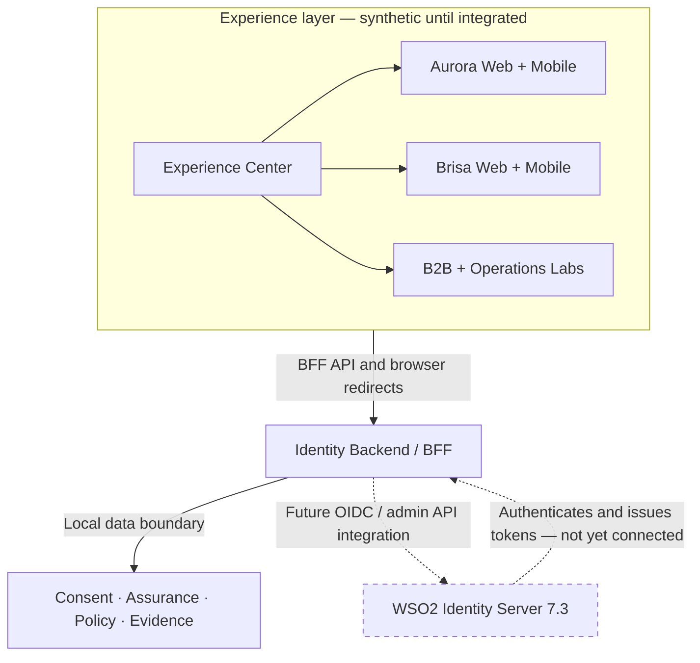

# Identity Experience Center

**Explore customer identity journeys across multiple fictional brands and channels, with a future WSO2 Identity Server 7.3 integration.**

> **Current status:** Interactive local preview and offline security-contract testing. WSO2 is **not configured**. The project does not authenticate real users, issue OAuth tokens from the preview, or claim verified production CIAM capabilities.

## The challenge

A customer may interact through a retailer's web site, mobile application, sales partner or assisted-service channel. The platform must support continuity **inside** a brand while protecting against unauthorized identity correlation **between** brands. Consent, attributes, assurance, delegation and B2B administration need independently enforceable boundaries.

## The proposed architecture

**WSO2 Identity Server 7.3** is the future identity authority for OpenID Connect, sessions, MFA, federation, organization features and token issuance, subject to actual deployment, licensing/update provenance, architecture testing and configuration. Local extension services implement synthetic consent, assurance, policy evaluation and evidence workflows. They are **not** identity issuers.



The identity BFF owns real OIDC authorization-code/PKCE flows, callback validation, server-side session controls and token verification. The preview API only serves fictional records. The provider-adapter package is located in `services/identity-bff/src/provider/`. It **does not modify** established OIDC/JWT code.

## Explore six business stories

| Journey | Interactive entry point | What is currently exercised |
| --- | --- | --- |
| 1. One customer, multiple brands | `/` · `/aurora.html` · `/brisa.html` | Fictional continuity; pairwise and SSO require real signed tokens |
| 2. Security follows the action | `/aurora-mobile.html` · `/brisa-mobile.html` | Synthetic account/security actions and assurance state |
| 3. Consent is explicit | `/` | Local consent lifecycle, brand isolation and audit |
| 4. Partners administer their organization | `/b2b.html` | Synthetic hierarchies, delegated policies and denials |
| 5. APIs and agents have least privilege | `/authorization.html` | Server-side fixture policy decisions and HTTP 403 |
| 6. New brands do not disturb existing ones | `/onboarding.html` | Validated *plans* only; no actual tenant provisioned |

`/provider.html` · `/evidence-lab.html`

Screenshots: not yet supplied. Do not present style mockups as screenshots of executed software.

## Operating modes

| Mode | What it permits | What it does **not** prove |
| --- | --- | --- |
| `story-preview` — default | Browse stories, fictional personas and local extension decisions | Real authentication or WSO2 behavior |
| `offline-contract` | Node unit/contract tests with controlled fixtures and real denial behavior | WSO2 end-to-end compliance |
| `live-wso2` — future integration | Config/read-only discovery verification; actual login only after wiring the existing BFF | Acceptance without signed-token evidence and review |

**Never** treat a preview fixture as an authenticated identity, and **never** create a local token issuer to imitate WSO2. The provider adapter fails closed on unimplemented login, exchange and tenant provisioning methods.

## Run locally (without WSO2)

Requires Node.js 22+ with the existing application's dependencies installed. The local browser preview binds to loopback. Use the existing repository lockfile.

```bash
npm ci
./provider.sh test
./provider.sh status
./experience.sh operations-test
./experience.sh build
./experience.sh dev
```

Open `http://127.0.0.1:5173` or `http://127.0.0.1:5173/provider.html`. When serving the production build locally, use `./experience.sh serve` and port `4317`.

### WSO2 integration readiness (future)

See [Provider integration guide](docs/PROVIDER_INTEGRATION.md). The example values below are *names only*, not real URLs or secrets. Set these in an **untracked local environment**, never in a client bundle:

```text
IDENTITY_MODE=live-wso2
WSO2_INTEGRATION_ACK=yes
WSO2_OIDC_ISSUER=(trusted HTTPS issuer)
WSO2_OIDC_DISCOVERY_URL=(approved HTTPS discovery URL)
WSO2_CLIENT_AURORA_WEB_ID=(registered app client ID)
WSO2_CLIENT_AURORA_MOBILE_ID=(registered app client ID)
WSO2_CLIENT_BRISA_WEB_ID=(registered app client ID)
WSO2_CLIENT_BRISA_MOBILE_ID=(registered app client ID)
WSO2_BUILD_ATTESTATION_FILE=(local file outside the public repository)
```

When configured, run `./provider.sh verify` to perform **read-only** discovery validation. A successful discovery check is not an accepted login, an authenticated session, a pairwise-subject proof, or a passed performance test. `./experience.sh dev` intentionally refuses to run as a live identity environment; it is a synthetic preview server. Real login must be activated separately through the existing identity BFF after implementation reviews.

## Implementation status

| Component | Current evidence | Status |
| --- | --- | --- |
| Branded retail sites, mobile browser simulators | Local synthetic interfaces | Preview |
| Consent, attribute assurance, retail records | Local persistent extension tests | Offline-tested |
| B2B, onboarding, policy and evidence | Fixture workflows, HTTP negative tests | Offline-tested |
| Provider adapter and readiness UI | Runtime guards, config validation, contract tests | Offline-tested |
| WSO2 OIDC authentication and four-client pairwise continuity | No live configured instance | Integration pending |
| Real B2B federation, live MFA, consent integration, actor exchange | No live acceptance traces | Blocked |
| Multi-region operations, restore and load targets | No environment/performance evidence | Blocked |

A passing unit test **must not** raise acceptance to `Live Verified`.

## Security and evidence

- Synthetic email addresses use reserved `.example` domains; no customer records or confidential proposal documents should be committed.
- The provider endpoints are **read-only**. They never accept arbitrary URLs from the browser.
- Live metadata checks enforce pinned issuer, HTTPS, strict redirect policy and same-origin provider metadata by default.
- Four independent future OIDC client registrations are required. Keep client secrets on the BFF only.
- Full credential changes, MFA, session revocation, signed-token verification, pairwise subjects and SSO require the real server.
- Local evidence distinguishes `OFFLINE` checks from signed live evidence and documentary approval. Public branches must not contain customer-specific acceptance matrices.
- Run `python3 scripts/security/check_public.py --staged` before every commit when the publication security kit is installed.

See [Security and repository safeguards](docs/PUBLIC_SECURITY.md) and [Provider integration and test gates](docs/PROVIDER_INTEGRATION.md).

## Roadmap

- **Phase A — Experience:** guided journeys, Portuguese retail stores and mobile simulations. **Preview available**.
- **Phase B — Domain:** consent, assurance, seller organizations, authorization policies, append-only evidence. **Offline tests available**.
- **Phase C — Provider readiness:** adapter boundary, four-client configuration validation, modes, verified discovery tool. **This milestone**.
- **Phase D — Live integration:** deployed WSO2 7.3, actual multi-tenant topology, real OIDC, B2B federation, RFC 8693, consent integration and signed-token evidence. **Pending**.
- **Phase E — Operations:** HA topology, reproducible deployment and measured benchmarks. **Pending**.

This is an educational, reusable identity demonstration. No customer-specific requirements or commercially confidential metrics belong in this public repository.
