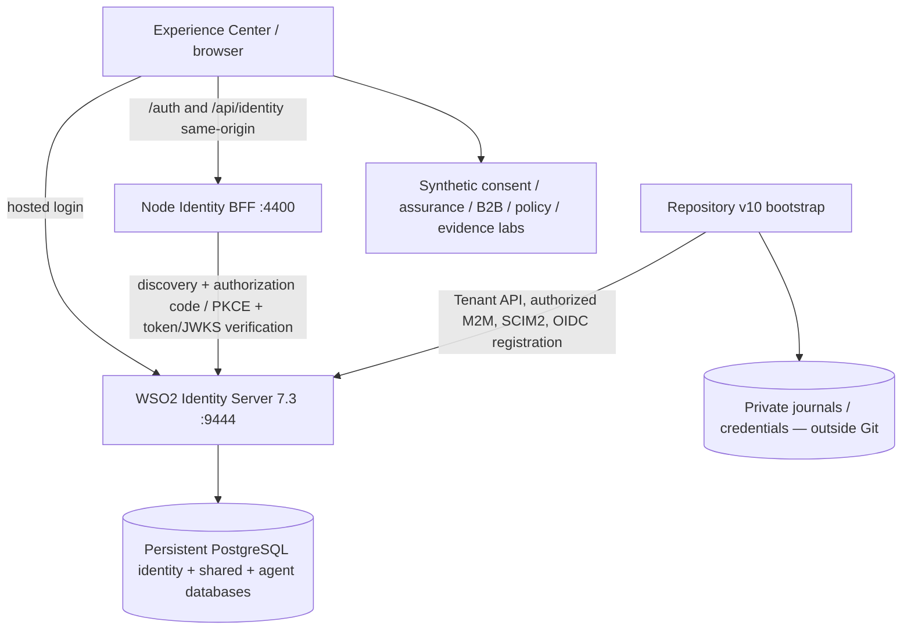

# Identity Experience Center

<!-- CIAM_V10_REVIEW_V2 -->

Explore fictional customer-identity journeys across Aurora and Brisa. The repository now includes an **isolated, automated WSO2 Identity Server 7.3 lab (v10)** alongside the existing synthetic Experience Center. The lab uses persistent PostgreSQL, tenant-scoped provisioning, two non-admin CIAM users, four OIDC registrations and a Node Identity BFF. They are **not** equivalent to a finished production CIAM implementation.

**Evidence snapshot (26 Oct 2026):** both root tenants, their scoped management applications, SCIM users and four OIDC application records have been read back successfully from local WSO2 at `https://localhost:9444`; the BFF at `http://127.0.0.1:4400` reported a genuine **Aurora Web signed-ID-token login**. Brisa Web and both mobile-browser-preview routes still require browser acceptance, as do pairwise-subject isolation, cross-tenant SSO, MFA, federation, consent integration and production operational gates. This is a report from a local operator run, not CI validation or a guarantee that a new machine is fully provisioned.

**Start here:** [WSO2 CIAM v10 end-to-end runbook](docs/CIAM_V10_END_TO_END.md) · [Acceptance and scenario matrix](docs/CIAM_V10_SCENARIO_MATRIX.md) · [Bootstrap source reference](deploy/ciam-v10/README.md).

## The challenge

A customer may interact through a retailer's web site, mobile application, sales partner or assisted-service channel. The platform must support continuity **inside** a brand while protecting against unauthorized identity correlation **between** brands. Consent, attributes, assurance, delegation and B2B administration need independently enforceable boundaries.

## The implemented architecture



The Experience Center's synthetic personas and business workflows remain demonstration fixtures. Real CIAM users authenticate with WSO2 through the BFF. The BFF owns OIDC state/nonce, PKCE, token exchange, ID-token signature/issuer/audience validation and a server-side session; the browser must not receive client secrets. Tenant management M2M clients perform authorized provisioning, **not interactive login**. `aurora-app` and `brisa-app` are browser-based mobile previews, not native mobile SDK integrations. See the detailed [component/port and trust-boundary explanation](docs/CIAM_V10_END_TO_END.md).

## Explore six business stories

| Journey | Interactive entry point | What is currently exercised |
| --- | --- | --- |
| 1. One customer, multiple brands | `/` · `/aurora.html` · `/brisa.html` | Fictional continuity; pairwise and SSO require real signed tokens |
| 2. Security follows the action | `/aurora-mobile.html` · `/brisa-mobile.html` | Synthetic account/security actions and assurance state |
| 3. Consent is explicit | `/` | Local consent lifecycle, brand isolation and audit |
| 4. Partners administer their organization | `/b2b.html` | Synthetic hierarchies, delegated policies and denials |
| 5. APIs and agents have least privilege | `/authorization.html` | Server-side fixture policy decisions and HTTP 403 |
| 6. New brands do not disturb existing ones | `/onboarding.html` | Synthetic onboarding plans; live Aurora/Brisa tenants are created separately by the v10 bootstrap |

`/provider.html` · `/evidence-lab.html`

Screenshots: not yet supplied. Do not present style mockups as screenshots of executed software.

## Operating modes

| Mode | Evidence | Boundaries |
| --- | --- | --- |
| `story-preview` | Fictional journeys and local extension decisions | Never a real authenticated user or WSO2-issued token |
| `offline-contract` | Node/Python tests, local guards and negative contracts | Does not establish live WSO2 correctness |
| Isolated `ciam-v10` | Persistent WSO2 7.3 on port 9444, BFF on 4400, two tenants, scoped M2M/SCIM users, four OIDC app records | Four-channel interactive acceptance and pairwise/SSO claims still gated |
| Legacy `wso2-lab` | Previous H2-backed instance on port 9443 with its own BFF on 4000 | Keep separate; never reset or confuse credentials/callbacks |

A read-only discovery check or registered application is not proof of a valid browser session. Do not turn on demo capabilities merely because a preview card shows a user or an OIDC client has been created.

## Run locally (without WSO2)

Requires Node.js 22+ with the existing application's dependencies installed. The local browser preview binds to loopback. Use the existing repository lockfile.

```bash
npm ci
./provider.sh test
./provider.sh status
./experience.sh operations-test
./experience.sh build
./experience.sh dev
```

Open `http://127.0.0.1:5173` or `http://127.0.0.1:5173/provider.html`. When serving the production build locally, use `./experience.sh serve` and port `4317`.

### Run the implemented v10 WSO2 laboratory

The CLI lives in the **Git checkout**. Runtime credentials and state remain at `${CIAM_V10_HOME:-$HOME/wso2-ciam-v10}`. The default environment is local-only and not a production template. Full steps and safe-resume conditions are in the [end-to-end runbook](docs/CIAM_V10_END_TO_END.md).

```bash
./scripts/ciam-v10.sh test
./scripts/ciam-v10.sh status
./scripts/ciam-v10.sh bff-diagnose
```

For an **entirely new** workstation only, `fresh` sets up isolated PostgreSQL/WSO2; after HTTPS is ready, `bootstrap` provisions tenants, M2M permissions, two SCIM users and four OIDC applications; `bff-start` starts the separate relying party. These write operations require explicit environment confirmations. **Do not run `fresh` or redo schemas against existing v10 state.** The legacy port-9443/H2 container is never an acceptable reset target.

The OIDC browser routes are `http://127.0.0.1:4400/auth/{aurora,brisa}-{web,app}/login`, and the same-browser session evidence is at `http://127.0.0.1:4400/api/identity/me`. See the [acceptance checklist](docs/CIAM_V10_END_TO_END.md#4-browser-oidc-acceptance-and-evidence).

## Implementation status

| Component | Verified evidence | Current status |
| --- | --- | --- |
| Experience UI and extension services | Local synthetic tests and server-side denial contracts | Preview / offline-tested |
| v10 PostgreSQL/WSO2 | Isolated 9444 HTTPS, schema initialization and live service observed in operator logs | Local runtime observed; restore/HA not verified |
| Aurora and Brisa tenants | Tenant/owner ID readback from WSO2 | RESOURCE_VERIFIED |
| Two scoped management apps and SCIM users | OAuth bearer granted-scope checks and SCIM readback | RESOURCE_VERIFIED; interactive login separate |
| Four OIDC Web/Mobile-browser-preview registrations | Callback, issuer, credentials and readback | RESOURCE_VERIFIED |
| Aurora Web signed ID-token flow | Real BFF session with `identitySource:WSO2_SIGNED_ID_TOKEN` | LIVE_LOGIN_OBSERVED (one local operator run) |
| Aurora App, Brisa Web/App | No equivalent signed-token evidence yet in this record | BROWSER_ACCEPTANCE_PENDING |
| Pairwise subjects and cross-tenant SSO | Configuration/discovery alone, no controlled experiment | NOT_VERIFIED |
| MFA, federation, durable consent, real B2B/delegation | Only synthetic/offline contracts | NOT_VERIFIED |
| Persistence, upgrades, restore, load/HA | PostgreSQL volumes initialized; no tested recovery | NOT_VERIFIED |

An offline unit test, issuer discovery, OAuth token HTTP 200 or successful application creation **must not** be promoted to live acceptance. Use the [scenario matrix](docs/CIAM_V10_SCENARIO_MATRIX.md) to track independent evidence.

## Security and evidence

- Synthetic email addresses use reserved `.example` domains; no customer records or confidential proposal documents should be committed.
- The provider endpoints are **read-only**. They never accept arbitrary URLs from the browser.
- Live metadata checks enforce pinned issuer, HTTPS, strict redirect policy and same-origin provider metadata by default.
- Four independent v10 OIDC registrations exist; real interactive acceptance remains separately gated. Keep client secrets on the BFF only.
- Signed-ID-token verification was observed for Aurora Web. MFA, full recovery, revocation, pairwise privacy and SSO require separate live acceptance.
- Local evidence distinguishes `OFFLINE` checks from signed live evidence and documentary approval. Public branches must not contain customer-specific acceptance matrices.
- Run `python3 scripts/security/check_public.py --staged` before every commit when the publication security kit is installed.

See [Security and repository safeguards](docs/PUBLIC_SECURITY.md) and [Provider integration and test gates](docs/PROVIDER_INTEGRATION.md).

## Roadmap

- **Operationalize v10:** four-channel browser acceptance and regression automation; clean-machine bootstrap from the committed source; safe recovery from interrupted writes.
- **Prove privacy:** controlled within-brand Web/App subject continuity, cross-brand isolation and explicit HTTPS sector-document design (not inferred from two issuers).
- **Prove session security:** OIDC callback replay/state/nonce, CSRF/origin, logout/revocation, lockout and MFA step-up.
- **Integrate domain cases:** durable consent, tenant-safe assurance and B2B delegation/federation, policy enforcement, RFC 8693 agents and authorization evidence.
- **Production architecture:** version and image provenance, external certificates, hardened secrets, backups with tested restores, durable sessions, multi-instance operation and load testing.

This is a public educational identity demonstration. No real customer data, private runtime journals, tokens, passwords or proprietary proposal documents belong in this repository.
