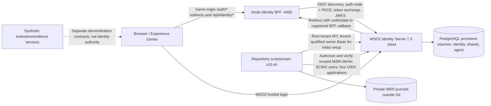

# WSO2 CIAM v10 — end-to-end architecture and deployment runbook

> **Scope:** local educational lab, WSO2 Identity Server 7.3.0, two synthetic root organizations and four browser-facing OIDC registrations. **Not a production-ready reference deployment.** This page describes the repository's implemented v10 workflow and the acceptance gates still to prove, not a claim that every CIAM scenario works.

## 1. What talks to what



**Boundaries:** WSO2 is the identity issuer. The BFF is an OIDC relying party; it initiates login, validates state/nonce, uses authorization code + PKCE S256, exchanges the code server-side, checks signed ID tokens against the expected issuer and JWKS, and holds a server-side session. The browser receives a session cookie, not the BFF's client secrets or raw ID tokens. The BFF's `/api/identity/me` returns sanitized evidence and permissions, not a universally trusted identity for synthetic extension services. Preview personas are **not** WSO2 users. Synthetic consent, assurance, authorization, B2B, federation and workload demonstrations remain separately scoped until independently connected and tested.

### Component and port inventory

| Component | Default local address | Role |
| --- | --- | --- |
| Original/legacy WSO2 lab | `https://localhost:9443` | Earlier H2-backed lab; **do not reset, restart/recreate or reuse for v10** |
| Isolated v10 WSO2 | `https://localhost:9444` | Two real root organizations; management APIs; OIDC issuer and login |
| v10 Identity BFF | `http://127.0.0.1:4400` | Four OIDC callbacks, signed token verification, session/API |
| v10 PostgreSQL | `wso2-ciam-v10-postgres-1`, Docker-internal 5432 | Persistent identity (171 tables), shared (60) and agent (4) schemas on the recorded workstation |
| Legacy BFF | `http://127.0.0.1:4000` | Earlier experiment, **not** the v10 endpoint |
| Experience preview | Typically Vite `:5173`, built preview `:4317` | Fictional stories; do not equate preview with live authentication |

The public repo describes the *source*. The runtime at `${CIAM_V10_HOME:-$HOME/wso2-ciam-v10}` contains Docker Compose runtime material, generated admin/user passwords, application secrets, journals and certificates; it is **not** Git content. The BFF also uses private local files under `var/wso2/`. Treat both paths as sensitive. Never paste or commit their contents. Default ports and loopback HTTP are intentionally lab-only.

## 2. Automated bootstrap — sequence and dependencies

Run from the repository root. The source entry point is `scripts/ciam-v10.sh`, backed by `deploy/ciam-v10/cli.py`.

1. **Fresh runtime** — `fresh` refuses an existing v10 runtime path. It creates an isolated Compose project (`wso2-ciam-v10`), persistent PostgreSQL volumes, two initial databases plus the AgentIdentity datasource, applies SQL from the pinned WSO2 image, obtains a PostgreSQL JDBC driver, writes a private `deployment.toml`, generates private root admin credentials, and requests startup at port 9444. The old container on 9443 is not reset. A *request to start* is not proof of HTTPS readiness.
2. **Tenant stage** — `deploy/ciam-v10/tenants/provision.py` creates Aurora (`aurora.identity.test`) and Brisa (`brisa.identity.test`) with random tenant-owner passwords and readback by authoritative owner/tenant IDs. It writes a private state journal before uncertain operations. Empty catalog is only expected on first installation.
3. **Management and SCIM stage** — `deploy/ciam-v10/resources/bootstrap.py` uses the tenant-qualified names `labtenantadmin@aurora.identity.test` and `labtenantadmin@brisa.identity.test` for initial tenant API authorization. *Tenant Console sign-in may instead accept `labtenantadmin`*. It registers/reads back a tenant management M2M client per tenant; authorizes scoped Application Management and SCIM2 APIs; verifies the actual bearer-token scopes (a token HTTP 200 is insufficient); creates `ciam_aurora` and `ciam_brisa` through SCIM2; readbacks their IDs. The M2M clients use `client_credentials` and are **not browser accounts**.
4. **OIDC stage** — `deploy/ciam-v10/oidc/bootstrap.py` uses scoped management bearer tokens to register four distinct OIDC applications (`aurora-web`, `aurora-app`, `brisa-web`, `brisa-app`) and check their callbacks, credentials, discovery metadata and distinct issuers. Current callback shape: `http://127.0.0.1:4400/auth/<client-key>/callback`. `-app` means **mobile browser preview**, not a registered native iOS/Android application. The tool creates the private BFF manifest/certificate bridge; it does not issue a fake ID token.
5. **BFF stage** — `bff-start` launches the existing `services/identity-bff` implementation under the project checkout and verifies that 4400 responds. `bff-diagnose` reports PID, port, configuration and sanitized errors without printing secrets. A healthy anonymous `/api/identity/me` returns `authenticated:false` until browser login.
6. **Browser acceptance** — a user signs into each app and the BFF verifies the signed ID token. Readback of WSO2 application records is not browser acceptance. See §4 and [scenario matrix](CIAM_V10_SCENARIO_MATRIX.md).

**Privileges and API formats:** The initial root administrator has management authority. Tenant-qualified administrator Basic authentication is used during tenant application setup; afterwards M2M tokens carry explicitly granted scopes. WSO2 Console sign-in on a tenant-prefixed URL may expect the *local* username instead of the API-qualified form. Confusing these flows caused earlier false password-reset diagnoses. None of these privileged accounts should be used as routine CIAM customers.

## 3. Commands

### New, empty machine (not an upgrade)

Prerequisites: Docker/Compose, Python 3.11+, Node.js 22+; vendor WSO2 7.3 image and JDBC dependency availability. Verify the repository's local security/publication hooks before sharing it. Reserve loopback ports 9444 and 4400. A new environment requires independent certificate provenance review; the lab uses local certificate trust, not production PKI.

```bash
cd /path/to/identity-poc-repository
./scripts/ciam-v10.sh test
WSO2_CIAM_V10_FRESH_CONFIRM=CREATE_NEW_ISOLATED_PERSISTENT_LAB ./scripts/ciam-v10.sh fresh
./scripts/ciam-v10.sh status
# ONLY after new https://localhost:9444/console is ready:
WSO2_CIAM_V10_DEPLOY_CONFIRM=BOOTSTRAP_RECORDED_LAB_RESOURCES ./scripts/ciam-v10.sh bootstrap
./scripts/ciam-v10.sh bff-start
./scripts/ciam-v10.sh bff-diagnose
```

Never run `fresh` on the existing `~/wso2-ciam-v10` runtime. Never run `docker compose down -v`, reset its databases, rerun schema SQL, or copy live secrets into Git. A production launch requires deployment redesign, not merely changing ports.

### Existing workstation (resources already provisioned)

```bash
cd /path/to/identity-poc-repository
./scripts/ciam-v10.sh test
./scripts/ciam-v10.sh status
./scripts/ciam-v10.sh bff-diagnose
```

These are diagnostic/test commands. **Do not rerun `fresh` or an `apply` command just to troubleshoot a login.** Use the stage status/journals and a guarded reconciliation workflow for interrupted writes. `bff-start` is appropriate only if the port is down and the PID state allows startup. If `pidState: STALE` and 4400 is not listening, the supported recovery is:

```bash
WSO2_CIAM_V10_STALE_PID_CONFIRM=CLEAR_DEAD_PID_ONLY ./scripts/ciam-v10.sh bff-clear-stale
./scripts/ciam-v10.sh bff-start
```

The stale-PID command removes only a verified dead local PID file; it does not kill a live process.

## 4. Browser OIDC acceptance and evidence

Sign in through a **single browser session** if your goal is to see all four `clients` authenticated in one `/api/identity/me` JSON response. Use the dedicated non-admin account for each tenant (`ciam_aurora`, `ciam_brisa`); the passwords are in the private v10 resource journal, not in this repository. Each new channel must complete its own authorization-code callback; earlier channel logins must remain in the same BFF session.

| Order | Route | Account | Expected issuer |
| --- | --- | --- | --- |
| 1 | `http://127.0.0.1:4400/auth/aurora-web/login` | `ciam_aurora` | `https://localhost:9444/t/aurora.identity.test/oauth2/token` |
| 2 | `http://127.0.0.1:4400/auth/aurora-app/login` | `ciam_aurora` | Same Aurora issuer |
| 3 | `http://127.0.0.1:4400/auth/brisa-web/login` | `ciam_brisa` | `https://localhost:9444/t/brisa.identity.test/oauth2/token` |
| 4 | `http://127.0.0.1:4400/auth/brisa-app/login` | `ciam_brisa` | Same Brisa issuer |

Then visit `http://127.0.0.1:4400/api/identity/me` **in the same browser**. For every client, look for `configured:true`, `authenticated:true`, `verifiedAt`, a tenant-correct `issuer`, and a subject fingerprint; at the top level require `identitySource:WSO2_SIGNED_ID_TOKEN` and `evidence:BFF_VALIDATED_SIGNED_ID_TOKEN`. This is server-reported verification evidence: the BFF performs cryptographic validation, not the documentation checker. Do not publish the full JSON because it contains session CSRF data and fingerprints.

For a compact status gate, copy the JSON response into the clipboard locally on macOS, then run the non-networked checker:

```bash
pbpaste | python3 scripts/ciam-v10-acceptance.py
printf '' | pbcopy
```

The checker emits **only booleans/status names**; it never prints the pasted JSON, passwords, token or cookie. It exits nonzero until all four channels satisfy the basic live-login evidence. It **cannot** prove native mobile flows, independent brand sectors, true cross-tenant SSO, subject unlinkability, logout or production security. `/api/identity/me` fetched from a new shell or a private browsing window without the session cookie will correctly report unauthenticated.

Current evidence as of **26 Oct 2026**, from the local operator run (not from the public repository): all four OIDC app records configured; signed Aurora Web login verified once; the three other browser routes and true pairwise/SSO behavior remain to be independently confirmed.

## 5. Failure handling and operational invariants

| Symptom | Meaning / safe response |
| --- | --- |
| `authenticated:false` from anonymous CLI GET | No BFF browser session; do not reset users or clients |
| HTTP 401 on tenant Basic API | Check tenant-qualified API username format before inferring password invalidity; Console may use a different format |
| HTTP 403 on SCIM/API catalog | Missing scope or API authorization; inspect granted scopes; don't let an M2M client self-elevate |
| Authorized-API POST returns HTTP 200 | Read back exact resource and scopes; neither assume failure nor blindly retry |
| Journal state `*-started` | Outcome uncertain: reconcile remote object/permissions by ID before any next write |
| BFF PID exists but 4400 is down | Diagnose PID and sanitized log; clear only a verified stale PID |
| `GET /console` returns HTTP 200 | Console is reachable, not proof of database readiness, login, or API authorization |
| Database tables are nonzero | Never rerun vendor schema initialization indiscriminately |
| One OIDC route fails | Check that callback, issuer, PKCE/state/nonce and BFF cookie belong to **v10**; do not modify 9443 |

Root-tenancy, user and client provisioning guard against duplicate resources and unknown journal changes. Still back up and test restoration of the new persistent PostgreSQL volume; **persistence is not backup**. Keep existing H2-backed `wso2-identity-server-1` untouched unless a separately planned migration has backups and explicit approval.

## 6. Current capability boundaries and upgrades

Implemented resource-level foundations: persistent PostgreSQL, two root organizations, two scoped management M2M clients, two test users, four OIDC registrations, BFF browser login/ID-token verification, tests and read-only diagnostics. **This does not imply comprehensive CIAM acceptance.**

Prioritize the enhancements listed in [CIAM v10 scenario matrix](CIAM_V10_SCENARIO_MATRIX.md): four-channel browser evidence, actual pairwise-subject tests (with brand-specific HTTPS sector documents where the desired design requires them), negative session/CSRF/OIDC tests, tenant isolation, and restart/restore tests. Then design independent real MFA, consent persistence, B2B delegated organization admin, federation, cross-tenant SSO and RFC 8693 token exchange—not synthetic substitutes.

The local CLI and Compose templates deliberately assume two domains, hardcoded loopback ports and local certificates. For reusable deployments, parameterize **validated** domains, ports, client redirect/sector origins, secret injection, CA roots and database credentials; require HTTPS for public origins, proper PKI, durable session storage, license/update provenance and observability. Do not represent `-app` browser previews as production native mobile authorization flows.
